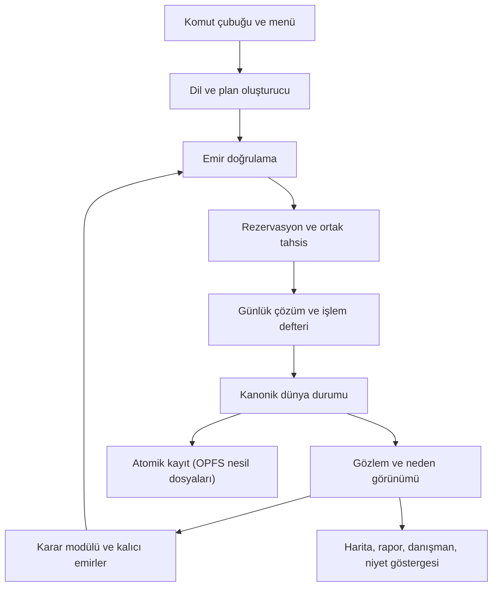

# Tarih Strateji Oyunu — Üretim Şartnamesi v1.4

**Android · çevrimdışı · yapay zekâsız · komut öncelikli büyük strateji oyunu**

| Alan | Değer |
| --- | --- |
| Sürüm | 1.4.0 |
| Tarih | 4 Kasım 2026 |
| Proje sahibi | Hasan Fırat / @HAAN |
| Belge durumu | Üretime başlangıç için bütünleştirilmiş tasarım, mimari ve mühendislik şartnamesi |
| Yerine geçtiği metin | Üretim Şartnamesi v1.3 ve "Şartname v1.3 İncelemesi: Analizle Karşılaştırma" |
| Kullanım | Oyunu yazacak geliştiriciye (insan veya Claude) verilen tek belge; önceki sürümleri açmadan tek başına okunur |
| Doğrulama durumu | Tasarım tutarlılığı, formül uç değerleri ve kaynak dayanakları incelendi. Motor, tarihî dünya verisi, gerçek cihaz ölçümü ve APK bu belgenin teslimi değildir. Kabul testleri uygulanacak sözleşmelerdir, geçmiş test sonucu değildir. |

---

## İçindekiler

0. Bu belge nasıl kullanılır
1. v1.4 değişiklik özeti
2. Ürün kimliği ve kapsam
3. Referans oyunlardan çözüm matrisi (HOI4 · EU5 · Pax Historia)
4. Oyuncu döngüsü ve komut öncelikli deneyim
5. Sistem mimarisi
6. Sayılar, zaman, kimlik, rastlantı ve hash
7. Zamanlayıcı, günlük faz hattı ve barış hızlı yolu
8. Dünya, harita ve çizim
9. Yönetim erişimi: kontrol, işgal itaati, kültürel bütünleşme
10. Nüfus, askerlik, seferberlik, yaralı ve esir
11. Tarım, gıda ve yaşam düzeyi
12. Ekonomi, bütçe, vergi, borç ve para basma
13. Sanayi, ekipman, mühimmat, araştırma ve projeler
14. Lojistik, ticaret ve ortak kapasite
15. Kara muharebesi, tahkimat ve büyük taarruz
16. Deniz, hava ve çıkarma
17. Siyaset, istikrar, yorgunluk ve ülke içi çatışma
18. Diplomasi, savaş, barış ve rakip niyet göstergesi
19. Karar modülü, otomasyon ve istihbarat
20. Türkçe komut sistemi
21. Olaylar, danışman, Kronik ve tarihî eğilim
22. Devlet istatistikleri paneli
23. Mobil arayüz ve erişilebilirlik
24. Kayıt, dallanma, Sandbox ve senaryo dışa aktarma
25. Veri, harita, içerik ve lisans hattı
26. Performans bütçeleri ve Android teslimi
27. Geliştirme aşamaları, zaman kutuları ve kapılar
28. Kabul testleri (T001–T133)
29. Kodlama standartları ve AI geliştirici çalışma kuralları
30. İlk sprint görev kartları
- Ek A. Karar kaydı
- Ek B. Veri sözlüğü ve başlangıç katsayıları
- Ek C. Modül kartları
- Ek D. Somut oyun akışı ve sayısal kontroller
- Ek E. Kaynaklar ve araştırmanın sınırları

---

## 0. Bu belge nasıl kullanılır

### 0.1 Bağlayıcılık

| Düzey | Anlamı | Değiştirme yolu |
| --- | --- | --- |
| **ZORUNLU** | Aksi yazılmadıkça bütün kurallar, sözleşmeler, faz sıraları, korunum ve güvenlik koşulları | Yeni şartname sürümü ve Ek A'ya karar kaydı |
| **VARSAYILAN** | Bütün sayısal katsayılar, eşikler, süreler, teknoloji seçimlerinde "VARSAYILAN" etiketli olanlar | Gerekçeli değişiklik; aynı commit'te Ek B ve test güncellenir |
| **ÖNERİ** | Uygulama kolaylığı için verilen yöntemler | Serbest; davranış sözleşmesi korunmalı |

### 0.2 Sayıların statüsü

Tarihî veri olarak kaynaklandırılmamış bütün maliyet, süre ve katsayılar **denge başlangıç değeridir**. "Yaklaşık" etiketli tarihî rakamlar yalnız formül ölçeğini kontrol etmek içindir; veri paketine girmez. Önizleme duyuruları piyasaya çıkmış mekanik kabul edilmez. Gerçek değerler laboratuvar koşuları ve oyun testleriyle kalibre edilir.

### 0.3 Geliştirici için okuma sırası

1. Bölüm 0–2: ne yapılıyor, ne yapılmıyor.
2. Bölüm 5–7: mimari, sayı sözleşmesi, faz hattı. Bunlar her kod görevinin ön koşuludur.
3. Görevin ilgili sistem bölümü (8–24).
4. Bölüm 28: görevin test kimlikleri.
5. Bölüm 29: kodlama kuralları ve tamamlanma tanımı.
6. Bölüm 30 ve Ek C: görev kartı ve modül kartı.

### 0.4 Terimler

| Terim | Tanım |
| --- | --- |
| Bölge | Hareket, muharebe, kontrol ve fiziksel tesis düğümü; haritanın en küçük kara birimi |
| Eyalet | 5–8 bölgeden oluşan ekonomik yönetim birimi; oyuncu ekonomiyi eyalet üzerinden yönetir |
| Deniz bölgesi | Deniz görevi, konvoy ve abluka birimi |
| Gün | Simülasyonun tek zaman birimi; saat yoktur |
| Tur | Oyuncunun emir verdiği duraklama ile bir sonraki duraklama arası |
| Emir | Kullanıcı onaylı, sürümlü semantik eylem kaydı |
| Plan | Birden çok bağımlı emirden oluşan yönlü döngüsüz yapı |
| Niyet | Karar modülünün veya kalıcı emrin ürettiği, doğrulanmamış eylem adayı |
| İşlem | Defterde onaylanmış hesap hareketi |
| Rezervasyon | Kaynağın gelecekteki kullanım için ayrılması; fiziksel tüketim değildir |
| Faz | Günlük hattın P0–P12 adımlarından biri |
| Pulse | Haftalık veya aylık toplu güncelleme |
| Bayrak | Senaryo düzeyinde açılıp kapanan mekanik (bölüm 5.8) |
| Fixture | Testte kullanılan sabit, küçük dünya |
| Kapı | Aşamanın tamamlanması için geçilmesi gereken test ve ölçüm kümesi |
| PG | Siyasi güç |
| SP | Sanayi puanı; para değildir |
| AGE | Ortak fayda birimi; son 3 ayın ortalama aylık geliri |
| Kontrol | Sahip olunan ve kontrol edilen bölgede yönetimin etkinliği (0–100) |
| İtaat | İşgal edilen bölgede halkın işgalciye uyumu (0–100) |
| Bütünleşme | Bölgenin sahip ülkeyle uzun dönemli kültürel kaynaşması (0–100) |

---

## 1. v1.4 değişiklik özeti

v1.4, v1.3'ün bütün sistemlerini korur. Aşağıdaki değişiklikler inceleme bulgularını kapatır ve sorunları HOI4/EU5'te kanıtlanmış tasarım yaklaşımlarıyla çözer. "Bulgu" sütunu incelemedeki sorunu, "Çözüm kaynağı" esin alınan yaklaşımı gösterir.

| Kod | Değişiklik | Bulgu | Çözüm kaynağı | Bölüm | Test |
| --- | --- | --- | --- | --- | --- |
| C01 | Komut çubuğu ana ekranda varsayılan giriş; 1A kapısına komut testleri | Yazılı komut ilk oynanabilir sürümde sınanmıyordu | Pax Historia eylem döngüsü | 4, 20, 27 | T093A, T094, T119–T123 |
| C02 | Türkçe kip × olumsuzluk × hal eki matrisi; soru cümleleri danışmana | Emir kipleri ve isim-fiil karışması tanımsızdı | — | 20.3 | T119–T121 |
| C03 | Cihazda tutulan tanınmayan komut günlüğü ve katalog büyütme döngüsü | Katalog büyütme yolu yoktu | — | 20.6 | T122 |
| C04 | Her menü eylemi eşdeğer komut metnini gösterir | Komut dilinin öğretimi yoktu | — | 4.2 | T123 |
| C05 | Çekirdek muharebe modu; zırh, delme, sertlik ve karşıtlık bayrakla | Savaş "sade" hedefinden uzaktı; 1914–1916'da bu alanlar işlevsizdi | HOI4 istatistik yapısının kademeli açılması | 15.2–15.3 | T127 |
| C06 | Muharebe rastlantı çarpanı r tanımlandı | r formülde vardı, tanımı yoktu | — | 15.2 | T097 |
| C07 | Tahkimat (siper) birikimi | 1914 siper tıkanması karar alanı değildi | — | 15.7 | T126 |
| C08 | Büyük taarruz harekâtı ve fiziksel mühimmat ürünü | Durağan cephede anlamlı tercih yoktu; mühimmat soyuttu | HOI4 hazırlık–cephe bağı | 13.2, 15.8 | T125 |
| C09 | Durağan cephe raporu özetlenir | Boş tur riski | — | 15.9 | T131 |
| C10 | Eğitimli yedek statüsü (E) ve seferberlik | 1914 açılışı modellenemiyordu | EU5 yükümlü/daimi ordu ayrımı | 10.5 | T106–T107 |
| C11 | Kohort giriş ve çıkış statüleri tanımlandı | Y/(S+Y) oranı kayabiliyordu | — | 10.4 | T104–T105 |
| C12 | Köken çözünürlüğü eyalet; birlik başına 8 köken + ulusal köken defteri | Bellek patlaması riski | — | 10.6 | T102 |
| C13 | Bölge kimlik hücresi üst sınırı | Kültür/inanç çaprazı sınırsızdı | EU5 pop toplulaştırması | 10.2 | T103 |
| C14 | Kontrol: başkente yönetim mesafesiyle hesaplanan etkinlik | Uzak toprakların yönetimi modellenmemişti | EU5 kontrol ve yakınlık | 9.2 | T110–T111 |
| C15 | İşgal itaati ayrı kavram; başlangıç değeri ve taban erişim | İşgal geliri yıllarca %2–4'te kalıyordu | HOI4 uyum ve direniş | 9.3 | T108–T109 |
| C16 | Kültürel bütünleşme ayrı kavram | "Uyum" adı üç kavramı karşılıyordu | — | 9.4 | — |
| C17 | Yorgunluk "o ayın ölü + kalıcı sakat kaybı"; propaganda çarpanı aralığı | Tanımlar belirsizdi | — | 17.3, 17.1 | T112–T113 |
| C18 | Para basma ve enflasyon (bayrak) | Savaş finansmanı yalnız borçtu | EU5 para basma–enflasyon | 12.5 | T133 |
| C19 | mulRatio/divRatio; BigInt yalnız soğuk yol; para birimi kuralı | Ulusal hesaplar sürekli BigInt'e düşüyordu | — | 6.2 | T101 |
| C20 | Sıklık katmanları, barış hızlı yolu, tahsis yeniden kullanımı | Bir yıllık atlama ≈ 24 s | Paradox günlük tick + aylık pulse | 7.2–7.4 | T114–T116 |
| C21 | Tek kayıt deposu: OPFS nesil dosyaları + A/B başlık | İki depo iki ayrı kurtarma yolu üretiyordu | — | 24.1 | T117–T118 |
| C22 | Dünya hedefi 1.500–2.000 bölge; 3.000 üst sınır | İçerik ve dokunma maliyeti | EU5 lokasyon → eyalet hiyerarşisi | 8.2 | — |
| C23 | İşgal taraması: sabit desen katmanı + feature-state opaklık | fill-pattern feature-state desteklemiyor | — | 8.5 | T130 |
| C24 | Kademeli rota: 1A tek rota, 1B-1 üç aday | 1A'nın en riskli parçası | HOI4 ikmal sisteminin iteratif gelişimi | 14.2 | T047 |
| C25 | Soyut deniz ve hava modu varsayılan; ayrıntılı mod bayrak | Dünya sistemleri aşamasının ağır parçası | HOI4 deniz bölgesi ve görev mantığı | 16 | T128 |
| C26 | Rakip niyet göstergesi | Rakip niyetleri okunmuyordu | EU5 2026 yol haritası: okunur AI | 18.6 | T124 |
| C27 | İstihbarat aralığı | Sis tahmin aralığının genişliği tanımsızdı | HOI4 istihbarat kavramı | 19.4 | T132 |
| C28 | Sandbox'tan senaryo dışa aktarma | Oyun içi senaryo üretimi yoktu | Pax Create modu | 24.4 | T129 |
| C29 | Aşama 0b: sahte kurallı dikey dilim (eğlence sondası) | Eğlence ilk kez 200+ saat sonra sınanıyordu | — | 27.2 | İnsan raporu |
| C30 | Daraltma sırasına deniz/hava soyutlaması | Daraltma sırası eksikti | — | 27.4 | — |
| C31 | Özellik bayrakları sistemi | Kademeli açılış mekanizması yoktu | Paradox oyun kuralları | 5.8 | T127 |
| C32 | Depo yapısı, Worker protokolü, kodlama standartları, görev kartları | Kodu yazdırmak için uygulama düzeyi eksikti | — | 5, 29, 30 | — |
| C33 | Devlet istatistikleri paneli | İstatistiklerin tek listesi yoktu | HOI4/EU5 ülke ekranları | 22 | — |
| C34 | Seferberlik ve büyük taarruz için Temmuz Krizi açılış zinciri | 1914 açılış tempo riski | — | 21.5 | — |

---

## 2. Ürün kimliği ve kapsam

### 2.1 Nihai kimlik

1914 dünyasında devletin kaynaklarını, insanlarını ve siyasi iradesini yöneten; emirlerini **yazarak** veya menüden veren; emirleri cepheye, ekonomiye ve diplomasiye bağlanan; her sonucun nedenini gösteren çevrimdışı mobil büyük strateji oyunu.

Üç referans oyunun bütün sistemlerini birleştirme hedefi yoktur. Aktarılan şey genel tasarım ilkeleridir; metin, görsel, harita, kod veya sayısal katalog kopyalanmaz.

### 2.2 Bağlayıcı kararlar

| Başlık | Karar |
| --- | --- |
| Ana senaryo | 28 Haziran 1914 – 31 Aralık 1925; serbest devam mümkün |
| Platform | Android, yatay telefon; geliştirmede masaüstü tarayıcı |
| Çalışma | Uçak modunda tam oyun; INTERNET ve RECORD_AUDIO izni yok |
| Giriş biçimi | Komut çubuğu birincil, menü keşif ve düzeltme aracı; ikisi aynı semantik emri üretir |
| Modlar | Normal, kalıcı etiketli Sandbox, Gözlemci |
| Tarih davranışı | Tarihî eğilim veya Serbest; olasılık ağırlığıdır, zorunlu sonuç değildir |
| Dünya ölçeği | Yaklaşık 60 devlet, 1.500–2.000 bölge (üst sınır 3.000), 250–350 eyalet, 60–90 deniz bölgesi |
| Simülasyon sınırı | Başlangıç hedefi 2.000 kara birliği, 600 deniz/hava grubu; kapasite aşımı sessiz silme üretmez |
| Savaş derinliği | Çekirdek mod varsayılan; ayrıntılı alanlar bayrakla açılır (bölüm 15) |
| Deniz ve hava | Soyut mod varsayılan; ayrıntılı mod 1936 senaryosu kapısında |
| Oturum | 15–30 dakika; aylık eşdeğer ilerlemede ortalama 2–4 anlamlı karar |
| Açıklama | Her önemli göstergeden "Neden?" ekranına en fazla iki dokunuş |
| Sonraki dönemler | 1936/1939; ardından ayrı kapılarla 2026, 1600, 750 |
| Kapsam dışı | Çok oyunculu, sınırsız serbest dil anlama, özel sektör tam para simülasyonu, nükleer kullanım, 3B birim modelleri |

### 2.3 Beş tasarım sütunu

1. **Açıklanabilir sonuç:** her sayının nedeni gösterilir.
2. **Birbirine bağlı kıtlık–savaş–siyaset:** gıda, insan, mühimmat ve meşruiyet aynı defterden beslenir.
3. **Az dokunuşla anlamlı karar:** plan kartı ve otomasyon mikro yönetimi azaltır.
4. **Yazarak yönetme:** oyuncu niyetini Türkçe cümleyle verir; oyun onu güvenli, önizlenen plana çevirir.
5. **Ülkenin özgün hikâyesi:** Kronik, hedef ağacı ve tarihî eğilim her oyunu farklı anlatır.

Yeni özellik en az bir sütuna hizmet etmeli ve mevcut döngüyü bozmadığını test ile göstermelidir.

### 2.4 Oyuncu hedefleri ve puan

Oyuncu hedef ağırlıklarını seçer: toprak, refah, güvenlik, diplomasi, teknoloji. Son puan başlangıç ölçeğine göre normalize edilir; küçük ülke dünya üretimindeki payıyla değerlendirilmez. Sandbox'ta rekabetçi puan kapalıdır. Oyuncunun ülkesi ilhak edilirse başka ülkeye veya Gözlemci moduna geçiş sunulur.

### 2.5 Kullanıcının başlangıç gereksinimlerinin karşılanması

| Gereksinim | Karşılandığı yer |
| --- | --- |
| Pax Historia benzeri, yazarak eylem verilen oynanış | 4, 20 |
| Yapay zekâ (dil modeli) olmadan, Pax kalitesine yakın tepki | 18–21 (kural motoru, plan şablonu, şablonlu anlatı) |
| Senaryolar: I. Dünya Savaşı, II. Dünya Savaşı, Modern Dünya, 1600'ler, 750'ler | 2.2, 27.5 |
| Eylem ve olaylarla değişen ayrıntılı devlet istatistikleri | 22 |
| 0–100 ölçekli devletlerarası ilişkiler | 18.1 |
| Diplomasi düzeyine bağlı askerî ve ekonomik ticaret | 18.1 tablo |
| Ekipman ve ordu gücüyle çözülen sade HOI tarzı savaş | 15.2 çekirdek mod |
| Tarım sistemi | 11 |
| HOI4 tarzı askerî ekipman | 13.3 |
| Sandbox: sınırsız kaynak ekleme/çıkarma | 24.3 |

---

## 3. Referans oyunlardan çözüm matrisi

### 3.1 Kanıt düzeyi

İnceleme; yayıncı ve geliştirici açıklamaları, resmî geliştirme günlükleri, resmî kılavuzlar ve Pax Historia Creator Docs üzerinden yapıldı. HOI4 ve EU5'in kapalı motor kaynak kodu incelenmedi; bellek yerleşimi, iş parçacığı planlayıcısı, tam savaş formülleri veya YZ algoritması hakkında erişilmeyen ayrıntı uydurulmadı. Aşağıdaki "yaklaşım" sütunları doğrulanmış sistem ilişkilerini ve bunlardan çıkarılan tasarım derslerini ifade eder. Kaynak kimlikleri Ek E'dedir.

### 3.2 Problem → çözüm

| # | Problem | HOI4 yaklaşımı | EU5 yaklaşımı | Pax yaklaşımı | Bu oyundaki çözüm | Bölüm |
| --- | --- | --- | --- | --- | --- | --- |
| 1 | Mikro yönetim yükü | Savaş planı ve otomatik birlik dağıtımı | Kabine görevleri ve otomasyon | Tek cümlelik niyet | Komut → plan kartı; Kapalı/Danış/Uygula bakanlıklar | 4, 19, 20 |
| 2 | Savaşın anlaşılırlığı | Çok istatistikli tümen şablonu; öğrenme yükü yüksek | — | Anlatıyla çözüm, tutarsız | Çekirdek mod 4 istatistik; oyuncuya 3 sayı; ayrıntı bayrakla | 15.2–15.4 |
| 3 | Siper tıkanması ve tempo | Hazırlık ve ikmalin cephe sonucunu belirlemesi | — | Zaman atlaması | Tahkimat birikimi + fiziksel mühimmatla büyük taarruz + durağan cephe özeti + sonraki önemli olaya atlama | 15.7–15.9 |
| 4 | Uzak toprağın yönetimi | — | Kontrol ve başkente yakınlık | — | Yönetim mesafesinden kontrol; vergi ve asker erişimi kontrolle | 9.2 |
| 5 | İşgalin değeri | Uyum arttıkça kaynak erişimi; direniş | — | — | Taban erişim + itaat; işgal politikası; direniş ve sabotaj | 9.3 |
| 6 | İnsan gücü | Askerlik yasaları | Yükümlü askerden daimi orduya geçiş | — | Askerlik yasası + eğitimli yedek + seferberlik | 10.4–10.5 |
| 7 | Lojistik | İkmal merkezleri, demiryolu, kamyon; iteratif tasarım | Mesafe ve pazar erişimi | — | Ortak fiziksel kapasite defteri; kademeli rota | 14 |
| 8 | Ekonomi derinliği | Sivil/askerî fabrika soyutlaması | Nüfus ihtiyacı, üretim girdisi, pazar | — | Sınırlı mal listesi, katma değer, haftalık dünya pazarı | 12–14 |
| 9 | Savaş finansmanı | — | Para basma ve enflasyon | — | Borç + para basma (enflasyon, huzur bedeli) | 12.5 |
| 10 | Rakip niyetinin okunması | Gerekçe ve dünya gerginliği | AI'a okunur yüz (2026 yol haritası) | Sohbetle niyet | Rakip niyet göstergesi (yalnız kamu sinyali) | 18.6 |
| 11 | Tarihî yolların keşfi | Ulusal odak ağaçları | Dinamik tarihî olaylar; keşfedilebilirlik sorunu kabul edildi | — | Hedef ağacı + yaklaşan kontrol noktaları + ayrışma göstergesi | 21 |
| 12 | Sis ve hile | İstihbarat | — | — | Gözlem görünümü + istihbarat aralığı; AI gerçek düşman verisini okuyamaz | 19 |
| 13 | Deniz savaşı karmaşıklığı | Deniz bölgeleri ve görevler | — | — | Soyut deniz modu; ayrıntılı mod bayrak | 16 |
| 14 | İçerik üretimi | Veri dosyaları ve mod desteği | Veri dosyaları | Preset ve Create | Veri derleyici + Sandbox'tan senaryo | 24.4, 25 |
| 15 | Uzun zaman atlamasında performans | Günlük/saatlik tick | Günlük tick + aylık pulse | Tur başına model çağrısı | Sıklık katmanları + barış hızlı yolu | 7.2–7.4 |
| 16 | Belirlenimcilik | Deterministik çok oyunculu simülasyon | Aynı | Garanti edilmez | Sabit nokta tamsayı + anahtarlı RNG + kanonik hash | 6 |
| 17 | Serbest dil tutarsızlığı | — | — | Model çıkarımı tutarsız; bundle komut doğrular | Kapalı katalog + plan şablonu + önizleme + ret ve üç öneri | 20 |
| 18 | Bildirim yağmuru | Uyarılar | Uyarı sessize alma (1.1) | — | Durma koşulları + histerezis + tür bazında sessize alma | 7.5 |

### 3.3 Bilinçli olarak alınmayanlar

- HOI4'ün ayrıntılı araç tasarımcıları ve askerî sanayi kuruluşları.
- EU5'in lokasyon düzeyinde ayrıntılı pop sınıfları, özel sektör para dolaşımı ve çok merkezli fiyat oluşumu (dünya pazarı tek referans fiyat kullanır).
- Pax'ın sınırsız serbest dil anlama vaadi ve model hafızası.
- Açıklamasız "hazırlık bonusu" türü katsayılar; hazırlık gerçek stok, organizasyon, rota ve kuvvetten oluşur.

---

## 4. Oyuncu döngüsü ve komut öncelikli deneyim

### 4.1 Tur döngüsü

1. **Durum özeti:** nakit ömrü (gün), yerel gıda açığı, cephe riski, seferberlik durumu, bekleyen işler, rakip niyet değişimleri.
2. **Niyet:** komut çubuğuna yazılan cümle (birincil), harita bağlam menüsü veya ekran menüsü.
3. **Plan kartı:** kapsam, hedefler, bugünkü bedel, günlük taahhüt, rota, süre aralığı, siyasi tepki, iptal bedeli ve eşdeğer komut metni.
4. **Onay:** kuyruk/plan oluşturulur; rezervasyonlar ekranda görünür.
5. **Zaman seçimi:** 1 gün, 1 hafta, 1/3/6 takvim ayı, 1 yıl veya sonraki önemli olay (varsayılan).
6. **Simülasyon:** günlük otomasyon; durma koşulunda kesinleşmiş gün sonunda durur.
7. **Rapor:** beş önemli değişim, cephe özeti (durağan cepheler toplulaştırılır), sözleşmeler, otomasyon istisnaları, rakip niyet değişimleri.
8. **Devam:** anlık görüntü, yeni emir veya dal açma.

Savaşta önerilen üst sınır aktif muharebede 7–30 gün, istikrarlı otomasyon altında 1–3 aydır; oyuncu daha uzun süre seçebilir, kritik durmalar geçerlidir. "Durdur" geçmişteki bir güne dönmüş gibi göstermez; geçmiş güne dönüş açıkça yeni dal açar.

### 4.2 Komut çubuğu (birincil giriş)

| Kural | Ayrıntı |
| --- | --- |
| Konum | Ana harita ekranının alt şeridi; her ekranda erişilebilir |
| Odak | Ekran açıldığında çubuk vurgulanır; klavye yalnız dokunuşla açılır |
| Öneri çipleri | Yazarken en olası üç eylem şablonu; boş çubukta bağlama göre üç öneri (seçili bölge/eyalet/ordu) |
| Son komutlar | Son 10 onaylı komut; tek dokunuşla yeniden düzenlenebilir |
| Menü eşdeğeri | Her menü eyleminin kartında "Bu eylemin komutu: …" satırı; dokununca çubuğa yazılır |
| Belirsizlik | Güven < 0,80 ise uygulanabilir emir değil, en olası üç yorum çipi |
| Ret | Katalog dışı istek: neden + en yakın üç seçenek |
| Soru | Soru cümlesi emir üretmez, danışmana gider (bölüm 20.3) |
| Dikte | Cihaz klavyesinin hizmetidir; oyun mikrofon izni istemez |

### 4.3 Plan kartı

Her önemli kartta şu alanlar bulunur: **Bugün** (kesin bedel ve rezervasyon), **30 gün sonra tahmin** (aralıkla), **Başarısızlık nedeni** (ön koşul eksikse), **İptal bedeli**, **Eşdeğer komut**. Kesin veri ile tahmin görsel olarak ayrılır. Ret örneği: "İlişki 52; ekipman satışı teklifi için 60 gerekiyor."

### 4.4 Eylem türleri

| Tür | Davranış |
| --- | --- |
| Anlık | İlk ilerleyen günde işler (vergi oranı, yasa) |
| Süreli | Kaynak, iş gücü ve kapasiteyle ilerler (proje, eğitim, seferberlik) |
| Sürekli | Günlük tahakkuk eder (bütçe payı, üretim hattı) |
| Kalıcı | Günlük koşuldan niyet üretir (gıda < 0,80 ise satın al) |

Bağımlı emirler yönlü döngüsüz plan oluşturur. İlk sürümde kullanıcı keyfî program yazmaz; onaylı şablonlar vardır.

### 4.5 Diplomasi konuşma görünümü

Diplomasi ekranı konuşma görünümü kullanabilir ("Gıda satın al", "Geçiş iste", "Barış öner"). Her mesaj bir Teklif kaydına veya açıklama isteğine bağlıdır. Kabul, ret ve karşı teklif ayrı durumlardır. Sohbeti temizlemek anlaşmayı silmez. Yanıt metni karar kesinleştikten sonra oluşur ve kararı değiştiremez.

---

## 5. Sistem mimarisi

### 5.1 Katmanlar ve yetki

| Katman | Okuma | Yazma |
| --- | --- | --- |
| Arayüz ve harita | Oyuncu görünümü, açıklamalar | Emir taslağı, kullanıcı tercihleri |
| Dil ve plan oluşturucu | Katalog, görünür varlıklar | Sürümlü semantik emir taslağı |
| Karar modülü | Salt okunur gözlem görünümü | Niyetler ve kendi plan hafızası için önerilen değişim |
| Domain kuralları | Kendilerine verilen değişmez günlük görünüm | İşlem adayları |
| Çözümleyici ve işlem defteri | Adaylar, rezervasyon, kapasite | Onaylı işlemler ve dünya durumu (tek yazar) |
| Depolama adaptörü | Kesinleşmiş durum | Kayıt dosyaları; oyun kuralı uygulamaz |
| Veri araçları | Kaynak dosyaları | Derlenmiş, sürümlü paket |

Worker tek yazardır. Karar modülünün aynı Worker'da bulunması dünya durumuna erişim yetkisi vermez; modül import kuralları ve dar arayüzler bu sınırı uygular (5.5). Saf motorun dosya sistemi bağımlılığı yoktur; aynı çekirdek başsız laboratuvarda çalışır.



Önizleme, aynı hesap çekirdeklerini gözlenen/tahmin edilen girdilerle kullanır. Gizli dünya kopyası arayüze gönderilmez. Gerçek durumu hesaplayan fonksiyon ile tahmin fonksiyonunun girdileri ayrıdır; ortak saf matematik modülleri paylaşılır.

### 5.2 Çalışma birimleri

| Birim | İçerik | İletişim |
| --- | --- | --- |
| UI iş parçacığı | Arayüz bileşenleri, MapLibre haritası, komut ayrıştırıcı (saf fonksiyon), Capacitor eklenti çağrıları | Worker'a yapılandırılmış mesaj |
| Simülasyon Worker'ı | Motor, faz hattı, karar modülü, işlem defteri, kayıt deposu (OPFS) | UI'a yanıt, olay ve delta tamponu |
| Veri derleyici | Node.js komut satırı aracı; oyun içinde çalışmaz | Paket dosyası üretir |
| Laboratuvar | Başsız Node.js koşucu; motorun aynısı | Rapor dosyaları |

Komut ayrıştırıcı UI iş parçacığında çalışır, çünkü yalnız katalog ve görünür varlık adlarını okur; doğrulama ve bedel hesabı Worker'dadır.

### 5.3 Worker mesaj protokolü

Her mesaj `{ v: protokolSürümü, id: istekKimliği, t: tür, p: yük }` biçimindedir. Yükler `packages/protocol` içindeki şemalarla iki yönde doğrulanır. Bilinmeyen tür veya sürüm uyumsuzluğu `error` yanıtı üretir; sessizce yutulmaz.

| Yön | Tür | Yük | Yanıt |
| --- | --- | --- | --- |
| UI → W | `init` | paket kimliği, senaryo veya kayıt yuvası | `ready` (sürümler, gün, dünya sürümü) |
| UI → W | `preview` | semantik emir taslağı | `previewCard` |
| UI → W | `submit` | emir listesi, beklenen dünya sürümü | `orderResult` (kabul/ret, neden kodu) |
| UI → W | `advance` | hedef (gün sayısı / takvim ayı / sonraki olay), durma politikası | `dayCommitted` akışı, sonunda `stopped` |
| UI → W | `stop` | — | bir sonraki gün sınırında `stopped` |
| UI → W | `query` | görünüm adı, kapsam (ülke/eyalet/bölge/ordu) | `view` |
| UI → W | `explain` | değer kimliği | `explanation` (neden ağacı) |
| UI → W | `save` / `load` / `branch` | yuva, gün | `saveResult` / `ready` |
| UI → W | `sandbox` | Sandbox komutu | `orderResult` |
| UI → W | `exportScenario` / `exportSave` | ad | `fileReady` (bayt tamponu) |
| W → UI | `dayCommitted` | gün, dünya sürümü, delta tamponu (transferable), ilerleme | — |
| W → UI | `stopped` | neden, olay listesi | — |
| W → UI | `report` | tur raporu | — |
| W → UI | `error` | kod, ayrıntı, kurtarma önerisi | — |

Delta tamponu her gün için ayrı bir `ArrayBuffer`'dır; dünya durumunun asıl tamponları hiçbir zaman transfer edilmez (T067). Worker her gün sonunda mesaj döngüsüne görev olarak döner; `stop` mesajı mikro görev zinciriyle aç bırakılmaz (T061).

### 5.4 Depo yapısı

```text
tarih-strateji/
├── CLAUDE.md                     # AI geliştirici çalışma kuralları (bölüm 29.6)
├── docs/
│   ├── sartname-v1.4.md          # bu belge
│   ├── moduller/M01.md … M18.md  # modül kartları (Ek C)
│   └── kararlar/                 # Ek A'ya eklenen karar kayıtları
├── package.json                  # npm workspaces, kilitli sürümler
├── packages/
│   ├── engine/                   # saf motor: DOM, Date, Math.random, float yok
│   │   └── src/
│   │       ├── num/              # sabit nokta, mulRatio, divRatio, mulDiv, sqrtInt, yuvarlama
│   │       ├── id/ rng/ calendar/
│   │       ├── state/            # SoA tablolar, şema, kapasite
│   │       ├── ledger/           # hesap, rezervasyon, transfer, paket
│   │       ├── phases/           # p00 … p12 orkestratör
│   │       ├── systems/          # demography, food, economy, industry, logistics,
│   │       │                     # land, naval, air, politics, diplomacy, events, control
│   │       ├── observe/          # gözlem görünümü ve istihbarat aralığı
│   │       ├── decision/         # karar modülü (yalnız observe/ ve katalog import eder)
│   │       ├── explain/          # neden defteri
│   │       ├── flags/            # özellik bayrakları
│   │       └── serialize/ hash/
│   ├── protocol/                 # Worker mesaj şemaları
│   ├── command/                  # Türkçe ayrıştırıcı ve plan oluşturucu (motor dışı)
│   ├── storage/                  # OPFS nesil deposu + yedek adaptör
│   ├── worker/                   # Worker giriş noktası
│   ├── map/                      # MapLibre katmanları, feature-state, PMTiles adaptörü
│   ├── ui/                       # ekranlar, bileşenler, metinler
│   ├── data-compiler/            # kaynak → paket derleyici (Node)
│   └── lab/                      # başsız koşucu, tohum taramaları, denge raporları
├── data/
│   ├── kaynak/                   # CSV/XLSX/JSON kaynakları, lisans manifesti
│   └── derlenmis/                # derleyici çıktısı (paket)
├── tests/
│   ├── fixtures/                 # dört devletli fixture, küçük dünyalar
│   ├── acceptance/               # T001–T133
│   └── corpus/                   # Türkçe komut kabul kümeleri
└── apps/android/                 # Capacitor kabuğu, yerel eklentiler
```

### 5.5 Modül bağımlılık kuralları

| Paket | Import edebilir | Import edemez |
| --- | --- | --- |
| `engine/num`, `id`, `rng`, `calendar` | Yalnız kendi içi | Her şey |
| `engine/state`, `ledger` | num, id, calendar | systems, decision, ui |
| `engine/systems/*` | num, id, rng, calendar, state (salt okunur görünüm), ledger (aday API) | Başka bir system'in iç modülü (yalnız tipli veri sözleşmesi), decision |
| `engine/observe` | state (okuma), num, rng | decision, ledger yazma |
| `engine/decision` | observe, num, rng, katalog tipleri | state, ledger, systems iç modülleri |
| `engine/phases` | hepsi | ui, storage, worker |
| `command` | katalog tipleri, protocol | engine iç modülleri |
| `storage` | protocol, serialize | engine kuralları |
| `worker` | engine, storage, protocol | ui |
| `ui`, `map` | protocol, command | engine, storage |

Kurallar ESLint `no-restricted-imports` ve `no-restricted-globals` ile zorlanır (bölüm 29.2). Kural ihlali CI'da hatadır.

### 5.6 Motor içi veri düzeni

- Her varlık türü bir **yapı-dizisi (SoA)** tablosudur: her alan bir tipli dizidir (`Float64Array` güvenli tamsayı için, `Int32Array`, `Uint32Array`, `Uint16Array`).
- Satır = varlık yuvası; kimlik = (yuva, kuşak). Silinen yuva serbest listeye girer; yeniden kullanımda kuşak artar.
- Kapasite büyümesi deterministiktir: kapasite iki katına çıkar, yeni yuvalar sıfırla doldurulur; büyüme anı hash'i etkilemez.
- Değişken uzunluklu listeler (birlik köken partileri, anlaşma maddeleri) için havuzlu bitişik diziler + (başlangıç, uzunluk) çifti kullanılır.
- Görünüm nesneleri (salt okunur) dizilere sarmalayıcıdır; kopya üretmez.

### 5.7 Teknoloji yığını

| Bileşen | Seçim | Düzey | Not |
| --- | --- | --- | --- |
| Dil | TypeScript, `strict`, `noUncheckedIndexedAccess` | ZORUNLU | — |
| Paket yönetimi | npm workspaces, kilit dosyası | VARSAYILAN | `npm ci` ile kurulum |
| Paketleyici | Vite | VARSAYILAN | Worker ayrı giriş noktası |
| Arayüz | Preact + sinyaller | VARSAYILAN | Küçük boyut; JSX |
| Şema | Zod veya eşdeğeri | VARSAYILAN | Protokol ve veri derleyici |
| Test | Vitest + fast-check (özellik tabanlı) + başsız replay | ZORUNLU (işlev) | Araç VARSAYILAN |
| Harita | MapLibre GL JS + PMTiles | VARSAYILAN | Aşama 0 spike'ında özel WebGL kimlik dokusu çizicisiyle kıyaslanır |
| Depolama | OPFS (Worker içi eşzamanlı erişim tutamacı) | VARSAYILAN | Yedek: Capacitor Filesystem adaptörü |
| Android kabuğu | Capacitor | VARSAYILAN | Sürüm Aşama 0'da resmî gereksinimlerle kilitlenir |
| Hedef Android | 9+ (API 28) | VARSAYILAN | Destek matrisi geçmeden vaat verilmez |
| Derleyici çalışma ortamı | Node.js LTS | VARSAYILAN | — |

### 5.8 Özellik bayrakları

Bayraklar senaryo paketinde tanımlanır, kanonik duruma ve hash'e girer, oyun ortasında yalnız Sandbox'ta değiştirilebilir. Kapalı bayrağın sistemi faz hattında çağrılmaz; ilgili alanlar varsayılan değerini korur.

| Bayrak | Varsayılan (1914) | Açtığı mekanik | İlk açıldığı aşama |
| --- | --- | --- | --- |
| `zirh_aktif` | Kapalı; 1917 tankı araştırılınca otomatik açılır | Sert saldırı, zırh, delme, sertlik, karşıtlık matrisi | 1B-1 |
| `rota_alternatif` | Açık (1B-1'den) | Üç rota adayı ve yeniden tahsis | 1B-1 |
| `seferberlik` | Açık | Eğitimli yedek ve seferberlik | 1B-1 |
| `tahkimat` | Açık | Siper birikimi ve bombardıman | 1B-1 |
| `buyuk_taarruz` | Açık | Harekât kartı | 1B-1 |
| `secim` | Açık | Seçim, koalisyon | 1B-2 |
| `para_basma` | Açık | Para basma ve enflasyon | 1B-2 |
| `deniz_soyut` | Açık | Soyut deniz modu | Dünya sistemleri |
| `deniz_ayrintili` | Kapalı | Gemi sınıfı, tespit, perdeleme (bölüm 16.4) | 1936 kapısı |
| `hava_soyut` | Açık | Hava gücü, keşif | Dünya sistemleri |
| `goc` | Açık | Aylık göç | 1B-1 |
| `istihbarat` | Açık | İstihbarat aralığı | 1A (basit), 1B-2 (tam) |

1A fixture'ında `zirh_aktif`, `rota_alternatif`, `seferberlik`, `tahkimat`, `buyuk_taarruz`, `secim`, `para_basma`, `deniz_*`, `hava_*` ve `goc` kapalıdır.

---

## 6. Sayılar, zaman, kimlik, rastlantı ve hash

### 6.1 Sayı sözleşmesi

Kanonik simülasyonda sabit ölçekli tamsayı kullanılır. Ondalıklı sayı kanonik durumda bulunamaz.

| Tip | Temsil | Kural |
| --- | --- | --- |
| Para | Senaryonun para biriminde tamsayı | Mutlak değer ≤ 9 × 10¹²; para birimi kuralı aşağıda |
| Kişi | Tamsayı | Kesirli oran sonuçları işlem kanalında artık taşır |
| Gıda | Milibirim tamsayı | 1 birim = 30.000 sivil kişi-günü |
| Mühimmat | Milibirim tamsayı | 1 birim = 1 ton eşdeğeri taşıma ağırlığı (katalogda) |
| Sanayi | Milipuan tamsayı | Para değildir |
| Oran / çarpan | 10⁶ ölçekli tamsayı | Oran 0–1; çarpan için ayrı şema alanı |
| Puan | 10³ ölçekli tamsayı | Huzur, kontrol, itaat, görüş vb. 0–100 |
| Tahkimat | Tamsayı puan | 1 seviye = 1.000 puan |
| Fiyat düzeyi (enflasyon) | 10⁶ ölçekli tamsayı | 1,0 = 1.000.000 |
| Gün, mesafe, taşıma | Tamsayı | Birimleri sütun şemasında sabit |

**Para birimi kuralı (ZORUNLU):** Senaryonun para birimi, en büyük ülkenin yıllık gelirini 10¹⁰ birimin altında tutacak ölçekte seçilir (ör. 1 birim = 1.000 yerel alt birim). Bu, para × oran çarpımlarının BigInt'siz hızlı yolda kalması için gereken payı bırakır (6.2).

Stoklar `Float64Array` içinde güvenli tamsayı olarak, kimlikler `Int32Array`/`Uint32Array` içinde saklanır. NaN, sonsuzluk ve güvenli aralık dışı değer yüklemede ve işlemde reddedilir; −0 sıfıra çevrilir.

### 6.2 Aritmetik yardımcılar

Bütün oran işlemleri tipli yardımcılarla yapılır; çıplak `*` ve `/` operatörü oran ölçekli değerlerde lint hatasıdır (29.2). `S = 1.000.000` oran ölçeğidir.

**mulRatio(a, r)** — miktar × oran, BigInt'siz. Önkoşul: |a| ≤ 9 × 10¹², 0 ≤ r ≤ 9 × 10⁸ (çarpan en çok 900).

```ts
function mulRatio(a: number, r: number): { q: number; rem: number } {
  const sign = a < 0 ? -1 : 1;
  const x = Math.abs(a);
  let hi = Math.floor(x / S);
  let lo = x - hi * S;
  if (lo < 0) { hi -= 1; lo += S; }        // kayan nokta bölme düzeltmesi
  if (lo >= S) { hi += 1; lo -= S; }
  const t1 = hi * r;                       // ≤ 9e6 × 9e8 = 8,1e15 < 2^53
  const t2n = lo * r;                      // < 1e6 × 9e8 = 9e14
  const t2 = Math.floor(t2n / S);
  const rem = t2n - t2 * S;                // 0 ≤ rem < S
  return { q: sign * (t1 + t2), rem: sign * rem };
}
```

Doğrulama örneği: a = 7.300.000.000.123, r = 1.250.000 (1,25) → q = 9.125.000.000.153, rem = 750.000 (gerçek değer 9.125.000.000.153,75).

**divRatio(a, r)** — miktar ÷ oran = a × S / r. q₁ = ⌊|a|/r⌋, lo = |a| − q₁r, sonuç = q₁S + ⌊lo·S/r⌋. Önkoşul r ≥ 1.000 (0,001); aksi soğuk yola gider.

**mulDiv(a, b, d)** — genel durum. Sıra: (1) |a·b| ≤ 2⁵³ ise doğrudan; (2) d ile bölme ayrıştırması güvenliyse ayrıştırma; (3) aksi hâlde BigInt (soğuk yol). Soğuk yol çağrıları performans sayacına yazılır; standart fixture'da günlük hatta soğuk yol sayısı 0 olmalıdır (T101).

**Yuvarlama:** Korunan miktarlarda kalan aynı işlem kanalında artık hesabına yazılır (işaretli kalan kuralı test edilir). Korunmayan endekslerde `roundHalfEven(n, d)` kullanılır; `Math.round` yasaktır.

**Karekök:** `sqrtInt(x)` tamsayı Newton yöntemi ve tam kare denetimi. Oran karekökü: `sqrtRatio(q) = sqrtInt(q × S)`; q önce 16 × S ile kırpılır (pazar formülü 14.4 bu aralığın dışına çıkmaz).

**Derlenmiş sabitler:** Üs, logaritma ve mevsim tabloları veri derleyicide hesaplanıp tamsayı sabit olarak pakete yazılır. Motor `Math.sqrt`, `Math.pow`, `Math.log`, `Math.exp` kullanmaz.

### 6.3 Motor yasakları

Motor (`packages/engine`) içinde şunlar yasaktır ve lint ile engellenir: `Math.random`, `Date`, `Intl`, `performance`, `setTimeout`, `Math.round`, `Math.sqrt/pow/log/exp`, `toLocaleString`, `JSON.parse` ile 2⁵³ üstü sayı okuma, nesne anahtar sırasına bağlı yineleme (`for…in`, `Object.keys` sırasına dayanan hesap), `Map/Set` yineleme sırasına dayanan hesap (yineleme ancak kalıcı kimlik sırasıyla).

### 6.4 Zaman

Proleptik Gregoryen takvim; saat yoktur, birim gündür. Ay/yıl atlaması hedef ayın son gününe kırpılır. Bir olasılığın dönemi açıkça günlük/aylık/yıllık yazılır; aynı olasılık farklı sıklıkta tekrar uygulanamaz.

### 6.5 Rastlantı

**Anahtar:** (tohum, gün, sistemId, kalıcıVarlıkId, kuşak, amaçId, olayÖrneği, sayaç). Çağrı sırasına bağlı global sayaç yoktur; sayacın anlamı sistem sözleşmesinde yazılır. Metin seçimi alanı savaş alanından ayrıdır. Dal kimliği rastlantıya katılmaz; aynı emirler aynı sonucu üretir.

**Algoritma `rng.v1` (VARSAYILAN):** Her alan 32 bitlik parçalara bölünür; h = tohum; her parça f için `h = fmix32(h ^ f); h = imul(h, 0x9E3779B1) >>> 0`; çıktı `fmix32(h)`. `fmix32`: `h ^= h >>> 16; h = imul(h, 0x85EBCA6B); h ^= h >>> 13; h = imul(h, 0xC2B2AE35); h ^= h >>> 16; return h >>> 0`. Test vektörleri `tests/acceptance/rng.v1.json` içinde sabitlenir.

**Yardımcılar:** `uniformInt(u, n) = ⌊u × n / 2³²⌋` (n ≤ 2²¹, ara çarpım güvenli); `bernoulli(u, pRatio) = uniformInt(u, S) < pRatio`. Muharebe çarpanı r = 850.000 + uniformInt(u, 300.001) → [0,85; 1,15].

### 6.6 Kanonik durum ve hash

Geleceği etkileyen bütün sütunlar, tablolar, kuyruklar, artıklar, rezervasyonlar, plan hafızası, olay eşikleri, devam eden yükler, harekâtlar, özellik bayrakları ve kimlik tahsis durumu hash'e ve anlık görüntüye girer. Sıralama kalıcı kimlikle ve eşitlik bağlayıcısıyla yapılır. İşlem adaylarının geliş sırası sonucu değiştirmez.

Serileştirme küçük-endian, şema sırasını izler; alan etiketi, uzunluk ve değer içerir. **`hash.v1` (VARSAYILAN):** iki farklı tohumlu murmur3-32 hesabının birleşimi (64 bit), BigInt'siz; kriptografik güvence değildir. Paket ve dışa aktarım bütünlüğü için SHA-256 depolama/derleme adaptöründedir. Görsel durum, panel konumu ve yeniden üretilebilir önbellek hash dışıdır; önbelleksiz çalışma aynı sonucu vermelidir. Simülasyon hash'i ile anlatı hash'i ayrıdır (T096).

### 6.7 Kimlik

Kimlik = (yuva: Uint32, kuşak: Uint32). Silinen yuva yeniden kullanıldığında kuşak artar; eski referans geçersizdir (T010). Senaryo varlıklarının kalıcı metin kimliği (ör. `TUR`, `R1234`) derleyicide sayısal kimliğe eşlenir ve eşleme pakette saklanır.

---

## 7. Zamanlayıcı, günlük faz hattı ve barış hızlı yolu

### 7.1 Günlük hat (motor sürümünün parçası)

| Faz | İşlem | Görünüm ve sonuç |
| --- | --- | --- |
| P0 | Önceki günün kesinleşmiş durumunu aç | Yarım gün yayımlanmaz |
| P1 | Takvim; aylık/yıllık kapanış; sona eren etkiler | Aylık ve yıllık işlem yalnız bir kez |
| P2 | Oyuncu emirleri, kalıcı emirler, acil karar modülü niyetleri, planlama niyetleri | Aynı değişmez başlangıç görünümü |
| P3 | Aktör uygunluğu, diplomasi, paket ve rezervasyon | Savaş/barış sonrası erişim yeniden doğrulanır |
| P4 | Günün ağ görünümü, zamanlanmış varışlar, erişim | Düşman yere varış el koyma/geri yönlendirme kuralına gider |
| P5 | Yerel üretim (gıda, mal, ekipman, mühimmat); önceki günden ulaşan girdilerin işlenmesi | Aynı gün biten tesis ertesi gün üretir |
| P6 | Sivil günlük gıda rezervi; talep toplama (gıda, yakıt, mühimmat, ticaret, intikal); ortak taşıma tahsisi | Tek kapasite defteri |
| P7 | Sevkiyat, tüketim, günlük vergi/gider ve yükümlülükler | Yeni uzak yük en erken ertesi gün varır |
| P8 | Kara intikali, karşılaşma, bombardıman, çatışma listesi | Karşılıklı geçişte birlikler iç içe geçmez |
| P9 | Deniz ve hava, ardından kara çatışması | Her alt faz içinde eşzamanlı kayıp |
| P10 | Geri çekilme, kontrol değişimi, tahkimat güncellemesi, tamamlamalar | Kontrolün ekonomik etkisi ertesi gün |
| P11 | Olay üretimi, durma eşikleri, görünüm ve nedenler | Olay seçimi sonraki günün emri |
| P12 | Bütünlük, hash, gerekirse kayıt, günü yayımla | Başarısızsa gün kesinleşmez |

Günün bütün değişiklikleri çalışma alanında hesaplanır; bütünlük geçince dünya sürümü artar. Çökmede yalnız son kalıcı kontrol noktasına dönüş garantilenir.

### 7.2 Sıklık katmanları

| Sistem | Sıklık | Çalışma koşulu |
| --- | --- | --- |
| Takvim, emir doğrulama, defter | Günlük | Her zaman |
| Üretim hatları, tarım, sivil yerel tüketim | Günlük | Her zaman; vektörel döngü |
| Ağ tahsisi | Günlük | Girdiler değişmediyse önceki tahsis yeniden kullanılır (7.4) |
| Kara hareket ve muharebe | Günlük | Yalnız hareketli birlik ve temas kümesi üzerinde |
| Bombardıman ve harekât | Günlük | Yalnız etkin harekât varsa |
| Tahkimat | Günlük | Yalnız savunmadaki birlikler |
| Deniz ve hava | Günlük | Yalnız görevdeki gruplar |
| Pazar temizleme | Haftalık (pazartesi) | Her zaman |
| Karar modülü stratejik planlama | Ülke planlama günü (aylık/üç aylık) | Acil: günlük; cephe: savaşta günlük |
| Doğal nüfus akışı, kohort, göç | Aylık (ayın 1'i) | Her zaman |
| Siyaset, kontrol, itaat, bütünleşme, yorgunluk, enflasyon | Aylık | Her zaman |
| Olay tetikleri | Dönemine göre | Günlük olaylar günlük, aylık olaylar ay başında |
| Hash ve bütünlük | Günlük (P12) | Her zaman |
| Kayıt | Tur sonu ve takvim ayı başı | Her zaman |

### 7.3 Barış hızlı yolu

Faz hattı bayrakla atlanmaz; her sistem yalnız **etkin kümesi** üzerinde çalışır. Hareketli birlik kümesi, temas kümesi, görevdeki filo kümesi, etkin harekât kümesi ve kirli rota kümesi artımlı tutulur. Savaş yokken bu kümeler boştur ve P8–P9 iş yapmaz. Hiçbir sistem her gün bütün birlikleri veya bütün bölgeleri taramaz; tam tarama yalnız aylık pulse'ta ve test bayrağı `zorlaTamYol` altında yapılır.

Eşdeğerlik sözleşmesi: `zorlaTamYol` açık ve kapalı iki koşu aynı günlük hash'leri üretir (T114).

### 7.4 Tahsis yeniden kullanımı

P6 tahsis sonucu (rota epoch'u, talep vektörü hash'i, kapasite vektörü hash'i, kaynak stok uygunluğu hash'i) anahtarıyla önbelleğe alınır. Anahtar aynıysa önceki tahsis aynen uygulanır. Önbellek hash ve kayıt dışıdır; önbellek kapalı koşu aynı sonucu verir (T115).

### 7.5 Durma koşulları

**Durdurur:** savaş ilanı, müttefik çağrısı, zorunlu olay, başkent tehdidi, cephe çöküşü, temerrüt riski, son 7 gün gıda karşılama oranının 0,50 altına geçişi, yürütülemeyen kritik kalıcı emir, komşu veya büyük devletin seferberlik ilanı, büyük taarruzun hazır olması/başlaması/bitmesi, rakip niyet göstergesinde "yüksek tehdit"e geçiş.

**Histerezis:** gıda yeniden 0,60 üstüne çıkmadan aynı eşik tekrar kurulmaz. Tehdit göstergesi "orta"ya inmeden aynı ülke için tekrar durdurmaz.

**Sessize alma:** oyuncu tür bazında sessize alabilir: proje tamamlama, sözleşme bitişi, otomasyon istisnası, ilişki değişimi, durağan cephe özeti. Sessize alınamaz: savaş ilanı, müttefik çağrısı, başkent tehdidi, cephe çöküşü, temerrüt riski, kritik gıda, zorunlu olay, komşu seferberliği.

**Öncelik:** varlık/savaş → kıtlık/kriz → diplomasi → otomasyon → proje; eşitlik olay kimliğiyle çözülür.

**Tanımlar:** Aktif cephe: bölgede/komşuda düşman teması ve son 7 günde muharebe; ilk temas günü aktif sayılır. Başkent tehdidi: iki kara kenarı içinde düşman veya başkentin kritik ikmal açığı. Cephe çöküşü: son 7 günde başlangıç cephe bölgelerinin en az %20'sinin kaybı; başlangıç kümesi kayıtlıdır; boş cephede payda sıfırsa çöküş yoktur.

### 7.6 Durdurma ve ilerleme

Uzun atlamada arayüz gün sayacı ve ilerleme çubuğu gösterir; "Durdur" bir sonraki gün sınırında uygulanır. Görünen gün her zaman kesinleşmiş gündür.

### 7.7 Diplomasi P3 sırası

Teslim/barış → anlaşma kabulü → savaş ilanı/ültimatom → yeni teklif. Aynı gün barış imzalayanlar ateşkes nedeniyle yeniden savaşamaz. Karşılıklı savaş ilanı tek savaş kaydına birleşir. Yeni teklifler en erken ertesi gün yanıtlanır. Eşit çekişmeler sabit anahtarlı öncelikle çözülür.

---

## 8. Dünya, harita ve çizim

### 8.1 Mekân hiyerarşisi

| Düzey | İşlev | Not |
| --- | --- | --- |
| Bölge | Hareket, muharebe, kontrol, tesis, depo, nüfus dilimi | Kara komşuluğu yalnız ortak sınırla; köşe teması komşuluk değildir |
| Eyalet | Ekonomik yönetim, inşa yuvası, gıda havuzu raporu | Çoğunlukla 5–8 bölge |
| Ülke | Hukuki sahiplik, bütçe, siyaset, diplomasi | — |
| Deniz bölgesi | Deniz görevi, konvoy, abluka | Kıyı bölgeleri liman kenarıyla bağlanır |
| Kenar | Kara, nehir geçişi, boğaz, kanal, liman, deniz | Her kenar yetki ve kapasite taşır |

Bölge alanları: hukuki sahip, fiilî kontrol eden, ana yurt listesi, iddialar, arazi, iklim, bitki örtüsü, yerleşim kademesi (kırsal/kasaba/şehir), tesis ve depo konumları, altyapı, demiryolu düzeyi, kontrol, itaat, bütünleşme, tahkimat puanı, mevsim profili.

### 8.2 Ölçek hedefleri

| Aşama | Bölge | Eyalet | Devlet | Deniz bölgesi |
| --- | --- | --- | --- | --- |
| 1A (kurgusal fixture) | 48 | 8 | 4 | 0–2 |
| 1B (Balkan–Anadolu–Kafkasya–Doğu Akdeniz kesiti) | 250–350 | 45–60 | 8–12 | 8–12 |
| 1914 dünya | 1.500–2.000 (üst sınır 3.000) | 250–350 | ≈ 60 | 60–90 |

1B'de deniz bölgeleri yalnız taşıma ve ticaret kenarıdır; deniz kontrolü, konvoy baskını ve çıkarma (bölüm 16) dünya sistemleri aşamasında açılır. Yoğunluk Avrupa, Anadolu, Balkanlar, Kafkasya, Orta Doğu ve Doğu Asya kıyılarında fazla, seyrek alanlarda düşüktür. Yoğun cepheler sonradan geometri sürümüyle bölünebilir (8.3); 3.000 hedef değil üst sınırdır.

### 8.3 Geometri sürümü

Harita önce 1914 sınırlarıyla oluşturulur. Geometri sürümü ve eskiBölge → yeniAltBölgeler dönüşümü vardır. Bir kampanyanın geometrisi sabittir; sürüm dönüşümü açık onaylı kopyada yapılır. Bölünmede stok, nüfus ve artıklar korunur (T070).

### 8.4 Mevsim

Her bölgede 12 aylık profil: kış 0–3, çamur 0–2, sıcaklık stresi 0–2. Kışta hareket çarpanı 0,85/0,70/0,55; kapasite 0,90/0,75/0,60. Çamur 2'de hareket 0,60, taarruz 0,80. Aynı etki ikmal ve saldırıda iki kez uygulanmaz; neden ekranında ayrı kanallar gösterilir.

### 8.5 Harita çizimi

| Katman | Kaynak | Dinamik değer | Yöntem |
| --- | --- | --- | --- |
| Deniz/arka plan | Stil | — | Sabit |
| Bölge dolgusu | PMTiles vektör | Harita moduna göre renk | `fill-color` + feature-state |
| İşgal taraması | PMTiles vektör (aynı kaynak) | İşgalli mi | Sabit `fill-pattern` + `fill-opacity` feature-state ile 0/1 |
| Sınırlar | PMTiles vektör | Zoom'a göre ülke/eyalet/bölge | `line` katmanları, minzoom/maxzoom |
| Cephe hattı | GeoJSON (Worker deltası) | Günlük | Kaynak verisi güncellenir |
| Birim sembolleri | GeoJSON | Günlük | `symbol`; uzak zoom'da eyalet kümesi |
| Etiketler | Yerel glif ve font | — | Yerel dosya |

MapLibre stil belirtiminde `fill-color` ve `fill-opacity` feature-state destekler; `fill-pattern` ve `filter` desteklemez. Bu nedenle görünürlük filtreyle değil opaklıkla değiştirilir ve sahiplik değişiminde karo yeniden üretilmez (T130). Feature kimliği sayısal bölge kimliğidir ve PMTiles üretiminde korunur.

Zoom kademeleri: uzak zoom'da ülke ve eyalet sınırları, birimler eyalet kümeleri; yakın zoom'da bölge sınırları ve tek birimler. Dokunma testi `queryRenderedFeatures` ile; 48 dp altındaki bölgeler için seçim listesi açılır. PMTiles yerel aralık okuma adaptörüyle okunur; her karo için bütün dosyayı okumak kabul edilmez. Font, stil ve ikonlar yereldir.

**Aşama 0 harita spike'ı:** MapLibre + PMTiles ile "tek bölge-kimlik dokusu + palet shader" WebGL çizicisi 1.500 bölgelik sentetik haritada karşılaştırılır. Ölçütler: ilk açılış süresi, kaydırma FPS, sahiplik güncelleme gecikmesi, bellek. Karar Ek A'ya yazılır.

### 8.6 Harita modları

Sahiplik, kontrol, cephe/ikmal, gıda, ekonomi, nüfus, kültür, ilişki/blok, altyapı/demiryolu, direniş, işgal itaati, seferberlik, tahkimat, istihbarat kapsamı, mevsim, deniz/hava. Sahip–kontrol farkı tarama deseniyle gösterilir; renk tek anlam taşıyıcısı değildir.

---

## 9. Yönetim erişimi: kontrol, işgal itaati, kültürel bütünleşme

### 9.1 Üç ayrı kavram

v1.3'te "uyum" adı üç farklı kavramı karşılıyordu. v1.4'te ayrıdırlar:

| Kavram | Kimde | Ölçek | Hız | Etkilediği | Esin |
| --- | --- | --- | --- | --- | --- |
| **Kontrol** | Sahip olunan ve kontrol edilen bölge | 0–100 | Aylık ≤ +3 / ≤ −10 | Vergi ve asker alma erişimi | EU5 kontrol ve yakınlık |
| **İşgal itaati** | İşgal edilen bölge | 0–100 | Aylık ≤ +3 | İşgalcinin kaynak/vergi erişimi, direniş | HOI4 uyum ve direniş |
| **Kültürel bütünleşme** | Sahip ülke ile bölge halkı | 0–100 | Aylık ≤ +0,1 | Ana yurt koşulu, huzur katkısı | — |

### 9.2 Kontrol

**Yönetim mesafesi m (gün):** Başkentten bölgeye, ülkenin ve müttefiklerinin erişimli ağında, kapasite gözetmeksizin en kısa intikal süresi (taban hız, demiryolu, deniz rotası). Rota epoch'u değişince yeniden hesaplanır.

```text
kontrolHedefi = clamp( 100 − 1,5 × max(0, m − 10)
                       + 10 × anaYurt
                       + yapıBonusu            (Valilik +15)
                       − 20 × örgütlüİsyan
                       − kapasiteCezası        (min(20, 15a), bölüm 17.2)
                       , 10, 100 )
```

- Aylık yaklaşım: artışta en çok 3, düşüşte en çok 10 puan.
- Barışla devralınan veya yeni kurulan sahiplikte başlangıç kontrolü 20.
- **Etkiler:** vergi erişimi = kontrol/100; Y havuzundan asker alma erişimi = kontrol/100. Üretim tesisleri kontrolden etkilenmez (fiziksel tesis kendi işçisiyle çalışır).
- Örnek: m = 5 gün ve ana yurt → hedef 100. m = 30, ana yurt → 80. m = 60, valilikli koloni → 40.

### 9.3 İşgal itaati

| Politika | Erişim tavanı | İtaat hedefi | Aylık itaat yaklaşımı | Direniş hedefi | Garnizon ihtiyacı | Diğer |
| --- | --- | --- | --- | --- | --- | --- |
| Yumuşak | %40 | 60 | +3 | 25 | ×0,75 | — |
| Dengeli | %55 | 45 | +2,5 | 40 | ×1,00 | — |
| Sert | %70 | 30 | +2 | 55 | ×1,25 | İlk 90 gün direniş hedefi −15; saldırganlık ünü ve yerel huzur bedeli |

**Başlangıç itaati:**

```text
itaat₀ = clamp( 5 + 25 × kültürYakınlığı + 15 × inançYakınlığı
                + 0,2 × (görüş − 50), 0, 40 )
```

Kültür yakınlığı: aynı kültür 1, aynı kültür grubu 0,5, farklı 0; bölgenin kimlik dağılımıyla ağırlıklıdır. İnanç yakınlığı aynı biçimde. Görüş: işgal edilen ülkenin işgalciye yönlü görüşü.

**Erişim:**

```text
işgalErişimi = erişimTavanı × (0,25 + 0,75 × itaat / 100)
```

Taban (%25 × tavan) zorla el koymanın sınırıdır; işgal ilk günden sınırlı değer üretir.

- Garnizon kapsaması itaat hedefini en çok +15 artırır, direniş hedefini en çok −20 düşürür.
- Direniş aylık hedefe en çok 5 puan yaklaşır; 60 üstünde anahtarlı sabotaj olasılığı aylık en çok %20; hasar gerçek tesis/hat kapasitesine yazılır.
- İşgalci için zorla asker alma kapalıdır. Hukuki sahip, kontrol etmediği sivil yükümlüyü askere alamaz.
- Örnek: farklı kültür ve inanç, görüş 20 → itaat₀ = 0; Dengeli politikada erişim %13,75; 12 ay sonra itaat 30 → erişim %26,1.

### 9.4 Kültürel bütünleşme ve ana yurt

Bütünleşme hedefi = 60 × kültürYakınlığı + eğitim etkisi + hoşgörü politikası etkisi; hedefe aylık en çok 0,1 puan yaklaşır. Yalnız 25 yıl beklemek tek başına bütünleşme yaratmaz.

Ana yurt: başlangıç verisi veya 25 yıl kesintisiz sahiplik + kontrol + bütünleşme ≥ 50; yıllık değerlendirilir. İşgalde geçen süre yeni ana yurt sayacını ilerletmez.

Hoşgörü politikası, yönetim uyumsuzluğu vergi cezasının en çok yarısını giderir ve muhafazakâr grubun memnuniyetine veriyle belirlenen bedel getirir. Ana ürün zorla kültür değiştirme mikro yönetimi içermez.

---

## 10. Nüfus, askerlik, seferberlik, yaralı ve esir

### 10.1 Demografik korunum

```text
N_son = N_ilk + doğum − doğalÖlüm − ekSivilÖlüm − askerÖlümü + gelenGöç − gidenGöç
```

N, köken demografik kayıtlarının toplamıdır. Asker, yedek, yaralı ve esir ayrı bir ikinci nüfus değildir; köken bölgesinin hücrelerinde statü olarak tutulur. Tek tek insan nesnesi yaratılmaz.

### 10.2 Hücre yapısı ve kimlik sınırı

Her bölge iki tablo taşır:

1. **Yaş × statü tablosu:** 4 yaş bandı (çocuk, askerlik çağı, diğer yetişkin, yaşlı) × 8 statü. Geçersiz hücreler (ör. çocuk × A) şemada kapalıdır. Toplam = bölge nüfusu.
2. **Kimlik dağılımı:** en çok 3 kültür × 2 inanç çifti + "diğer" (≤ 7 hücre), tamsayı kişi sayısı, toplam = bölge nüfusu. Veri derleyici 4. kültürü veya 3. inancı "diğer"e katlar ve uyarı yazar (T103).

Kimlik dağılımı statü ve yaşla çaprazlanmaz; bir bölgedeki asker, yedek veya yaralının kimliği bölgenin kimlik dağılımıyla orantılı kabul edilir. 2.000 bölgede bu yapı yaklaşık 2.000 × (32 + 7) ≈ 78.000 tamsayı hücre eder.

### 10.3 Statüler

| Statü | Tanım | Temel geçiş |
| --- | --- | --- |
| O | Yaşı veya geçici uygunluğu nedeniyle kohort dışı sivil (çocuklar dâhil) | Yaş/uygunluk değişiminde S/Y; kalıcı muafsa R |
| S | Askerliğe uygun, yasaya göre çağrı dışı sivil | Yasa artışıyla Y |
| Y | Çağrılabilir, eğitimsiz sivil | Eğitim başlangıcında A |
| **E** | **Eğitimli yedek sivil (yeni)** | Seferberlikte A; yedeklik süresi bitince S/O |
| A | Eğitim, görev, garnizon veya takviyede personel | Ölüm, W, P, barışta terhisle E |
| W | Yaralı, geçici iş gücü dışı | İyileşmede Y/E veya uygun değilse R |
| P | Esir | İadede E/R; ölümde nüfus azalır |
| R | Kalıcı askerlik dışı sivil | Yeniden otomatik askere alınamaz |

S, Y ve E yalnız askerlik çağı bandında bulunur. A/W/P yaş etiketi taşır; hizmette yaşlanan kişi silinmez. R'nin çalışabilme oranı ayrı veridir. Sivil statüler (O, S, Y, E, R) iş gücüne katılır.

### 10.4 Askerlik yasası ve kohort

| Yasa | Yükümlü payı y | Savaşa destek şartı | Eğitim etkisi |
| --- | --- | --- | --- |
| Gönüllü | %7,5 | Yok | Taban |
| Sınırlı | %12,5 | 10 | Taban |
| Kapsamlı | %25 | 20 | Süre +%10 |
| Zorunlu | %50 | 60 | Süre +%20 |
| Son çare | %80 | Savaş ve başkent tehdidi | Süre +%35, deneyim −%10 |

Yasa değişimi 150 PG; yönetim türünün barış tavanı ayrıca uygulanır (17.1).

**Yasa aktarımı:** y₀ → y₁ > y₀ için S'den Y'ye `aktar = S × (y₁ − y₀)/(1 − y₀)`; y₀ = 1 ise aktarım yoktur. Düşüşte Y'den S'ye `aktar = Y × (y₀ − y₁)/y₀`; y₀ = 0 ise yoktur. E, A, W, P, R bu işlemle değişmez. Ölümden sonra hedef yüzdeye tamamlamak için yeni yükümlü yaratılmaz.

**Kohort girişi (aylık):** Çocuk bandından askerlik çağına geçiş gerçek transferdir; nüfus yaratmaz. Giren g kişi yasa payıyla bölünür: `Y += ⌊g × y⌋` (kalan bölgenin artık kanalında taşınır), geri kalanı S'ye. 1914 başlangıç giriş hızı toplam nüfusun yıllık yaklaşık %1'idir; çocuk bandının mevcut miktarıyla sınırlıdır (T104).

**Kohort çıkışı (aylık):** Askerlik çağından diğer yetişkin bandına geçiş; varsayılan aylık oran askerlik çağı nüfusunun 1/300'ü. Statü dönüşümü: S, Y, E → O; R → R; A, W, P yalnız yaş etiketi değiştirir, terhis/iyileşme/iadede O'ya geçer (T105).

### 10.5 Eğitimli yedek ve seferberlik

**Yedek havuzu:** Barışta terhis edilen A, E'ye geçer. E'nin yedeklik süresi dolanlar yıllık 1/yedeklikYılı oranıyla S'ye (yaş dışındaysa O'ya) döner; varsayılan yedeklikYılı = 12. Başlangıç E miktarı senaryo verisinde ülke ve köken dağılımıyla verilir. E sivildir, çalışır ve iş gücüne katılır.

**Seferberlik ilanı:**

| Tür | Kapsam | PG | Diplomatik etki |
| --- | --- | --- | --- |
| Genel | Bütün E | 50 | Dünya gerginliği +5; komşu ve rakip büyük devletlerin görüşü −10; komşular için durma koşulu |
| Kısmi | Seçilen eyaletlerdeki E veya E'nin %50'si | 25 | Etkilerin yarısı |

- Süre `D = D₀ × demiryoluÇarpanı`; D₀ ülke verisidir (1914 varsayılan 21 gün); demiryolu çarpanı ülke ortalama düzeyine göre 0 → 1,4; 1 → 1,0; ≥ 2 → 0,8.
- Günlük akış = seferber edilen E / D (artık kanalıyla). Akış önce mevcut birliklerin personel açıklarını doldurur, sonra katalogdaki yedek birlik şablonlarıyla yeni birlikler kurar. Yedek birlik ekipmanı depodan çekilir; eksikse birlik düşük dolulukla kurulur.
- E iş gücünden köken sektör dağılımıyla düşer; seferberlik ekonomide gerçek iş gücü şoku üretir.
- Seferberlik kamu bilgisidir; rakip niyet göstergesinde ve haritada görünür.
- İptal: akış durur; çağrılmış olanlar A'da kalır, terhis ayrı emirdir. Savaş hâlindeki ülke genel terhis yapamaz.
- Seferberlik yalnız E'yi çağırır. Y'den yeni asker eğitimi ayrıdır ve 90/120 gün sürer (15.5).

Bu mekanik, EU5'teki yükümlü asker ile daimi ordu ayrımının 1914 karşılığıdır ve Temmuz Krizi'nin açılış dinamiğini (bölüm 21.5) üretir (T106–T107).

### 10.6 Köken çözünürlüğü

- Birlik personeli, köken **eyaletine** göre "köken partileri" listesinde tutulur: (eyalet, kişi).
- Birlik başına en çok 8 parti + "diğer" kovası. Dokuzuncu köken eklendiğinde en küçük parti (eşitlikte eyalet kimliği büyük olan) diğer kovasına aktarılır.
- Her ülkenin **ulusal köken defteri**, bütün birliklerin diğer kovalarındaki kişileri eyalet bazında tutar. Σ defter = Σ diğer kovaları (değişmez).
- Birlik içi kayıp, partilere ve kovaya orantılı dağıtılır (en büyük artık yöntemi, kalıcı kimlik bağlayıcısı). Kovadan düşen kayıp ulusal köken defterindeki eyaletlere orantılı dağıtılır.
- Eyalete düşen kayıp, o eyaletin bölgelerindeki A hücrelerinden orantılı düşülür. Nüfus toplamları ve negatif olmama kuralı kesin korunur (T102).

Bu, birlik başına sınırsız köken listesinin yarattığı bellek ve hesap yükünü kaldırır; kova içindeki dağılım yaklaşık, toplamlar kesindir.

### 10.7 Doğal akış ve göç

Doğum ve ölüm ayrı kayıttır. Yıllık net doğal büyüme başlangıç hedefleri: 1914/1936/1939 %1, 2026 %0,9, 1600 %0,2, 750 %0,1; ülke kaynak verisi önceliklidir. Derleyici aylık net hedefi (1+g)^(1/12) − 1 olarak sabit nokta üretir. Veri yoksa 1914 fixture'ında yıllık %3 nominal doğum kullanılır, aylık ölüm oranı doğum ile net hedef farkından türetilir ve "tasarım" etiketlenir.

Doğum O/çocuk hücresine girer. Doğal ölüm yaş ağırlıklarıyla dağıtılır; ölüm adayları günlük sonlandırıcıda askerî ve ek ölümlerle mevcut sayıya birlikte sınırlanır (T024).

Göç (`goc` bayrağı) ay başında oluşur: kaynak bölgede kıtlık/işsizlik/çatışma baskısı ve hedefte gıda/iş/erişim puanlanır. Toplam tavan kaynak sivil nüfusun ayda %0,5'i; hedef kabulü boş iş + barınma kapasitesiyle sınırlı; hedef aday en çok 3; talepler eşzamanlı orantılı kabul edilir. Askerî hizmetteki kişi sivil göçe katılmaz; kimlik korunur. Göç dünya nüfusunu değiştirmez.

### 10.8 İş gücü

Sivil iş gücü, sivil statülerdeki çalışabilir kişilerin katılımıyla hesaplanır. Çalışan + işsiz = katılımcı sivil iş gücü. Askere alma gerçek çalışan/işsiz havuzundan köken dağılımıyla düşer; sektörlere ayrıca düz seferberlik cezası uygulanmaz.

Aylık yeniden dağıtım bütçesi sivil iş gücünün %3'üdür (toplam; her sektöre ayrı değil). Gıda karşılama oranı 0,80 altındaysa tarım açığı önceliklidir. İş yoksa serbest kalan çalışan işsizdir (T078).

### 10.9 Yaralı, esir, firar

- Yaralı: başlangıç modelinde 60 gün sonra %50 hizmete uygun (E'ye; yaşı dışındaysa O), %50 kalıcı askerlik dışı (R). Hastane iyileşme oranını değiştirebilir, toplamı aşamaz (T021).
- Esir: köken nüfusu değişmez; tüketimi tutulduğu kampa aittir. İade iki tarafça tek transferle işler (T022).
- Terhis muharebede yasaktır; sağlam ekipman fiziksel depoya ulaşır, ışınlanmaz.
- Firar ölüm değildir: güvenli yerel sivil statüye veya tanımlı kaçak partiye geçer.
- Bir asker öldüğünde nüfus kaybı tek köken hücresine, asker kaybı tek birlik hesabına yazılır.

---

## 11. Tarım, gıda ve yaşam düzeyi

### 11.1 Üretim

```text
G_gün = alan × alanVerimi / 30 × min(1, atanmışİşçi / gerekliİşçi)
        × sulama × hasat × savaşEtkisi × harcamaEtkisi
```

Alan verimi, 30 günlük gıda birimi/alan; gerekliİşçi = alan × işçiYoğunluğu. İşçi ihtiyacı sıfır olan tamamen mekanize katalog ayrıca tanımlanmadıkça geçersizdir. Tarım teknolojisi işçi yoğunluğunu azaltır, verimi ayrıca artırabilir; yeterli işçi varsa işçi ihtiyacının düşmesi üretimi düşürmez (T028–T029).

Sulama 0–3, çarpan 1 + 0,15s. Savaş etkisi: aktif cephede 0,50, işgalde 0,70, barışta 1; en ağır tek durum uygulanır. Eyaletlerin kendi kendine yetmesi zorunlu değildir; uzmanlaşma ve erişilebilir ağ birlikte kalibre edilir.

**Hasat:** iklim bölgesi/yıl anahtarından çekilir. Ham çarpanlar 0,61/0,87/1,02/1,12/1,22; olasılıklar %5/%20/%50/%20/%5; ham beklenti 0,9995. Derleyici çarpanları bu değere bölerek normalleştirir; tam 1,000000 için son basamaklar ağırlıklı artık dağıtımıyla düzeltilir (T030). İlk üründe aylık üretim günlere eşit dağılır; mevsimsel hasat stoğu ayrı içerik kapısıdır.

### 11.2 Tüketim ve yerellik

Her tüketici tam bir hesapta sayılır: yerleşik sivil 1; eğitim/garnizon/savaş dışı asker 1,5; aktif cephe askeri 2 sivil eşdeğeri; yaralı/esir bulunduğu kurumda 1. Günlük ihtiyaç = eşdeğerKişi / 30.000 gıda birimi.

Sıra: üretim ve gelen yük → düğümün bir günlük sivil rezervi → bölgesel açık, ordu talepleri ve sözleşmeler → fiziksel sevkiyat → yerinde tüketim → kapasite taşması → bozulma. Ticaret günlük sivil minimumu aşamaz. Üç aylık güvenlik hedefi ihracata uygun fazlayı azaltır; içerideki açlığı gidermeyi engellemez.

Her fiziksel hesapta `son = ilk + üretim + giriş − çıkış − tüketim − bozulma − imha`. Yoldaki yük dünya gıda toplamına dâhildir. Birlik başlangıç hedefi 7 günlük erzaktır (T031–T033).

### 11.3 Güvence ve etkiler

Güvence oranı = karşılanan/istenen; ihtiyaç sıfırsa 1. Aylık oran toplam miktarla hesaplanır. Eşik etkileri maruz kalan günlerle ağırlıklanır.

| Güvence | Etki |
| --- | --- |
| 1 ve 90 günlük erişilebilir stok | Pozitif doğal büyümeye +%20; huzur hedefi +2 |
| 0,80–1 | Ek etki yok |
| 0,60–0,80 | Pozitif doğal büyüme yarıya; huzur hedefi −5 |
| 0,40–0,60 | Tam 30 günlük maruziyette nüfusun %0,2'si ek ölüm; huzur hedefi −15 |
| 0–0,40 | Tam 30 günlük maruziyette %1 ek ölüm; destek hedefi −10; kriz olayı |

Ek ölüm yalnız maruz kalan yerel nüfusa, günlük aylıkOran/30 ile yazılır; olay ikinci kez ölüm yaratmaz (T034–T035). Karne tüketim ihtiyacını %15 azaltır, huzur hedefi −5; tekrar yığılmaz. Aylık bozulma 1914'te %0,5, erken dönemde %2.

**Yaşam düzeyi (0–100):** `100 × clamp(0,45 × gıda + 0,35 × min(1, tüketimMalıYeterliliği) + 0,15 × (1 − işsizlik) + 0,05 × sosyalEtki, 0, 1)`. Eğitim gerçek harcamayla yılda en fazla 2 puan artar.

---

## 12. Ekonomi, bütçe, vergi, borç ve para basma

### 12.1 Reel üretim

Referans fiyatlar senaryonun sabit değerleme birimidir, tarihî para taklidi değildir. Katma değer = çıktı referans değeri − tüketilen ara malı referans değeri. Toplam ülke üretimi aynı günün tesis/tarım/hizmet katma değerlerinin toplamıdır. İnşaat hizmeti çıktı sayılır; sanayi puanı ile bu puanın ürettiği ekipman iki kez sayılmaz. Hizmet çıktısı = hizmet çalışanı × dönem/eğitim verimi. Negatif işletme katma değeri kayıtta kalır; vergi tabanı max(0, vergilendirilebilirKD).

### 12.2 Vergi

```text
vergi = Σ yerelVergiTabanı × r × idariVerim × huzurÇarpanı × erişim × kapasiteÇarpanı
```

- r: vergi oranı 0,05–0,50; aylık toplam değişim en çok 5 yüzde puanı.
- idariVerim = clamp(yönetimTabanı + eğitim/400 + altyapı/40, 0,1, 1).
- huzurÇarpanı = 0,5 + huzur/200.
- **erişim:** sahip olunan ve kontrol edilen bölgede kontrol/100 (9.2); işgalde işgalErişimi (9.3). Eski sahip işgal edilen bölgenin vergi tabanını kullanamaz.
- kapasiteÇarpanı = max(0,60, 1 − 0,50a); a yönetim kapasitesi aşımı (17.2).

Vergi, kaynağı "soyut sivil ekonomi" olan para girişidir. Gümrük ve geçiş ücreti anlaşmadaki ödeyen hesaptan gerçek transferdir. Aynı gelir iki devlet hesabına yazılmaz.

### 12.3 Harcama

Ödeme sırası: borç servisi → personel/ekipman bakımı → teslim alınan bağlayıcı sözleşmeler → politika bütçesi → proje payı. Alış için ödeme gücü önceden rezerve edilir. Borç ve bakım açığı yükümlülük olur. Gerçekleşmemiş isteğe bağlı bütçe borç değildir ve etki üretmez (T036–T038).

Politika zarfı = max(0, tahminiGelir − zorunluGider − güvenlikRezervi); güvenlik hedefi 30 günlük zorunlu gider. Krediyle büyütme açık karar ister. Dört kalem: Bilim, Eğitim, Altyapı/Tarım, Sosyal/Güvenlik; toplam %100. Bir kalemin aylık mutlak değişim toplamı ≤ 10 yüzde puanı; değiştirip geri almak sınırı sıfırlamaz (T077).

`o = gerçekleşenHarcama / max(referansTaban, dönemÜretimi × referansPay)`; f(o) doğrusal düğümler (0;0), (0,5;0,5), (1;0,8), (2;1), sonrası 1. Sıfır harcama sıfır etki. Bilim en çok +%50; eğitim en çok +2 puan/yıl; sosyal huzur hedefi en çok +8.

### 12.4 Borç ve bakım

Kredi limiti = son 12 ay geliri × clamp(0,5 + meşruiyet/100 − 0,2 × savaşta, 0,2, 1,5); temerrüt sonrası 5 yıl yarıya. Yıllık faiz %5 + borç/gelir 1'i aşınca en çok 5 puan risk primi + (para basma açıksa) son 12 ayın yıllıklaştırılmış enflasyonunun yarısı. Günlük faiz yıllık/365 olarak sözleşmede sabitlenir. 30 gün ödenemeyen borç servisi temerrüt kararı üretir: tek kez meşruiyet −15, güvenilirlik −20, kredi kısıtı; her gün yinelenmez (T039). Yapılandırma alacak sözleşmesini değiştirir, borcu açıklamasız silmez.

Bakım hedefi 0,50–1,00. Gerçek bakım = hedef × ödenenPay. Azami organizasyon bununla çarpılır; yükselince mevcut organizasyon aniden dolmaz. Gerçek bakım 0,80 altındaysa her 0,10 eksik için 30 günde 1 deneyim puanı ve mevcut ekipmanın %0,5'i kaybedilir; ödenmeyen bakım ayrıca 30 günde personel × ödenmeyenPay × 0,02 firar üretir.

### 12.5 Para basma ve enflasyon (`para_basma`)

- **Emir:** "Para bas" sürekli emri, aylık miktar M. Üst sınır aylık nominal katma değerin %50'si; üstü ret.
- **Muhasebe:** hazine += M; kaynak "Para basımı" dış sınır hesabıdır ve korunum raporunda ayrı kalemdir.
- **Fiyat düzeyi P (10⁶ ölçek):** aylık enflasyon `π_t = clamp(0,5 × π_{t−1} + 0,6 × M_t / max(1, aylıkNominalKD), 0, 0,5)`; `P ← P × (1 + π)`. Basım durursa enflasyon her ay yarıya iner; fiyat düzeyi geri düşmez.
- **Nominal etki:** yurt içi para cinsinden bütün maliyetler (bakım, personel, proje nakdi, dünya pazarı alışlarının dönüşümü) ve vergi tabanı P ile çarpılır. Mevcut borç, tazminat ve sözleşme tutarları nominal sabittir; gerçek yükleri erir.
- **Siyasi etki:** huzur hedefi −min(20, 4 × aylık π yüzdesi); meşruiyet hedefi −min(10, 2 × aylık π yüzdesi).
- **Gösterim:** hazine ve bütçe ekranında nominal ve reel (÷P) değer birlikte.

Para basmanın gerçek kazancı basım anındaki satın alma gücüdür (M/P); bedeli enflasyon, huzur ve meşruiyet kaybıdır. Bu, EU5'in para basma–enflasyon ilişkisinin sade karşılığıdır (T133).

### 12.6 Ekonomi yasası

| Yasa | Sivil tüketim kapasitesi payı | İnşaat verimi | Askerî verim | Huzur hedefi | Koşul |
| --- | --- | --- | --- | --- | --- |
| Sivil | %35 | 1,00 | 0,90 | +5 | Serbest |
| Kısmi | %25 | 1,10 | 1,00 | 0 | Destek ≥ 25 |
| Savaş | %15 | 1,20 | 1,10 | −5 | Savaş veya destek ≥ 60 |
| Topyekûn | %10 | 1,30 | 1,20 | −15 | Savaş ve destek ≥ 80 |

Tüketim malı yeterliliği = gerçek tüketim çıktısı / günlük nüfus ihtiyacı; 0–1,5 kırpılır. Hiçbir yasa boş fabrika veya işçi yaratmaz.

---

## 13. Sanayi, ekipman, mühimmat, araştırma ve projeler

### 13.1 Fiziksel üretim

Fabrika gücü = taban sanayi puanı/gün × teknoloji kategorisi × işçi doluluğu × durum. Doluluk min(1, atanmış/gerekli); gerekli sıfırsa veri hatası. Tesis kapasitesi inşaat, tüketim, askerî üretim ve tersane işlerine bölünür. Proje başına en fazla 10 sivil fabrika; eyalet inşa yuvası 1 + ⌊ortalamaAltyapı/2⌋ + ⌊kentleşme × 10⌋.

**Üretim hattı:** `C = F × g × η`; kaynak ihtiyacı `i_k = C × tarifKatsayısı_k`; `q = min(1, min_k(t_k / i_k))` (sıfır ihtiyaç hesaba katılmaz; hiç girdi yoksa q = 1). Çıktı `C × q / ürünSanayiMaliyeti`, tüketim `i_k × q`. Kullanılmayan tahsis yerel havuza döner. Kesirli ürün devam eden üretim (WIP) hesabında birikir; tam ürün depoya aktarılır (T040–T041).

**Verim:** başlangıç 0,10, taban tavan 0,50, teknolojiyle en çok 1. Günlük artış `0,01 × (tavan − mevcut) × çalışmaOranı`. Durmuş hat artmaz. Aynı türde yeni nesle geçişte verimin %70'i kalır; başka türde tabana döner. Lisanslı üretimde taban 0,08 olabilir (T045).

### 13.2 Mühimmat (yeni fiziksel ürün)

v1.3'teki soyut "ikmal hizmeti" kaldırılmıştır. Mühimmat askerî fabrikada üretilen, depolanan, taşınan ve tüketilen bir üründür.

| Özellik | Değer (VARSAYILAN) |
| --- | --- |
| Tarif (1914) | 1 birim mühimmat = 0,6 çelik + 0,3 kömür + 1,2 SP |
| Taşıma ağırlığı | 1 birim = 1 taşıma birimi |
| Muharebede günlük tüketim | Piyade taburu 0,05; makineli tüfek bölüğü 0,08; sahra topu taburu 0,6; ağır top taburu 1,0 |
| Muharebe dışı tüketim | 0 (tatbikat açıksa taburu başına 0,01) |
| Birlik taşıma hedefi | 7 muharebe günü |
| Bombardıman tüketimi | Topçu taburu başına günlük 2 × muharebe tüketimi |

Birlik savaş ikmal çarpanı `0,5 + 0,5 × min(gıdaOranı, mühimmatOranı)`; motorlu birliklerde yakıt etkisi yalnız yakıt kanalından gelir. Mühimmat açığı büyük taarruz hazırlığını doğrudan sınırlar (15.8); 1915 tipi "mermi krizi" kendiliğinden ortaya çıkabilir.

### 13.3 Ekipman kataloğu (HOI4 tarzı aileler)

Ekipman aileler ve nesiller hâlinde tanımlanır. Her ekipman kaydı zorunlu olarak referans adedi, taşıma ağırlığı, tarif ve SP maliyeti taşır. Tablo HOI4 verisi değildir; denge başlangıç değeridir.

| Ekipman | Yıl | Saldırı (YS) | Sert saldırı (SS) | Savunma (SV) | Kırılma (YR) | Zırh | Delme | Sertlik | SP/adet |
| --- | --- | --- | --- | --- | --- | --- | --- | --- | --- |
| Piyade silahı I | 1914 | 5 | 0,5 | 20 | 3 | 0 | 3 | 0 | 0,40 |
| Piyade silahı II | 1916 | 6 | 0,6 | 22 | 3,5 | 0 | 3 | 0 | 0,45 |
| Piyade silahı III | 1918 | 7 | 0,8 | 24 | 4 | 0 | 4 | 0 | 0,50 |
| Süvari teçhizatı | 1914 | 6 | 0,5 | 10 | 8 | 0 | 3 | 0 | 1,00 |
| Makineli tüfek | 1914 | 4 | 1 | 12 | 1 | 0 | 4 | 0 | 0,80 |
| Sahra topu | 1914 | 20 | 1 | 6 | 4 | 0 | 4 | 0 | 3,00 |
| Ağır top | 1914 | 28 | 4 | 6 | 3 | 0 | 10 | 0 | 6,00 |
| Ağır top II | 1916 | 32 | 5 | 6 | 3 | 0 | 12 | 0 | 6,50 |
| Tank I | 1917 | 10 | 6 | 2 | 14 | 12 | 10 | 0,70 | 9,00 |
| Tank II | 1918 | 12 | 8 | 3 | 18 | 15 | 12 | 0,75 | 10,00 |
| Kamyon | 1916 | — | — | — | — | — | — | — | 1,50 |

Kamyon motorlu ikmal kapasitesi sağlar ve yakıt tüketir. Uçak ve gemi aileleri bölüm 16'dadır. Çekirdek muharebe modunda (15.2) SS, zırh, delme ve sertlik sonucu etkilemez; Tank I araştırıldığında `zirh_aktif` bayrağı otomatik açılır.

### 13.4 Modernizasyon

Yalnız açık dönüşüm çiftiyle (ör. Piyade silahı I → II). Başlangıç sanayi maliyeti yeni ürünün %40'ı; tarifin ayrı girdi miktarı vardır. Eski ürün işleme başlarken WIP hesabına gider; iptalde işlenmemiş kısım geri döner, işlenmiş kısmın hurda/iade oranı katalogdan gelir. Tam ürünü ve eski ürünü birlikte stokta tutmak yasaktır (T042).

### 13.5 Kaynak sözleşmesi

1914 kaynakları: gıda, kömür, çelik, petrol, kauçuk, alüminyum; yakıt petrolün rafineri dönüşümünden oluşan ayrı çıktıdır. Kömürlü gemiler kömür tüketir. Yakıt, gıda, ekipman ve mühimmat stoklanır; diğer sanayi girdileri yalnız günlük kullanılabilir akış ve yoldaki yük olarak tutulur. Ulaşan girdi aynı gün kullanılamazsa görünür "tüketilmeyen akış" kaybına çıkar. Kaynak paylaşımı oyuncunun hat önceliğine, eşitlikte açık hat sırasına göre; uluslararası eşit rekabette orantılıdır.

### 13.6 Proje

Proje kaydı: yer, iş türü, toplam SP, toplam nakit, kullanılan SP/nakit, iş gücü, günlük kapasite, bağımlılıklar, durum. Günlük ilerleme en kıt nakit/SP/girdi oranıyla sınırlıdır. Tamamlanan tesis ertesi gün kullanılır (T043). Sıra değişikliği geçmiş harcamayı iade etmez.

Başlangıç süreleri (referans kapasiteyle): sulama 120 gün, ambar 60, fabrika 180, demiryolu düzeyi 120, valilik 150, onarım hasar oranıyla. Gerçek süre kapasiteye bağlı tahmindir.

### 13.7 Araştırma ve doktrin

2–5 araştırma yuvası; bir teknoloji aynı anda bir kez. Hız `v = v₀ × (1 + bilimBonusu + eğitim/200 + etkiler)`.

```text
Δy = (başlangıçGünü − teknolojiGünü) / 365,2425       (derlenmiş rasyonel katsayı)
maliyet = M₀ × [1 + 1,5 × max(0, −Δy)]
          / [1 + min(0,6; 0,2 × max(0, Δy)) + min(0,3; 0,1 × paylaşanMüttefik)]
```

Başlangıç günü farkı proje boyunca sabittir (T044). Teknoloji paylaşımı yalnız etkin anlaşmayla. Veri grafiği döngüsüzdür.

**Doktrin dalları:** hareket, ateş, planlı harekât, kitle. Doktrin değişimi 150 PG; eski yolun etkin bonusları kalkar, ortak düğümler korunur. 1914 dönemine özgü düğümler:

| Düğüm | Yıl | Etki |
| --- | --- | --- |
| Siper savaşı | 1915 | Tahkimat tavanı +2 seviye |
| Beton sığınak | 1916 | Tahkimat tavanı +1 seviye |
| Yürüyen baraj | 1916 | Bombardıman etkinliği κ × 1,3 |
| Sızma taktiği | 1917 | Saldırıda düşman tahkimat savunma etkisi × 0,6 |
| Bileşik silahlar | 1918 | Tank + piyade aynı muharebede kırılma × 1,15 |

1914 dünya hedefi 60 teknoloji: 12 piyade/destek, 10 topçu, 4 zırhlı, 6 hava, 8 deniz, 8 sanayi, 4 tarım, 4 altyapı, 4 doktrin.

---

## 14. Lojistik, ticaret ve ortak kapasite

### 14.1 Tek fiziksel ağ, çok talep

Bir kenarın günlük kapasitesi bütün ülkeler, sivil gıda, askerî ikmal, mühimmat, harekât stoğu, ticaret ve stratejik intikal arasında ortaktır. Erişim anlaşmaları hangi aktörün kenarı kullanabileceğini belirler; ülke başına ayrı kapasite kopyası yoktur (T046, T049).

- Kara kapasitesi = taban × altyapı × demiryolu × mevsim × hasar.
- Deniz kapasitesi = rota konvoyları ile liman elleçleme kapasitesinin küçüğü.
- Bütün yükler katalogdaki taşıma ağırlığıyla "taşıma birimi"ne çevrilir; ham adetler toplanmaz.
- Müttefik transitinde kapasite payı anlaşmada görünür.
- Eşit haklı talepler aynı öncelik sınıfında orantılı pay alır; kalan tam birimler anahtarlı kurayla dağıtılır.

### 14.2 Kademeli rota algoritması

**Öncelik sınıfları (varsayılan sıra):** acil sivil günlük ihtiyaç → başkent ve cephe ikmali (gıda, mühimmat, yakıt) → bağlayıcı teslimat → harekât hazırlık stoğu → diğer ikmal → isteğe bağlı ticaret ve intikal. Oyuncu askerî öncelik politikasını değiştirebilir; sivil açlık bedeli kartta gösterilir.

| Mod | Bayrak | Kural |
| --- | --- | --- |
| Tek rota | `rota_alternatif` kapalı (1A) | Her kaynak–hedef için izinli en kısa yol; sınıf içinde ortak kenar talepleri toplanır, darboğaz oranıyla birlikte küçültülür; kaynak stoğu ve bütün kenarlar atomik rezerve edilir |
| Üç aday | `rota_alternatif` açık (1B-1+) | Her kaynak–hedef için en çok üç basit, döngüsüz rota adayı; ikinci/üçüncü rota yalnız açık varsa denenir; en çok üç yeniden tahsis turu |

İki modda da: kaynak deposunun gerçek miktarı ayrı sınırdır (T048); kullanılamayan kapasite ve açık miktar raporlanır; yaklaşık çözüm küresel optimum iddiası taşımaz (T047 yalnız üç aday modunda uygulanır).

Taşıma soyutlaması: kapasite gönderi günü rota boyunca uçtan uca ayrılır; varış mesafe gününe bağlıdır; transit yük aynı gün son varışa ışınlanmaz. Gerçek tren çizelgesi değildir; kenar-zaman çizelgesi ayrı motor sürümü gerektirir.

Rota önbelleği yalnız topoloji içindir; günlük kapasite asla önbellekten devralınmaz. Kontrol, hasar, mevsim, geçiş hakkı veya boğaz değişince etkilenen rotalar kirlenir (rota epoch'u artar). Karmaşıklık talepler × adaylar × yol uzunluğuna bağlıdır; sabit bir toplam maliyet sözü verilmez.

### 14.3 İkmal ve hareket

- Yerel tüketim ve yerel stok kullanımı taşıma gerektirmez. Dış ikmal depo/liman/kaynak düğümünden gerçek yük olarak gelir.
- İkmal oranı ihtiyaçların gerçek karşılanma payıdır; bütün birliklerin aynı bölge oranını alıp sonra öncelikle ikinci kez çekmesi yoktur.
- Gıda, yakıt ve mühimmat ayrı ihtiyaç kanallarıdır.
- Hareket mesafe biriktirir; en yavaş tabur hızı ve kenar etkileri kullanılır.
- Demiryolu düzey 1'de intikal hızı 3, kapasite 2 kat başlangıçtır. Stratejik intikalde saldırı yoktur, organizasyon hedefi %10'dur; sona erince olağan yenilenme gerekir.
- Düşmanla aynı kenarda karşılaşma P8'de tek çatışma üretir (T050). Gün sınırında konum ya düğüm ya yönlü kenar/ilerleme kaydıdır.

### 14.4 Dünya pazarı

Pazar haftalık temizlenir:

```text
P* = P₀ × sqrtRatio( (ödenebilirErişilebilirTalep + ε) / (satılabilirArz + ε) )
```

Fiyat her temizlemede eski fiyatın en çok %10'u kadar hedefe yaklaşır; aralık 0,25P₀–4P₀. Sıfır arz/talepte fiyat P₀'a yaklaşır, işlem miktarı sıfırdır (T052). Azami/asgari fiyat uygunluğu temizleme fiyatında bir kez yeniden kontrol edilir; denge döngüsü yoktur. Ülke işlem sırası fiyatı ve tahsisi değiştirmez (T053).

Eşleşme kapasite veya gelecek mal garantisi değildir. Çok günlü teslimatta alıcının parası emanete alınır; teslim edilen kadar satıcıya ödenir; kayıp için sigortasız varsayılan satıcı riskidir ve karşılık gelen emanet iade edilir. Mal sevkiyatta satıcı hesabından transit hesaba, varışta alıcı deposuna geçer (T051).

### 14.5 Ticaret yasaları, ambargo, boğaz

| Yasa | Zorunlu teklif | Etki |
| --- | --- | --- |
| Serbest | İhracata uygun fazlanın %50'si | Gerçekleşen hacim/referans oranına göre inşaat en çok +%10 |
| Sınırlı | %25 | Nötr |
| Kapalı | Yok | İnşaat −%10; diplomatik ticaret tabanı −5; yerli kaynak kullanan üretime +%5 verim |

Fiziksel olmayan mal varmış gibi gösterilemez. Ambargo erişimi kapatır ve mevcut sözleşme ihlalini bir kez kaydeder. Boğaz/kanal açılışı kesin günle, geçiş ücreti ve savaşta kapama kuralıyla verilir (T072). Konvoy ticaret ve askerî ikmal arasında ortaktır.

### 14.6 Diplomasi kapısı

Ticaret türleri ilişki eşiklerine bağlıdır (18.1): temel kaynak/gıda ticareti ≥ 20; yatırım/gümrük anlaşması ≥ 40; ekipman ve mühimmat satışı, askerî geçiş ≥ 60; lisans, teknoloji paylaşımı, ittifak ≥ 80.

---

## 15. Kara muharebesi, tahkimat ve büyük taarruz

### 15.1 Birlik, ekipman ve ölçek

Birlik 2–6 muharebe taburu ve 0–3 destek bölüğünden oluşur; 1914 destekleri öncü, erzak, istihkâm, keşif, sıhhiye, muhabere. Tabur kişi ve ekipman referansını taşır; örnek piyade taburu 1.000 kişi / 100 ekipman. Doluluk `e = min(personelOranı, ağırlıklıEkipmanOranı)`; istatistik katkısı `Σ referans × e`. Destek de kendi doluluğuyla çalışır; boş destek bonus üretmez. Personel varlığı olmayan tabur katkı vermez. Referans saldırı tekrar ekipman adediyle çarpılmaz (T055).

Birlik genişliği piyade/tank 2, topçu 3, destek 0 (tabur başına).

### 15.2 Çekirdek mod (varsayılan)

Çekirdek modda dört istatistik vardır: **Saldırı** (YS), **Savunma** (SV), **Kırılma** (YR), **Organizasyon**. Bu, kullanıcının başlangıç hedefi olan "ekipman ve ordu gücüyle çözülen sade HOI tarzı savaş"ın uygulamasıdır.

```text
v = YS × e × deneyim × ikmal × hava × komuta × doktrin × taarruzArazi × mevsim
    × (1 − genişlikCezası) × r
k = savunmada:  SV × e × araziSavunma × (1 + 0,10 × tahkimatSeviyesi × sızmaÇarpanı)
    saldırıda:   YR × e × ilgiliEtkiler
etkinVuruş = 0,1 × min(v, k) + 0,4 × max(0, v − k)
organizasyonKaybı = min(günlükTavan, λ × etkinVuruş)
```

- r: anahtarlı muharebe çarpanı [0,85; 1,15] (6.5); amaç kimliği `combat.roll`, sayaç = muharebe içi taraf sırası.
- λ = 0,5; günlük organizasyon tavanı azami organizasyonun %35'i.
- Saldırı hedefler arasında paylaştırılır; her hedefe bütün saldırı kopyalanmaz (T057). Aynı birlik birden çok muharebeye günlük ateş kapasitesinin tamamını ayrı ayrı veremez (T058).
- Bütün hedefler aynı alt faz başlangıcından hesaplanır; savunma artışı etkin hasarı hiçbir adımda artırmaz (T054).

### 15.3 Tam mod (`zirh_aktif`)

Bayrak açıldığında çekirdek formüle şunlar eklenir:

```text
v = [(1 − hedefSertliği) × YS + hedefSertliği × SS] × (çekirdek çarpanlar) × karşıtlık
organizasyonKaybı = min(günlükTavan, λ × etkinVuruş × zırhÇarpanı)
```

- Zırh = 0,3 × maks + 0,7 × etkin ağırlıklı ortalama; delme = 0,4 × maks + 0,6 × ortalama; sertlik personel ağırlıklı.
- Zırh çarpanı z: delme/zırh ≤ 0,75 → 0,5; 0,75–1 → 0,5 + 2 × (oran − 0,75); ≥ 1 veya zırh 0 → 1.
- Karşıtlık = Σ saldırıPayı_i × hedefPersonelPayı_j × M_ij; 1914 varsayılanı 1; saldırı toplamı sıfırsa katkı sıfır.

Bayrak kapalıyken bu alanlar sonucu değiştirmez; açıkken T054–T058 aynen geçer (T127).

### 15.4 Oyuncuya gösterim

Birlik ve cephe kartında üç sayı gösterilir:

| Gösterge | Hesap |
| --- | --- |
| Saldırı gücü | Aktif hattaki birliklerin günlük v toplamı (r = 1) |
| Savunma gücü | Aktif hattaki k toplamı |
| Hazırlık (%) | min(organizasyon %, ikmal %, doluluk %, mühimmat %) |

Taarruz önizlemesi muharebe çekirdeğinin r = 1 ile üç günlük gölge çalışmasıdır; gerçek düşman bilgisi değil, istihbarat aralığının temkinli ucu kullanılır. Önizleme dünya hash'ini ve rastlantı durumunu değiştirmez (T092). Ayrıntılı istatistikler "Neden?" ekranındadır.

### 15.5 Kayıp, organizasyon, deneyim ve komuta

- Personel kayıp oranı `min(0,03, O_kayıp / max(1, O_taban) × 0,30)`; ekipman katsayısı ayrıdır. Bütün aday kayıplar günlük son çözümde mevcut kişi/ürünle birlikte sınırlanır (T059).
- Çatışma kaybı ayrımı %30 ölü, %65 yaralı, %5 esir; esir alma erişimi yoksa esir payı yaralıya döner. Kuşatmada teslim ayrı personel transferidir.
- Muharebe dışında organizasyon yenilenmesi `0,05 × azamiOrganizasyon × ikmal`; muharebede 0.
- Deneyim günlük 0,2 × yoğunluk; tatbikat 30 günde +1 ve 60 puanda durur. Kademeler [0,25): 0,75; [25,60): 1; [60,85): 1,15; [85,100]: 1,25. Takviye personel ağırlıklı seyreltir.
- Komuta kapasitesi 4 + 2 × seviye; aşımda yalnız komutan bonusu azalır.
- Eğitim: piyade 90, süvari/topçu 120 gün; erken çıkış bedeli organizasyon/deneyimdedir.

### 15.6 Arazi, nehir ve kış

| Arazi | Genişlik | Savunma | Süvari/tank taarruzu |
| --- | --- | --- | --- |
| Ova/bozkır | 90 | 1,00 | 1,00 |
| Orman | 84 | 1,15 | 0,80 |
| Tepe | 80 | 1,25 | 0,85 |
| Dağ | 50 | 1,50 | 0,60 |
| Bataklık | 50 | 1,30 | 0,50 |
| Çöl | 90 | 1,00 | 1,00 (ikmal ihtiyacı × 1,5) |
| Kent | 96 | 1,40 | 0,70 |

Nehir taarruzu 0,70; çıkarma 0,50. İstihkâm cezayı azaltır, ters bonusa çeviremez. Genişlik aşım cezası en çok %33; son birliğe en fazla kendi genişliği kadar aşım izni; rotasyon günlük bir kez. Genişlik dışındaki yedekler ateş etmez (T056).

Kış personel kaybı erzaklı günlük %0,05/%0,15/%0,30; erzaksız %0,2/%0,5/%1; dağda × 1,5. Kış ekipmanı ve erzak desteği toplam indirimi en çok %50. Ağır kuşatma günlük toplam yıpranma üst sınırı %2. Aynı kayıp "soğuk" ve "ikmalsizlik" diye iki kez yazılmaz (T069).

### 15.7 Tahkimat (siper) birikimi (`tahkimat`)

| Kural | Değer (VARSAYILAN) |
| --- | --- |
| Birim | Bölge başına tahkimat puanı; 1 seviye = 1.000 puan |
| Birikim | Savunma duruşundaki (Hattı tut, Esnek savunma, Garnizon) en az bir dost birlik, ikmal ≥ 0,5 ve o gün saldırmamış → +50 puan/gün (20 günde 1 seviye) |
| Tavan | 1914: 2 seviye; Siper savaşı +2; Beton sığınak +1 (en çok 5) |
| Savunmaya etkisi | k × (1 + 0,10 × seviye × sızmaÇarpanı); sızmaÇarpanı saldıranda Sızma taktiği varsa 0,6, yoksa 1 |
| Bozulma | Bölgede savunan yoksa −10 puan/gün; kontrol el değiştirince puan × 0,5 |
| Bombardıman hasarı | Puan kaybı = κ × B; κ = 0,05 (Yürüyen baraj × 1,3) |

Bombardıman gücü `B = Σ_topçu taburları (ekipman adedi × YS × doluluk) × mühimmatKarşılama`. Bombardıman günü savunanın organizasyon kaybı `min(günlükTavan / 2, λ × 0,1 × B)`; kayıp formülü olağan kanaldan işler (T126).

### 15.8 Büyük taarruz harekâtı (`buyuk_taarruz`)

Durağan cepheyi bekleme süresi olmaktan çıkarıp karar dizisine çevirir. Harekât fiziksel stok ve zamanlamaya dayanır; açıklamasız hazırlık bonusu yoktur.

| Alan | Açıklama |
| --- | --- |
| Hedef | 1–3 kesim (her kesim 3–6 bölge) |
| Katılan gruplar | Bir veya daha çok ordu grubu |
| Hazırlık süresi | En az 14 gün |
| Mühimmat hedefi | Σ topçu taburu × 2 × muharebe tüketimi × bombardıman günü + Σ katılan birlik × 7 muharebe günü tüketimi; ileri depoda tutulur |
| Bombardıman | 0–7 gün |
| Durdurma ölçütleri | Kayıp tavanı (personelin yüzdesi), mühimmat hedefin %20'si altına, hedef alındı, en çok 30 gün |

**Yaşam döngüsü:** Taslak → Hazırlık (stok ileri depoya taşınır, birlikler toplanır; harekât hazırlık stoğu öncelik sınıfı) → Hazır (durma koşulu) → Bombardıman → Taarruz → Bitti (harekât raporu).

**Başlatma koşulu:** ileri depodaki stok hedefin %50'si altındaysa ret; %50–80 arasında açık risk onayıyla; ≥ %80 normal (T125).

**Görünürlük:** Hazırlık sırasında ileri depo stoğu ve birlik yığınağı rakibin istihbarat aralığıyla görünür; savunan karar modülü yedek kaydırabilir. Uzun bombardıman tahkimatı ve organizasyonu düşürür ama savunana yedek getirme süresi verir; zamanlama gerçek bir ikilemdir.

### 15.9 Durağan cephe

Son 30 günde kontrolü değişen bölge sayısı < 1 ve kayıplar cephe personelinin %3'ünün altındaysa cephe "durağan" etiketlenir. Tur raporunda tek satırda özetlenir ("Batı Cephesi: 30 günde 42.000 kayıp, hat değişmedi"); durma üretmez. Mühimmat stoğu bir harekâta yetecek düzeye ulaştığında danışman "Büyük taarruz hazırlanabilir" kartı önerir (T131).

### 15.10 Geri çekilme ve kontrol devri

Organizasyon sıfırsa erişilebilir dost geri çekilme rotası kullanılır; yoksa teslim/dağılma. Geri çekilen kişi ve ekipman rota üzerinde kalır. Kontrol, düşman organize savunması kalmayıp erişebilen saldırgan bulunduğunda devredilir. Muharebede terhis reddedilir (T060).

---

## 16. Deniz, hava ve çıkarma

### 16.1 Soyut deniz modu (`deniz_soyut`, 1914 varsayılanı)

**Gemi sınıfları (VARSAYILAN, denge başlangıcı):**

| Sınıf | Kontrol gücü | Baskın gücü | Koruma gücü | Gövde | Yakıt | Mürettebat | SP | Yapım (gün) |
| --- | --- | --- | --- | --- | --- | --- | --- | --- |
| Dretnot | 100 | 10 | 20 | 1.000 | Kömür/petrol | 1.000 | 900 | 720 |
| Eski zırhlı | 55 | 5 | 15 | 700 | Kömür | 700 | 500 | 540 |
| Muharebe kruvazörü | 80 | 30 | 15 | 800 | Kömür/petrol | 1.000 | 800 | 660 |
| Kruvazör | 25 | 25 | 25 | 300 | Kömür | 400 | 200 | 360 |
| Muhrip | 10 | 10 | 30 | 120 | Kömür/petrol | 120 | 60 | 180 |
| Denizaltı | 0 | 40 | 0 | 60 | Petrol | 35 | 50 | 180 |
| Nakliye | 0 | 0 | 0 | 100 | Kömür | 60 | 30 | 120 |

**Görevler:** Deniz kontrolü, Konvoy koruma, Baskın, Abluka, Çıkarma desteği, Limanda bekle. Görev uygunluğu üs erişimi, menzil (deniz bölgesi sayısı), yakıt ve hasardan gelir. Mürettebat A'nın alt hesabıdır.

**Kontrol payı:** `p_z = K_dost / (K_dost + K_düşman)`; K = Σ kontrol gücü × gövdeOranı × görevUygunluğu (Deniz kontrolü ve Abluka görevindeki gemiler). Toplam 0 ise kontrol yoktur.

**Çatışma:** Aynı bölgede iki tarafta da kontrol görevli filo varsa günlük karşılaşma olasılığı `q = clamp(0,10 + 0,40 × min(K_A, K_B) / max(K_A, K_B), 0,05, 0,50)` (anahtarlı). Karşılaşmada her taraf gövde kaybı `c × K_karşı × r` (c = 0,5), filoya güç payıyla dağıtılır; tek günde gemi başına kayıp gövdenin %30'unu aşamaz. Gövdesi sıfırlanan gemi batar; mürettebat ölü/kurtarılan/esir olarak tek transferle ayrılır. Ertesi gün kayıp oranı büyük olan taraf en yakın üsse çekilir. Batan gemi ertesi gün ateş etmez.

**Konvoy:** Rota üzerindeki her deniz bölgesinde baskın gücü b ve koruma gücü k için o günün geçen yükünden kayıp oranı `clamp(0,25 × b / (b + k + 10), 0, 0,30)`. Yük ve nakliye gövdesi orantılı kaybedilir; kayıp mevcut yükle sınırlıdır; aynı yük iki baskında mevcudun üstünde kaybolmaz (T128).

**Abluka:** Abluka görevinde p_z ≥ 0,6 olan bölgede düşmanın o bölgeden geçen deniz kenarlarının kapasitesi × (1 − p_z). Bütün denizde otomatik kapama yoktur.

**Yakıtsız filo:** etkin güç 0. Onarım tersane kapasitesi ve malzeme ister; yeni gemi üretimiyle yarışır.

### 16.2 Soyut hava modu (`hava_soyut`)

Hava grubu 10–50 uçak; uçak adedi, pilot/yer personeli, üs, görev, menzil (bölge sayısı), yakıt ve bakım ayrı tutulur. Etkin sorti = uygun uçak × üs doluluk çarpanı × yakıt karşılama × mevsim.

| Uçak | Yıl | Avcı gücü | Keşif | Yakın destek | Bombardıman | SP |
| --- | --- | --- | --- | --- | --- | --- |
| Keşif uçağı | 1914 | 1 | 10 | 0 | 0 | 4 |
| Avcı | 1916 | 8 | 3 | 2 | 0 | 6 |
| Bombardıman | 1917 | 2 | 2 | 4 | 8 | 10 |

- **Üstünlük payı p** (bölge) = dost avcı gücü / toplam; kara çarpanı p ≤ 0,5 için 0,7 + 0,6p; p > 0,5 için 1 + 0,2(p − 0,5); toplam uçuş 0 ise 1. Uçaksavar yalnız olumsuz kısmı azaltır.
- **Keşif:** kapsadığı bölgelerde istihbarat düzeyine +20 (19.4); hasar bonusuyla ikinci kez sayılmaz.
- **Yakın destek:** ayrı vuruş olarak eklenir; aynı uçak ayrıca saldırı bonusu vermez.
- **Bombardıman:** hedef tesis kapasitesini azaltır; çalışan nüfusa otomatik ikinci kayıp uygulanmaz.
- Uçak kayıpları uçak ve personel hesaplarına ayrı yazılır; menzil dışı uçak görev yapmaz.

### 16.3 Çıkarma

Çıkarma planı kaynak liman, hedef kıyı, birlik listesi, taşıma kapasitesi, hazırlık SP/nakit, rota ve asgari kontrol şartı taşır. Başlangıçta hedef deniz bölgesinde p ≥ 0,6 gerekir; aksi ret (T128). Üstünlük kaybolursa plan başlamaz; yoldaki birlik silinmez, geri dönüş/erteleme/riske devam politikasını uygular. Kıyı başı ele geçirilse de gerçek ikmal liman kapasitesine bağlıdır. Çıkarma muharebe çarpanı 0,50.

### 16.4 Ayrıntılı deniz modu (`deniz_ayrintili`, 1936 kapısı)

Gemi kaydı sınıf, gövdeHP, saldırı, zırh, delme, hız, tespit, gizlilik, menzil, yakıtTürü, günlükTüketim ve mürettebat içerir. Tespit olasılığı `clamp(0,10 + 0,50 × tespit/(tespit + gizlilik + taban), 0,05, 0,90) × mevsimGörevOranı`; tespit olmadan saldırı yoktur. Perdeleme oranı = uygun perdeleme gücü / gerekli perdeleme; ana gemiye torpido erişimi `1 − 0,8 × perdelemeOranı`. Hasar `denizHasarÖlçeği × saldırı × isabet × zırhEtkisi × r`; günlük hedef HP kaybı en çok %30. Bu mod 1914 dünya sürümünde kapalıdır.

### 16.5 Sonraki dönemler

2026'da İHA, füze ve elektronik harp ayrı katalog kapısıdır. Füze tek kullanımlık stoktur; önlenen füze isabet edemez. Nükleer caydırıcılık yalnız diplomatik risk değişkenidir; üretim/fırlatma nesnesi yoktur.

---

## 17. Siyaset, istikrar, yorgunluk ve ülke içi çatışma

### 17.1 Yönetim, çıkar grupları ve seçim

| Yönetim | Aylık taban PG | Barış askerlik tavanı | Huzur / destek / meşruiyet tabanı | Blok |
| --- | --- | --- | --- | --- |
| Mutlak monarşi | 30 | Zorunlu | 50 / 50 / 60 | Hükümdar |
| Meşruti monarşi | 20 | Kapsamlı | 55 / 45 / 55 | Seçim + hükümdar |
| Demokratik cumhuriyet | 15 | Sınırlı | 60 / 35 / 55 | Seçim koalisyonu |
| Tek parti | 30 | Kapsamlı | 45 / 55 / 45 | Parti ve ordu |
| Askerî yönetim | 25 | Zorunlu | 35 / 55 / 35 | Cunta |
| Boy konfederasyonu | 15 | Zorunlu | 45 / 55 / 50 | Boy meclisi |

Ülkede 4–6 çıkar grubu bulunur: nüfuz toplamı 100, memnuniyet −100…100, radikallik 0…100. Seçmen tabanı ve bölgesel destek nüfuzdan ayrıdır. Talep uyumu ve hükümet üyeliği hedef memnuniyeti oluşturur; aylık yaklaşım en çok 10. Radikallik aylık `5 × max(0, −m)/100 − 3 × max(0, m)/100 + olay`.

**Seçim (`secim`):** oy ağırlığı `taban × (1 + m/200) × p`, **p = clamp(1 + propagandaEtkisi, 0,5, 1,5)** (T113). Sandalyeler en büyük artık yöntemiyle; eşitlik anahtarlı kurayla. En çok sandalyeli grup çekirdektir; ideolojik yakınlık ve kabul faydasıyla koalisyon kurulur. %50 aşılmazsa azınlık hükümeti: meşruiyet hedefi −10, yasa maliyeti +%25; her 30 günde bir yeniden koalisyon denemesi; sonsuz seçim döngüsü yoktur (T086). Hükümdar müdahalesi meşruiyet −10, dışlanan grubun radikalliği +15.

**Siyasi güç:** aylık `(taban + 0,2 × blokNüfuzu) × meşruiyetÇarpanı × huzurÇarpanı × kapasiteÇarpanı`; tavan 500; meşruiyet çarpanı 0,8–1,2; kapasite çarpanı en az 0,10; PG negatif olmaz (T088). Hükümet değişimi 100 PG, bakan 100, kararname 50–150. Bakan etkileri aynı kategoride yığılır; kişi atayarak sınırsız bonus üretilemez.

### 17.2 Huzur, meşruiyet ve yönetim kapasitesi

**Meşruiyet hedefi** = yönetim tabanı + 24 ayda sönen zafer/yenilgi etkisi + düzenli seçim/veraset 5 + (ortalama huzur − 50)/5 − anayasa ihlali 10 − etkin temerrüt etkisi − enflasyon etkisi (12.5). Aylık en çok 3 puan yaklaşır.

**Yönetim kapasitesi** = dönem/yönetim tabanı + idariVerim × 50 + kurum teknolojisi. Kullanım: kontrol edilen ana yurt 1, diğer sahip olunan 2, düşman işgalindeki kendi yeri 0,5, işgal edilen yabancı yer 1,5; bir bölge iki sınıfta sayılmaz. `a = max(0, kullanım / max(1, kapasite) − 1)`; tahsilat en çok −%40, PG en çok −%90, huzur hedefi −min(30, 20a), kontrol hedefi −min(20, 15a).

**Huzur hedefi** = yönetim tabanı + gıda etkisi + (yaşam − 50)/10 − max(0, vergiOranı − 0,20) × 40 + sosyal − yorgunluk/10 − işgal yükü + (meşruiyet − 50)/10 − kapasite cezası − enflasyon etkisi + olay. Aylık en çok 3 puan yaklaşır.

| Huzur | Etki |
| --- | --- |
| ≥ 80 | Üretim +%5 |
| 60–80 | Olağan |
| 40–60 | PG −%25 |
| 25–40 | Sanayi −%20; grev adayları |
| 10–25 | Örgütlü isyan |
| < 10 | Rejim krizi |

Eşik geçişlerinde bekleme ve yeniden etkinleşme bandı vardır; düşük huzur her gün isyan değildir.

### 17.3 Savaş yorgunluğu ve savaşa destek

**Yorgunluk (0–100), aylık:**

```text
Δ = savaştaysa 0,5
  + 2.000 × (o ayın askerî ölüsü + o ayın kalıcı sakatı) / nüfus
  + 10 × (işgal altındaki ana yurt nüfusu / toplam ana yurt nüfusu)
  − barıştaysa 5
```

Kümülatif kayıp kullanılmaz; yaralılardan yalnız kalıcı sakat (W → R) sayılır (T112). Ölçek kontrolü (yaklaşık rakamlar, kalibrasyon değil): 1914–1918 Fransa'sında aylık yaklaşık 27.000 ölü ve yaklaşık 40 milyon nüfusla terim ayda ≈ 1,4 puan, savaş katkısıyla ≈ 1,9 puan eder; işgal etkisiyle yorgunluk 1917'ye doğru 70–90 bandına ulaşır.

**Savaşa destek hedefi** = yönetim tabanı − yorgunluk/2 + saldırıya uğrama 20 (12 ayda söner) + zafer/propaganda etkisi.

### 17.4 İsyan, darbe, devrim, iç savaş

- **Darbe adaylığı:** ordu nüfuzu > 35, huzur < 30, memnuniyet < −30, radikallik > 50, meşruiyet < 40.
- **Devrim adaylığı:** halk radikalliği > 70, meşruiyet < 30, huzur < 15.
- Koşullar olay adaylığı yaratır; 180 günlük yeniden deneme beklemesi vardır.
- **İç savaş:** bölgesel desteği > 50 olan bölgeler aktarılır; birlik sadakati köken bölgesinin kimliği, bağlı grup ve konumla verideki kuralla belirlenir. Yerel stoklar konumla kalır, kopyalanmaz; nakit ve borç nüfus payıyla tam sayı artık dağıtılarak bölünür (T087).
- Lider ölümü/veraset dönem paketiyle, sabit tarih veya yaş riski olarak; uydurulmuş tarihî kesinlik yoktur.

---

## 18. Diplomasi, savaş, barış ve rakip niyet göstergesi

### 18.1 Yönlü görüş, tutum ve izin eşikleri

Görüş 0–100 yönlüdür; A'nın B'ye görüşü B'nin A'ya görüşünden farklı olabilir. Oyuncu teklif izni muhatabın oyuncuya görüşüne bağlıdır. Oyuncu tutum seçer (Dostane/Nötr/Soğuk/Düşmanca), 30 gün kilitli; Dostane aylık +0,5, Düşmanca −1 görüş etkisi. Rakip-rakip kabulü iki tarafın ayrı faydasıyla; ortak gösterge düşük görüştür.

| İmkân | Açılma | Kapanma |
| --- | --- | --- |
| Düşmanlık gerekçesi | ≤ 19 | ≥ 30 |
| Ambargo | ≤ 39 | ≥ 50 |
| Temel kaynak/gıda ticareti | ≥ 20 | < 10 |
| Saldırmazlık, yatırım/gümrük | ≥ 40 | < 30 |
| Ekipman ve mühimmat satışı, askerî geçiş, garanti/yardım | ≥ 60 | < 50 |
| İttifak, lisans, teknoloji paylaşımı | ≥ 80 | < 70 |

İzin kabul değildir. Mevcut anlaşma ilişki düştü diye sebepsiz yok olmaz. Görüş aylık tabana farkın %2'siyle yaklaşır; etkin ticaret +0,5.

### 18.2 Anlaşma yaşam döngüsü ve güvenilirlik

Taslak → Teklif → Kabul → Yürürlük → Askı/İhlal → İhbar → Bitiş. Her geçişin yetkili aktörü ve yürürlük günü vardır. Güvenilirlik 50'den başlar; sözleşme ihlali −10, anlaşma bozma −20, ittifak bozma −40; yılda 50'ye en çok 5 yaklaşır. Bir eylemin birden çok cezası tek neden ağacında listelenir.

### 18.3 Savaş, gerekçe ve koalisyon

- Gerekçe: iddia, çağrı, reddedilen ültimatom veya düşmanlık; 40–90 gün ve PG. Gerekçe süreci hedef ülkeye ve büyük devletlere görünür (kamu bilgisi).
- Gerekçesiz savaş: huzur −10, destek −15, ün +20. Ün 0–100, yıllık %20 söner.
- Dünya gerginliği aylık 0,5 azalır; gerekçe eşiği demokraside 60, monarşide 30, tek parti/askerî yönetimde yok. Seferberlik gerginliği artırır (10.5).
- Savaş kaydı: taraflar, liderler, katılım tarihleri, hedefler, ana yurt değerleri, kayıplar, ateşkes kapsamı. Ülke çifti savaş ilişkisi tekildir; bir savaşın bitmesi başka savaşın düşmanlığını silmez (T085).
- Müttefik çağrısı izin ve ayrı kabul ister. Savaş hedefi baştan görünen katalog hedefidir (bölge, bağımsızlık, tazminat).
- Koalisyon: hedefin görüşü < 30, ün > 50, ateşkes/ittifak yok, katılım faydası pozitif. Tehdit puanı önce `tehdit × yakınlık × korunanVarlıkAGE` ile AGE'ye çevrilir. Koalisyonun ayrı barışı varsayılan olarak yasaktır.

### 18.4 Savaş skoru

```text
S = clamp( 45 × hedefKontrolFarkı + 25 × başkentFarkı + 10 × yorgunlukFarkı
         + 20 × (kayıpRakip − kayıpKendi) / (toplamKayıp + 1), −100, 100 )
```

Farklar −1…1, tanımlı hedef/başkent değerleriyle ağırlıklıdır. Aynı bölgeyi al-bırak yapmak puan basmaz.

### 18.5 Müzakere ve konferans

```text
W = clamp( 0,45 × max(0, −S)/100 + 0,20 × (1 − destek/100) + 0,20 × yorgunluk/100
         + 0,10 × aleyheEğilim + 0,05 × min(1, savaşAyı/36) − 0,20 × müttefikUmudu, 0, 1 )
```

- **Beyaz barış:** W ≥ 0,15 veya iki tarafın ayrı barış faydası pozitif.
- **Tavizli barış:** W ≥ 0,25 ve istenen taviz değeri bütçeyi aşmıyor; taviz bütçesi `V × clamp(0,75 × max(0, −S)/100 + 0,25 × W, 0, 1)` (T081).
- **Askerî teslim:** müzakere eşiği kullanılmaz; konferans bütçesi V (T082). Teslim koşulu: başkent kaybı + ana yurt değerinin en az yarısının kaybı + organize savunmanın savaş girişindeki kapasitesinin %20 altına inmesi; sürgün hükümeti açık istisnadır. Destek < 10 teslim değil müzakere baskısıdır.
- YZ karşı teklifi kabul edebileceği bütçede üretir; aynı teklif 30 gün boyunca değişen durum yoksa yinelenmez.
- V nakit değildir: nüfus, son yıl referans üretim ve stratejik değerden senaryo ağırlıklarıyla hesaplanan barış puanıdır; tazminat, vasallık, rejim, silahsızlandırma aynı puana dönüşür; oranlar konferans açılışında dondurulur.
- **Konferans:** ikili barış 1A, çok taraflı konferans 1B-2. Bütçe kazananlara tek kez katkı payıyla ayrılır; turlar katkı sırasıyla, varlık rezervasyonu ve itiraz süresiyle işler; herkes pas geçince kapanır (T083). Son paket sahiplik, savaşlar, borç, bağlılık, nüfus ve birlik erişimini tek atomik işlemle günceller. Tazminat yoktan para yaratmaz; aylık ödeme gelirin en çok %15'i. Ateşkes 5 takvim yılı. Vasal ilişkisi döngüsüzdür; haraç gerçek transferdir.

### 18.6 Rakip niyet göstergesi (yeni)

EU5 geliştiricilerinin 2026'da kabul ettiği "AI niyetlerinin okunamaması" sorununa karşılık, her büyük devlet ve her komşu için diplomasi ekranında bir niyet kartı gösterilir. Kart **yalnız kamu bilgisi ve oyuncunun istihbarat aralığından** üretilir; karar modülünün gizli planını okumaz.

| Alan | Kaynak | Görünürlük |
| --- | --- | --- |
| Kişilik etiketi (Yayılmacı, Temkinli, Fırsatçı, Ticari, İdeolojik) | Senaryo verisi ve geçmiş davranış | Kamu |
| Oyuncuya tutum | Rakibin seçtiği diplomatik tutum | Kamu |
| Açık iddialar ve gerekçe süreçleri | Diplomasi kayıtları | Kamu |
| Seferberlik durumu | 10.5 | Kamu |
| Sınır yığınağı | İstihbarat aralığı (19.4) | Aralıkla |
| İttifak ve teklif hareketleri | İmzalanmış anlaşmalar; oyuncuya yapılan teklifler | Kamu |
| **Tahmini tehdit** (Düşük/Orta/Yüksek) | Oyuncu tarafındaki kural tabanlı tahminci | Türetilmiş |

Tahminci puanı: `30 × oyuncuya gerekçe + 20 × seferberlik + 15 × yığınak oranı (aralığın ortası) + 15 × düşmanca tutum + 10 × karşı blokta olma + 10 × ün/100`; ≥ 60 yüksek, 30–60 orta. "Yüksek"e geçiş durma koşuludur (7.5). Rakibin gizli planı değişip gözlem aynı kalırsa gösterge değişmez (T124).

---

## 19. Karar modülü, otomasyon ve istihbarat

### 19.1 Gözlem ve hafıza

Karar modülü yalnız kamu bilgisini, kendi ve sözleşmeyle paylaşılan müttefik bilgisini ve istihbarat aralıklarını okur. Gerçek düşman sütunlarına modül yolu yoktur (5.5). Hafıza: hedefler, son eylem ve sonuç, bekleme süreleri, tehdit eğilimi, son görülen temas, güven. Hafıza kanonik kayıttır ve anlık görüntüye girer. Unutulan temas kesin güncel konuma dönüşmez. Sisli düşman değişip gözlem aynı kalırsa karar aynıdır (T091).

### 19.2 Planlama sıklığı ve aday bütçesi

Ülke planlama günü `1 + hash(kalıcıÜlkeId) % 28`; büyük devlet aylık, küçük devlet üç aylık. Acil kararlar herkeste günlük; cephe kararları savaşta günlük. Aday bütçesi: yönetici başına en çok 32 aday; stratejide en çok 3 eşzamanlı ana hedef; cephede kesim başına en çok 3 rota/taarruz adayı. Oyuncu emir vermese de dünya aynı sıklıkta plan yapar.

### 19.3 Ortak fayda

1 AGE = son 3 ayın ortalama aylık geliri (> 0). Gölge fiyatlar: para 1/gelir, PG 1/max(1, aylıkPG), insan gücü 1/max(1, Y + E + yıllıkGiriş), gıda 1/max(gıdaTabanı, aylıkİhtiyaç), mühimmat 1/max(1, aylıkMuharebeTüketimi). Kıtlık `σ = clamp(1 − mevcut / max(taban, hedef), 0, 1)`, `λ = λ₀ × (1 + 2σ)`. Bütün katkılar, maliyetler, risk ve fırsat bedeli AGE'ye çevrilir. Aday faydası = hedef katkıları − gerçek bedeller − risk − alternatif bedeli; negatifse bekleme seçilir.

**Kişilik profilleri** hedef ağırlıklarını değiştirir, geçersiz emri meşrulaştırmaz: Yayılmacı (toprak ×1,5), Temkinli (risk ×1,5), Fırsatçı (zayıf komşu fırsatı ×1,5), Ticari (refah ve ticaret ×1,5), İdeolojik (rejim yakınlığı ×1,5).

**Aptallık sayaçları:** kıtlıkta ihracat, ikmalsiz taarruz, boş başkent, PG tavanında bir yıl bekleme, oran < 0,8 normal taarruz (0 olmalı; kuşatmadan kaçış istisnası ayrı sayılır).

### 19.4 İstihbarat aralığı (`istihbarat`)

```text
I(gözlemci, hedef) = clamp( 20 + güvenlikBütçesiEtkisi (0–30) + 20 × sınırKomşusu
                          + 15 × diplomatikMisyon + 10 × ittifak + keşif (bölgede +20), 0, 100 )
w = (50 − 0,45 × I) / 100                      (I = 0 → ±%50; I = 100 → ±%5)
merkez = gerçek × (1 + δ),  δ ∈ [−w/2, +w/2]   (anahtarlı; amaç intel.noise; ayda bir değişir)
gösterilen aralık = [merkez × (1 − w), merkez × (1 + w)]
```

Bu tanımla gerçek değer her zaman aralığın içindedir; istihbarat arttıkça aralık daralır (T132). Sisli alanlar: düşman birlik gücü, yığınak, ileri depo stoğu, üretim; hazine yalnız kaba kademe (zayıf/orta/güçlü). Kamu alanları: sınırlar, sahiplik, seferberlik, savaşlar, anlaşmalar, iddialar, gerekçe süreçleri, yasalar, rejim, lider. Açıklama paneli sis altındaki kesin değeri sızdırmaz.

### 19.5 Cephe yönetimi

Tiyatro coğrafi stratejik kümedir; cephe düşman teması olan bağlı bileşendir; kesim 3–6 bölgedir. Kesim ihtiyacı = gözlenen düşman tahmini × hedefDeğeri × 1,2 / araziSavunma. Birlik ataması ihtiyaç açığı ve mesafe birlikte en iyi olan yere; 7 günlük yeniden atama beklemesi salınımı önler; acil kuşatma istisnası günlüğe yazılır. Yedek hedefi toplam gücün %15'i; başkent ve liman güvenliği ayrı görevdir.

Saldırganlık eşikleri Temkinli/Dengeli/Atılgan için 1,8/1,5/1,3; oran < 0,8 normal taarruz yasak. Aynı politika rakip ve oyuncu otomasyonunda geçerlidir. Karar modülü büyük taarruzu (15.8) oyuncuyla aynı kurallarla planlar.

| Emir | Davranış ve durma |
| --- | --- |
| Hattı tut | Yerleştir, savun, tahkimat biriktir; taarruz yok; açık kesimde uyar |
| Esnek savunma | Oran < 0,8 veya ikmal kopma riskinde e