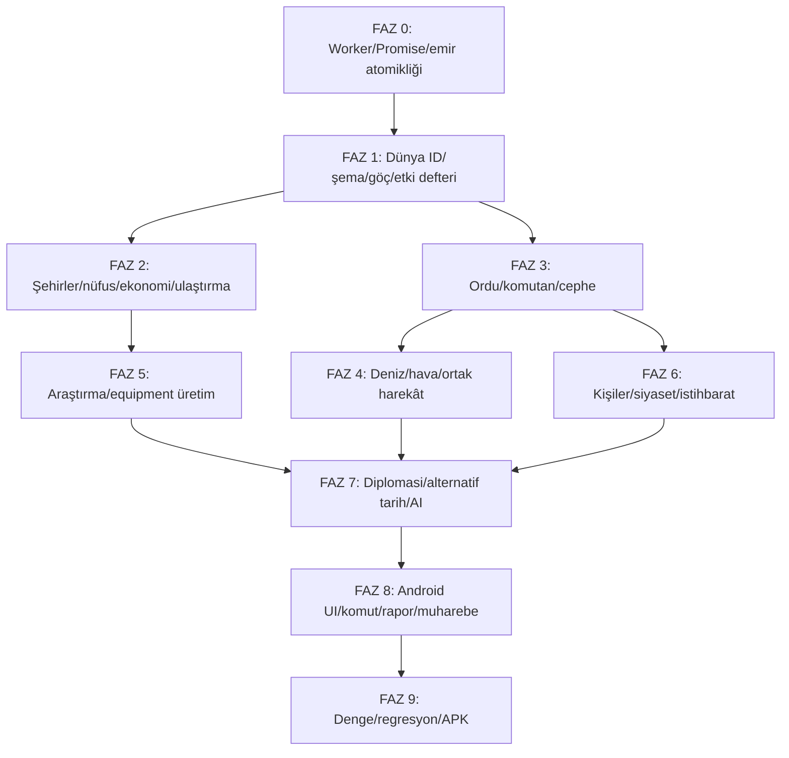

# TARİH STRATEJİ

**Karşılaştırmalı Oyun Analizi, Mimari Değerlendirme ve Bütüncül Geliştirme Şartnamesi**

**Hedef ürün:** Tarih Strateji v1.6+ | Android APK, **dikey ekran**, tam çevrimdışı büyük strateji / alternatif tarih oyunu.  
**İnceleme tarihi:** 12 Kasım 2026.  
**Kanonik incelenen GitHub revizyonu:** `3fdd26d53912c894f34a175469b4d13ac6edb407` (11 Kasım 2026, `main`).  
**Depo:** https://github.com/ERK-netizen/tarih-strateji1  
**İkinci referans:** `Tarih-Strateji-Oyun-Dosyasi-v1.5.pdf`, 26 sayfa, 7 Kasım 2026, kayıt şeması 7.  
**Önceki hazırlık:** `Tarih_Strateji_v1_6_Entegre_Gelistirme_Kit.zip`, bağımsız modül/yama prototipleri; **ana projeye entegre edilmiş sürüm değildir**.

> **Kanıt sınırı:** Rakip oyunların kullanıcıya görünen sistemleri ve yayımlanmış geliştirici açıklamaları incelenmiştir; rakip oyunların özel kaynak kodlarına, ticari yapay zekâ ağırlıklarına veya dahili motoruna erişildiği iddia edilmez. Tarih Strateji için GitHub kaynak dosyaları statik incelenmiştir; bu belgenin hazırlanması yeni bir APK derlemesi veya Android cihaz testi değildir. Aşağıdaki yüzdeler ve performans sınırları, açıkça “hedef” denilen yerlerde tasarım hedefidir; ölçülmüş başarı değildir.

## Yönetici özeti: ana tasarım hükmü

Oyun; **HOI4'ün operasyonel askerî karar kalitesini**, **EU5'in yönetim/popülasyon/üretim bağlantılarını**, **Victoria 3'ün insanların ekonomi üzerindeki gerçek rolünü**, **CK3'ün kişi ve kariyer sürekliliğini**, **Age of History 3'ün mobil erişilebilirliğini** ve **Pax Historia'nın alternatif tarih/serbest emir döngüsünü** birleştirmelidir. Fakat bu oyunların tamamının ayrıntısını kopyalamak hedef değildir. Teknik başarı ölçütü: bir oyuncu kararı aynı gün kabul edilmeli, uygun sistemlerde gün içinde sonuç üretmeli, sonraki aylarda diğer devletlerin bilgi sınırları içindeki tepkileriyle dallanmalı ve tüm süreç doğrulanabilir bir kayda yazılmalıdır.

**En kritik teknik kararlar:**

1. Mevcut TypeScript + SoA + Worker + deterministik P0–P12 korunur; tüm mutasyonlar tek yazarlı yürütülür.
2. Kullanıcı arayüzünde emir kabulü ile oyun içi zaman akışının **etki zamanları** ayrılır: *anlık idari karar*, *süreli proje*, *günlük operasyon* ve *bekleyen dış taraf yanıtı*.
3. Hava ve deniz, ülke toplam puanından çıkarılıp kalıcı kimlikli **filo/hava grubu**, konum, menzil, görev, bakım, ikmal ve komutan sahibi yapılır.
4. Kara savaşının “tek gerçek sonucu” motor verir; Canvas muharebe ekranı bu sonucu oynatır ve komutanın sonraki gün emirlerini motor doğrular. Grafiksel savaş ikinci bir kayıp hesaplamaz.
5. Kişiler (gerçek/kurgu), siyasi partiler, hükümet, ideoloji ve komuta zinciri **ayrı varlıklar, ilişkili roller** hâline getirilir.
6. Şehirde **bina kapasitesi** ile **eşzamanlı inşaat yuvası** ayrılır. Şehir seviyesi 1–10, seviye başına dört bina kapasitesi; yol/demiryolu/sulama/imar bu kapasiteyi tüketmez ancak altyapı maliyetlidir.
7. Demografi seyrek nüfus kohortlarına geçer; küçük azınlıklar görünür; göç/nüfus/askerlik kesin korunumludur.
8. Araştırma; keşif → prototip → üretime hazırlık → seri üretim → birlik modernizasyonu zinciriyle gerçek ekonomi, personel ve ekipmana bağlanır.
9. Harita yalnız görsel piksel büyütülerek değil, **tarihsel ve askerî işlevsel bölge ayrıntısı** artırılarak geliştirilir. 463 bölgenin %70 fazlası için tamsayı hedefi **en az 788** bölgedir; bu, coğrafi veri ve kayıt göçü gerektirir.
10. Eski oyunun tarihsel senaryoları ve eski kayıtları kaybolmadan aşamalı migration, test ve sürüm kapılarıyla ilerlenir.

---

# BÖLÜM I — BENZER OYUNLARIN MİMARİ, İŞLEV VE OYNANIŞ ANALİZİ

## 1. Hearts of Iron IV (HOI4)

**Oynanış döngüsü.** Ülke stratejik hedefini seçer → endüstriyi/silah üretimini düzenler → tümen şablonlarını ve komutanları hazırlar → cephe ve taarruz hattını belirler → ikmal, hava ve deniz koşullarını hazırlar → savaşın organizasyon, kayıp ve ilerleme sonuçlarını izler → eksik kaynaklara yeniden yatırım yapar. Kullanıcının başarısı salt ordu sayısına değil **hazırlık/ikmal/teknoloji/doğru cephe yoğunlaşmasına** bağlıdır.

**İşlevsel mimari (gözlemlenebilir iş mantığı):** Tümen ve taburların fiziksel ekipman-personel gereksinimi; üretim hattı; ikmal merkezi ve demiryolu üzerinden akış; generaller ve planlar; taktik harekât; hava kanatları ve filo görevleri; savaş sonrası konferanslar. Resmî tanıtım, ülke çapında üretim, tümen tasarımı, diplomasi ve alternatif tarihi temel özellik olarak tanımlar. Paradox'un ikmal geliştirici anlatımlarında demiryolu/merkez/araç kullanımı, arazi ve hava koşulunun cepheye kapasite ulaştırmasına etkisi açıkça belirtilir.

**Tarih Strateji'ye aktarılacak tasarım:**

- Tümen → kolordu → ordu → ordu grubu → cephe karargâhı. Kalıcı cephe hattı, hazırlık yüzdesi, yığınak, ihtiyat, saldırı eşiği, plan uygunluğu.
- **Ekipman bulunmadığı için eksik kadrolu birlik** ile tam donanımlı birliğin farklı gerçek muharebe değerleri.
- Hava/deniz görevleri P8/P9 muharebesinin menzil/ulaşabilirlik/rezervasyon hesaplarına katılır.
- Demiryolu ve limanların stratejik önemi; sivil ticaret ve askerî sevkiyat aynı kapasiteyi paylaşır.
- Hedef/araç ayrımı: “X bölgesini elde tut” hedefi, komutanın gündelik yığınak ve geri çekilme kararlarına dönüşür.

**Aktarılmaması gerekenler:** Arayüzün onlarca mikro paneli, çok yoğun tıklama ve tek senaryoya özgü sabit teknolojik takvim; telefon ekranında sürtünme yaratır. HOI4 benzeri muharebenin düğme/duraklatma animasyonu, tek-yazar kanonik motoru atlayıp kendi savaş defterini tutmamalıdır.

**Referanslar:** [Resmî oyun sayfası](https://www.paradoxinteractive.com/games/hearts-of-iron-iv/about), [Paradox ikmal geliştirici notu](https://devtrackers.gg/heartsofiron/p/360fc4aa-dev-diary-supply-a-first-look), [Tren ve ikmal notu](https://devtrackers.gg/heartsofiron/p/40a4cf1f-dev-diary-trains-and-supply), [Hava kuvvetleri kontrolü geliştirmesi](https://steamcommunity.com/games/394360/announcements/detail/1255787772101538939).

## 2. Europa Universalis V (EU5)

**Oynanış döngüsü.** Tarihsel toplumun başlangıç koşulları → ekonomik üretim ve ticaret → gelir, meşruiyet, yerel yönetim ve toplumsal güç odakları → kabine görevlendirmesi ve diplomasi → teknoloji, yasa ve askerî reform → bölgesel büyüme / kriz ve alternatif tarih. EU5 4 Kasım 2025'te yayımlanmış bir oyundur; nüfus birimleri, üretim girdileri, ticaret, kabine görevleri ve devlet idaresi resmî tanımlanan merkezî özelliklerdir.

**İşlevsel mimari:** Ülke “tek güç puanı” değildir; bölgeler, nüfus, sosyal tabakalar, mal akışı, kurumlar ve devlet politikaları birbirini etkiler. Danışman/kabine eylemleri ayrıntı yükünü azaltır. Teknoloji yeni mal, yeni yönetim biçimi ve yeni üretim seçenekleri açar.

**Tarih Strateji'ye aktarılacak tasarım:**

- Her eyalet/şehir için üretim ve tüketimin kaynak/kültür/iş gücü/ulaştırmayla bağlantılı olması.
- Devlet kadrosuna **bakanlık hedefleri**: ulaşımı güçlendir, gıda güvenliği sağla, ittifak arayışını sürdür, üretim önceliği ata.
- Ülkeler yalnız ideolojik rejim numarasıyla değil, farklı güç odakları ve **döneme özgü partiler/kurumlarla** temsil edilir.
- Savaş nedeniyle iş gücü orduda ise tarla/fabrika işçisi azalır; orduyu büyütmek gerçek ekonomik fırsat maliyetidir.
- Siyasi ve ekonomik kazanımlar farklı hızlarda ortaya çıkar; tüm binalar anında bonus üretmez.

**Aktarılmaması gerekenler:** EU5'in tüm alt mal/meslek/sınıf katmanlarını Android'de tam çözünürlükte her gün hesaplamak; seyrek ve olay güdümlü güncelleme ile kapsam dengelenmelidir.

**Referanslar:** [EU5 resmî tanıtımı](https://www.paradoxinteractive.com/games/europa-universalis-v/about), [EU5 yeni sistemler ve kabine](https://www.paradoxinteractive.com/media/press-releases/paradox-interactive/paradox-interactive-sets-date-for-europa-universalis-v), [EU5 çıkış duyurusu](https://www.paradoxinteractive.com/media/press-releases/paradox-interactive/rewrite-five-centuries-of-history-in-grandest-strategy-game-yet).

## 3. Victoria 3

**Oynanış döngüsü.** Nüfus ihtiyaçları/talepleri → bina ve işçi istihdamı → mal üretimi/fiyat/ücret → yaşam standardı ve toplumsal tabakalaşma → siyasi talepler ve reform → istikrar/göç → yeni üretim tercihi. Victoria 3'te “pops” ve üretim yöntemleri toplum sisteminin temelidir; bina çalışması iş gücü, girdi ve talebe bağlıdır.

**Tarih Strateji'ye aktarılacak tasarım:**

- *İnsan–iş–ürün–ücret–tüketim–vergi–siyaset* zinciri; ekonomi ve nüfus ayrı puan havuzları gibi çalışmaz.
- Eğitim/sağlık/gıda/yerleşim, doğum/ölüm/üretkenlik/göç/huzur arasında **gecikmeli, sınırlı** etkiler.
- Fabrika kapasitesi = bina × iş gücü uygunluğu × mal girdileri × enerji × pazar erişimi; ülke sadece bina dikerek hemen üretim yaratamaz.
- Bazı bölgelerde yoksullaşma ve nüfus hareketlerinin siyasal sonuçlar oluşturması.

**Sınır:** Mobil performans ve veri doğruluğu nedeniyle tam Victoria 3 ölçeğinde tüm pazar aktörlerinin tek tek işlemi yerine bölgesel/ülkesel mal havuzları ile doğrulanabilir yaklaşık modeller kullanılır. Belirsizlik tarihsel olarak belirsiz verilerde gösterilir.

**Referanslar:** [Victoria 3 resmî sayfası](https://www.paradoxinteractive.com/games/victoria-3/about), [Geliştirici günlük #57](https://www.paradoxinteractive.com/games/victoria-3/news/dev-diary-57-the-journey-so-far).

## 4. Crusader Kings III (CK3)

**Oynanış döngüsü.** Kişi hedefi/özellikleri → roller, görevler ve ilişkiler → sadakat/reform/entrika → toplum/iktidar tepkileri → kariyer veya iktidar değişimi → yeni tarihsel hikâye. CK3'ün resmî açıklamaları özellikler, karakter eylemleri, halefler, ilişkiler ve kişilik temelli kararları vurgular.

**Tarih Strateji'ye aktarılacak tasarım:**

- `Person` kalıcı kimliktir; `OfficeAssignment` ve `MilitaryCommand` ayrı ilişkidir. Kişi ölse bile tarihçe saklanır.
- Lider, general, bakan, ideolog ve diplomatın stratejik kararlara **ölçülü ve açıklanabilir** etkileri.
- Kariyerler gerçek tarihte zorunlu sıralamayla ilerlemez; alternatif tarih ayrışınca uygun yetenek/yaş/kurum koşulları belirleyici olur.
- Kurgusal kişi üretimi sabit tohumla yapılır, gerçek kişi ile çakışmaz, doğum-ölüm sınırını geçmez.
- İstihbarat operasyonları yalnız şansla değil yetkinlik, karşı-istihbarat, ağ gücü, bütçe ve uluslararası izlerle sonuçlanır.

**Sınır:** Oyuncu bir aile/dynasty simülasyonu yerine **devlet** yönetir; CK3'ten karakter nedenselliği alınır, kişi başına tam simülasyon ekranları kopyalanmaz.

**Referans:** [CK3 resmî sayfası](https://www.paradoxinteractive.com/games/crusader-kings-iii/about).

## 5. Age of History 3

**Oynanış döngüsü.** Devlet ve dönem seç → araştırma/bina → ordunun ön/arka hat bileşimi → günlük muharebe → kayıp/moral/geri çekilme → harita ve barış. Resmî Steam/Google Play açıklamaları 63'ten fazla birim, ön/arka hat savaşları, teknolojiyle bina/birim açma ve insan gücü bağlantılarını anlatır.

**Tarih Strateji'ye aktarılacak tasarım:**

- Dikey ekranda **tek elde işlem**: bölge seç → ilgili eylemler → kısa önizleme → onay → sonuç. Ana ekranı kaplayan çoklu modal yok.
- Savaş ekranında ön/arka hat, birlik durum kartları, mühimmat/HP/organizasyon ve sade animasyon.
- Yeni başlayanlar için kademeli karmaşıklık: “hızlı emir” yüzeyi, ayrıntı isteyenler için genişletilebilir istatistik.
- Harita üstünde durum katmanları; selektörlerle tüm orduyu hızlı seçme ve emir gruplama.

**Sınır:** Görsel çatışma, savaşı ikinci kez simüle etmez; görüntüleme **motor BattleEvent kaydından** yapılır.

**Referanslar:** [Steam resmî ürün açıklaması](https://store.steampowered.com/app/2772750/Age_of_History_3/), [Google Play Android açıklaması](https://play.google.com/store/apps/details?id=age.of.history3.lukasz.jakowski).

## 6. Pax Historia

**Oynanış döngüsü.** Oyuncu devleti seçer, dünya durumunu okur, serbest biçimli stratejik eylemler yazar, görüşme/danışman desteği alır, zaman atlar ve sonuçları okur. Pax Historia'nın kendi ana sayfası alternatif tarih sandbox'ı olduğunu belirtir. Kamuya açık kullanıcı senaryoları da *karar → tepkiler → dünya olayları → zaman atlama* yapısını örnekler; ancak bu senaryolar resmî motor kodu kanıtı değildir.

**Tarih Strateji'ye aktarılacak tasarım:**

- Türkçe çok adımlı niyet girişi: “Boğazları tahkim et, ana cepheyi savun, bilim yatırımlarını önceliklendir.”
- Komutların **gerekçeli çözümlenmesi**: amaç, alt emirler, maliyet, bekleme koşulu ve hangi planla ilişkili olduğu.
- Dünya yapay zekâsının oyuncudan bağımsız gündemi; devletler birbirleriyle görüşür ve savaşır.
- Her zaman atlaması sonunda iki rapor: **Devletim** ve **Dünya Olayları**, kritik farkların nedenleriyle.

**Sınır:** Pax Historia'daki dil modeli tabanlı üretim, burada çevrimdışı cihaz üzerinde zorunlu değildir. Oyun **karar odaklı kural motoruyla** çalışmalı; komut ayrıştırma gramer, sözlük, varlık çözümleme ve güven skoruyla belirlenimci olmalıdır. Tarih anlatısı nedensiz olay uydurmamalıdır.

**Referanslar:** [Pax Historia resmî ana sayfa](https://www.paxhistoria.co/), [örnek kullanıcı senaryosu](https://www.paxhistoria.co/presets/tfhF009KpCGk4watlBCd) (**senaryo kuralı, motor doğrulaması değildir**).

## 7. Birleşik seçim matrisi

Sütunlarda **A = doğrudan uyarlanacak**, **K = kısmen/ölçeklenerek**, **Y = yalnız tasarım ilkesi**, `—` = esas referans değil.

| Mekanik | Referans yaklaşım (A: doğrudan, K: kısmen, Y: ilke) | Tarih Strateji çözümü |
|---|---|---|
| Cephe/komuta | HOI4: A, EU5: K, CK3: K, AoH3: K, Pax Historia: Y | Harita planı + kalıcı komuta görevi |
| Kara muharebesi | HOI4: A, EU5: K, CK3: K, AoH3: A, Pax Historia: Y | P8–P10 tek sonuç + Canvas replay |
| Deniz/hava | HOI4: A, EU5: K, Victoria 3: K, AoH3: K, Pax Historia: Y | Birim kimliği + menzil + görev rezervasyonu |
| Ekipman/üretim | HOI4: A, EU5: A, Victoria 3: A, AoH3: K, Pax Historia: Y | Model stokları + üretim zinciri |
| Nüfus/kültür | EU5: A, Victoria 3: A, CK3: K, AoH3: K, Pax Historia: K | Seyrek kohortlar ve kimlik dağılımı |
| Şehir/sanayi | HOI4: K, EU5: A, Victoria 3: A, CK3: K, AoH3: A, Pax Historia: Y | 1–10 şehir + işgücü + bina slotu |
| Kabine/otomasyon | HOI4: K, EU5: A, Victoria 3: K, CK3: A, AoH3: K, Pax Historia: K | Sınırları belirlenen görev devri |
| Gerçek kişiler | HOI4: K, EU5: K, Victoria 3: K, CK3: A, AoH3: K, Pax Historia: K | Kalıcı kişi + rol + kariyer olayları |
| Partiler/ideoloji | HOI4: K, EU5: A, Victoria 3: A, CK3: K, AoH3: K, Pax Historia: K | Ülke/dönem parti kayıtları |
| Diplomasi/barış | HOI4: K, EU5: A, Victoria 3: A, CK3: K, AoH3: K, Pax Historia: A | Çok maddeli atomik antlaşma |
| Teknoloji | HOI4: A, EU5: A, Victoria 3: A, CK3: K, AoH3: A, Pax Historia: K | Bilim → prototip → üretim → kullanım |
| Alternatif tarih | HOI4: A, EU5: A, Victoria 3: A, CK3: A, AoH3: K, Pax Historia: A | Koşullu tarihsel olay grafiği |
| Türkçe serbest emir | EU5: K, CK3: K, AoH3: K, Pax Historia: A | Belirlenimci niyet/plan dili |
| Mobil deneyim | HOI4: K, EU5: K, Victoria 3: K, CK3: K, AoH3: A, Pax Historia: K | Dikey ekran + aşamalı detay |

**Ortak mimari ilkesi:** Bu alt sistemlerin hepsi birbirine olay mesajlarıyla rastgele bonus vermek yerine, tek kanonik dünya durumunu okuyup belirli alanların sahibi olan hesaplama modülleriyle bütünleşmelidir. Aynı insan, aynı gemi, aynı fabrika ya da aynı altın iki defa kullanılamaz.

---

# BÖLÜM II — TARİH STRATEJİ'NİN GERÇEK MEVCUT DURUMU

## 8. Denetlenen referansın sürüm farkları

- GitHub `package.json` sürümü **1.4.0**; README **1.4 şartnamesi** diyor. Bu sürüm etiketini, kullanıcı tarafından sağlanan v1.5 PDF ile veya önceki v1.6 kod prototipleriyle karıştırma.
- 26 sayfalık v1.5 belgesi, 7 Kasım 2026 motor durumunu ve 7 numaralı kayıt şemasını anlatıyor. Son GitHub `main` commit'i 11 Kasım 2026. Belgedeki tüm “mevcut” iddiaları bu commit'e ait değildir.
- Kod tabanı yeniden tasarlanmak zorunda değildir: `engine`, `worker`, `protocol`, `storage`, `command`, `data-compiler`, `map`, `ui`, `lab`, `android` ayrımı korunmaya elverişlidir.
- Mevcut deniz/hava sistemi **ülke başına toplam gemi/uçak ve tek genel görev** yaklaşımında; bağımsız filo/hava grubu modeli henüz kurulmuş değildir.
- `AndroidManifest.xml` içinde `sensorPortrait` var; README “APK yatay kilitlidir” diyor: **belgelenmiş çelişki**. Dikey UI'nin gerçek cihaz davranışı ayrıca sınanmalı.

## 9. Mevcut kod yapısı: dosya, işlev, sınır

| Mevcut dosya | Belirlenen işlev | Korunacak | Geliştirilecek |
|---|---|---|---|
| `packages/engine/src/state/world.ts` | SoA kanonik dünya | Tekil dünya, sütun tablolar | Person/Fleet/AirWing/Front/City ve ilişkiler |
| `packages/engine/src/phases/index.ts` | P0–P12 günlük akış ve bütünlük | Günlük zaman, hash, sıralama | Anlık emir sınırı, operasyon alt fazları, denetimler |
| `packages/engine/src/orders.ts` | Önizle, uygula, sıraya al | Paylaşılan validasyon | İşlem sınıfları, eşzamanlı sürüm, atomiklik |
| `packages/engine/src/emirEk.ts` | Deniz/hava, rejim, istihbarat vb. ek emirler | Mevcut emir sözlüğü | Yeni ağ/komutan/istihbarat maliyetleri |
| `packages/engine/src/systems/kara.ts` | Hareket, muharebe, geri çekilme | Deterministik savaş | Komutan ve görev rezervasyonu, BattleEvent |
| `packages/engine/src/systems/deniz.ts` | Ülke düzeyinde gemi/uçak güçleri | Formüller denge referansı | Ayrı filo/kanat, gerçek konum, menzil |
| `packages/engine/src/systems/us.ts` | Hava üssü/tersane/menzil | Dönem koşulları | Üs kapasitesi ve filo bazlı tahsis |
| `packages/engine/src/systems/gelisim.ts` | Eyalet inşaat eşiği, ordu limiti, lider etkisi | Hesap yardımcıları | Şehir bina kapasitesi ayrı, komuta bütçesi |
| `packages/engine/src/systems/toplum.ts` | Partiler, seçim, demografi ve şehir | Var olan toplum değişkenleri | Ülke-dönem partileri, seyrek kimlik |
| `packages/engine/src/siyasiKisiler.ts` | Döneme bağlı gerçek kişiler | Tarihsel kişi kaynakları | Kişi kimliği/rol/yaşam döngüsü |
| `packages/engine/src/decision/index.ts` | Rakip devlet günlük/aylık kararları | Kural tabanlı çekirdek | Stratejik hedef hafızası ve operasyon planları |
| `packages/engine/src/systems/olaylar.ts` | Koşullu tarihsel olaylar | Olay grafiği | Daha fazla sonuç, neden izi, alternatif tarih |
| `packages/worker/src/sunucu.ts` | Worker mesajları, emirler, gün ve kayıt | Tek yazar ve protokol | Beklenen sürüm, anlık emir, kayıt sonrası yanıt |
| `packages/ui/src/istemci.ts` | Promise/Worker istek eşleştirme | İstek kimlikleri | Akışlı hataları mutlaka reject etme |
| `packages/ui/src/eylem.ts` | Onay, emir, gün ilerletme | Önizleme/onay | Başarılı emirde tazele, anlık durum görünürlüğü |
| `packages/ui/src/App.tsx` | Ana UI, rapor, olay modali | Preact/Canvas | Dikey ekran, iki rapor, olay seçimi anında |
| `packages/data-compiler/src/harita.ts` | Coğrafi üretim | Coğrafya ve komşuluk | ≥788 bölge, stabil eski→yeni ID eşleştirme |
| `apps/android/android/app/src/main/AndroidManifest.xml` | Android ekran yönü ve izin | `sensorPortrait` ve offline | Cihazda ölçüm, README tutarlılığı |

## 10. Tespit edilen temel teknik bulgular — önem ve kanıt ayrımı

**A = kodda doğrudan görülebilen sorun; B = tasarım çatışması; C = eksik yetenek; D = doğrulanması gereken denge/performans riski.**

| ID / sınıf / öncelik | Kod kanıtı | Sorun / kök neden | Kapanma testi |
|---|---|---|---|
| F-01 · A · P0 | `ui/istemci.ts` hata akışında `if (b && !b.akis)` | Akışlı `advance` hata mesajı geldiğinde Promise reddedilmeyebilir | Akış `error` → Promise reject, bekleyen sayı sıfır |
| F-02 · A · P0 | `worker/sunucu.ts` `beklenenSurum?` alınır ama kullanılmaz | Eski görünümden verilmiş emir kabul edilebilir | Eski sürüm → sürüm çakışması, hiçbir mutasyon yok |
| F-03 · B · P0 | `submit` emirleri `kuyrugaAl`, P2 ertesi gün | Kullanıcının anlık karar talebiyle çelişir | `teklifYanit`/araştırma/görev aynı gün kanonikleşir |
| F-04 · A · P0 | `ui/App.tsx` olay seçiminden sonra zorunlu `ilerlet('gun',1)` | Karar 1 gün ilerlemeden etkili olamıyor | Olay aynı gün kapanır; `gun` değişmez |
| F-05 · A · P0 | `ui/eylem.ts` onaydan sonra yalnız `panelSurum++` | Yeni durum sorgusu garanti değil | Emir sonrası `query` taze sürüm taşır |
| F-06 · A · P1 | README yatay kilit iddiası / manifest `sensorPortrait` | Belgeler gerçek ayarla uyuşmuyor | README dikey ve APK portre testleri |
| F-07 · C · P1 | `deniz.ts` ülke sınıf toplamı ve `donGorev`, `havaGorev` | Gerçek filo/kanat kimliği yok | Aynı filo iki göreve atanamıyor |
| F-08 · B · P1 | `gelisim.ts` `insaYuvasi` eyalet paralel proje eşiği | Kullanıcının şehir başına 4× seviye bina yuvasından farklı | Bina kapasitesi/aktif inşaat limiti ayrı |
| F-09 · C · P1 | `siyasiKisiler.ts` dönemsel ad ve görev aralıkları | Kalıcı biyografi/atama/halef ilişkisi eksik | Kişi tarihçesi ve ölüm doğrulaması |
| F-10 · C · P1 | `toplum.ts` 5-parti desteği ve sabit alanlar | Ülkeye özgü parti sayısı/data modeli yok | 3, 7, 12 partili ülkeler testleri |
| F-11 · C · P1 | Bölge kimliği en çok 7 hücre | Küçük etnik unsurlar ayrı gözlenemiyor | %0,01 küçük topluluk net görülür |
| F-12 · C · P1 | `harita.ts` derlenmiş 463 bölge | Cephe/şehir ölçeği yetersiz | ≥788 tutarlı bölge + göç/adjacency |
| F-13 · D · P1 | `systems/kara.ts` P9 muharebe, Canvas ayrı öneriliyor | Çifte kayıp/otorite riski | Render yalnız BattleEvent okur |
| F-14 · D · P1 | Anlık mutasyon + devam eden `advance` beraber olabilir | Tek-yazar sıralama disiplini gerekir | Zaman atlama sırasında emir deterministik sırayla |
| F-15 · D · P2 | Nüfus/ülke ekonomi toplamları dönemlere göre değişir | Düşük bellek/CPU mobil cihazda eşikler aşılabilir | 365 gün, 5/10/25 yıl, gerçek cihaz raporu |
| F-16 · C · P2 | 36×12 araştırma kademeleri var | Üretime geçiş/prototip, uzman bilim insanı ayrı değil | Araştırma bitince stok kendiliğinden artmaz |
| F-17 · C · P2 | `decision/index.ts` aylık kurallı planlar | Plan hedefi, başarı/başarısızlık hafızası sınırlı | Hedef sonrası tekrar planlama gerekçesi |
| F-18 · C · P2 | `diplomasi.ts` mevcut barış tipleri | Çok maddeli, süreli, şartlı antlaşma kısıtlı | Aynı antlaşmada ilhak+tazminat+garanti |
| F-19 · D · P2 | 1914 senaryosu başkent ve tarihsel personel elle derlenmiş | Bazı tarihsel veri kontrolü eksik; 1914 Brezilya `Brasília` örneği | 1914 Brezilya Rio de Janeiro; kaynak doğrulama |
| F-20 · C · P2 | Gelişmiş komut ayrıştırıcı var | Kalıcı amaç/koşul/kişi ataması plan DSL'sine dönüşmüyor | Komut→Plan→günlük alt emirler→rapor |

**Kritik uyarı:** Bu bulguların “kapandı” durumuna ulaşması, sadece kod değişikliğine değil test çıktısı ve gerekiyorsa Android cihaz çalışmasına bağlıdır. Eski belge 192 test bildirse de mevcut `main` için testleri yeniden çalıştırmadan “başarılı” kabul edilemez.

## 11. Hedef ürün farklılaştırması

**Oyunun vaadi:** “1914'te Osmanlı'yı yönet; neyi, hangi kaynakla, kime emanet ettiğine ve nasıl bilgi topladığına göre tarih farklı gelişsin.” İyi bir oyun döngüsü altı şeyi hissettirmelidir:

1. **Tercih**: İkisi birden mümkün olmayan yatırım/ordu/ittifak seçenekleri.
2. **Hazırlık**: Komutan ve bakanın verdiğin hedef doğrultusunda çalışması.
3. **Belirsizlik**: Öteki devletlerin bilgisi, kapasitesi, korkuları ve tepkileri.
4. **Sonuç**: Hemen görülen emir kabulü; kaynak tüketimi ve gecikmeli etki.
5. **Açıklama**: Başarısız cephe neden kaybetti? Araştırma neden yavaş? Huzur neden azaldı?
6. **Yeniden oynanabilirlik**: Aynı tarihten farklı dünya ancak kendi koşullarını ihlal etmeden.

---

# BÖLÜM III — YENİ SÜRÜMÜN BÜTÜNCÜL SİSTEM MİMARİSİ

## 12. Katmanlar ve yetki sınırları

```text
Android Capacitor (dikey, çevrimdışı)
  └─ Preact Shell + Canvas Map + Tactical Battle Viewer
       ├─ Intent/Command UI       (kullanıcı girişi; kanonik state tutmaz)
       ├─ Query/Explain UI        (bilinen veri, gerekçe, rapor)
       └─ Worker Client           (id / expectedVersion / timeout / cancellation)
            ↓ tek sıralı komut hattı
       Simulation Worker
       ├─ Command transaction     (validasyon / atomik / idempotent)
       ├─ Time scheduler          (instant / next-day / duration / response)
       ├─ View projections        (fog of war; oyuncu ve AI bilgisi)
       ├─ Save journal            (dünya + olaylar + ACK)
       └─ Canonical World (SoA)    ← yalnız burada mutasyon
            ├─ Population & Cities & Labor
            ├─ Economy & Markets & Transport
            ├─ Research & Equipment
            ├─ Government & Persons & Parties
            ├─ Army & Command & Fronts
            ├─ Fleet & AirWing & JointOperations
            ├─ Diplomacy & Peace & Intelligence
            ├─ Historical Events & Alternative History
            └─ AI Goals & Plans & Observations
            ↓
       Deterministic event ledger / daily hash / save migration
```

**Sahiplik kuralı:** Nüfus sayısını yalnız Population, ülke stoklarını ResourceLedger, teknoloji ilerlemesini Research, birlik gücünü Military, toprak mülkiyetini Territory/Peace günceller. Başka sistem bu alanları doğrudan artırmak yerine sahip sisteme doğrulanabilir istek gönderir. Görünüm sistemi hiç mutasyon yapmaz. “Olay” hem bildirim hem de kanonik değişiklik anlamına gelmemeli; `DomainEvent` ve `UIReport` ayrı sınıflandırılmalıdır.

**Güncel mimariyi gereksiz yeniden yazma:** SoA tabloları korunur. Yeni türler başlangıçta ayrı SoA tabloları ve kod-üretilmiş ID çözümleyicilerle eklenir. Çok boyutlu değişkenler (nüfus, istihbarat, diplomat hafızası) seyrek tablo olarak tutulur. Dağıtık servis, çevrimiçi veritabanı, LLM API ya da çok Worker mutasyonlu yapı kullanılmaz.

## 13. Kanonik kimlik sistemi ve nesne ilişkileri

**Önerilen varlıklar:** `Country`, `Region`, `City`, `Cohort`, `Person`, `PersonRole`, `Party`, `Government`, `Office`, `ArmyFormation`, `Battalion`, `EquipmentModel`, `EquipmentBatch`, `CommanderAssignment`, `Front`, `Operation`, `Fleet`, `ShipGroup`, `AirWing`, `Airbase`, `Port`, `ResearchProject`, `Factory`, `ConstructionProject`, `TradeContract`, `Treaty`, `War`, `PeaceConference`, `IntelReport`, `AIPlan`, `TimedEffect`.

**Kimlik ve başvuru:** Her kalıcı kimlik `tableID + slot + generation` veya benzersiz sabit sayı olmalıdır. Silinip aynı slota yeni varlık yazılırsa generation artmalıdır. ID kayıt sonrası korunur; tarihi olaylar **isimle değil sabit kodla** kişiyi tanır. Harita yenilendiğinde `oldRegionId -> [newRegionId, popWeight, areaWeight]` veri göçü tablosu zorunlu, varsayımla tek bölgeye atama yoktur.

Örnek mantıksal sözleşmeler (uygulamada SoA olarak kodlanır):

```ts
type EntityId = number;
type Day = number;
type Fixed = number; // 1e6 ölçek, güvenli tamsayı zorunlu
interface Person {
  id: EntityId; source: 'historical'|'generated'; dataCode: string;
  name: string; birthDay: Day; deathDay?: Day;
  nationality: EntityId; skills: { admin: number; command: number; economy: number;
  diplomacy: number; research: number; intelligence: number };
  traits: number[]; ideologyId: EntityId; active: boolean;
}
interface Assignment {
  id: EntityId; personId: EntityId; targetId: EntityId;
  role: 'headOfState'|'minister'|'partyLeader'|'army'|'fleet'|'air'|'scientist';
  startDay: Day; endDay?: Day;
}
interface StandingOrder {
  id: EntityId; issuer: EntityId; executor: EntityId; scope: EntityId;
  goal: string; constraints: Record<string, number>;
  priority: number; authority: 'manual'|'advisor'|'delegated';
  createdDay: Day; expiresDay?: Day; state: 'active'|'blocked'|'done'|'cancelled';
}
interface BattleRecord {
  id: EntityId; day: Day; regionId: EntityId;
  participants: EntityId[]; inputsHash: string; outcomeHash: string;
  actions: Array<{ order: number; actor: EntityId; target?: EntityId;
    kind: string; hpDelta: number; orgDelta: number; ammoDelta: number }>;
}
```

**Çok rol testi:** Tek kişi bir tarihte bakan ve parti başkanı olabilir; fakat fiziksel komuta görevlerinde aynı saat birden fazla harekâta doğrudan komuta edemez. Tarihî bir kişiyi “canlandırmak” için tarih aralığı ve yaşam durumu geçerli olmalıdır. Personel maliyeti, sadakat ve bağlılık, simülasyona zamanla etkide bulunur.

## 14. Zaman, emir ve Promise çözümü (P0 kabul kapısı)

**Asıl sorun:** Oyunun `submit` işlemi şu anda çoğu emri ertesi P2 fazına kuyrukluyor. Bu bir zaman modelleme kararıdır; ancak teklif reddetmek, bütçe tahsis etmek, araştırma başlatmak, komutan görevlendirmek gibi işlemler kullanıcı tarafından onaylandığı **mevcut gün** kaydedilmelidir.

**Dört zaman sınıfı:**

| Sınıf | Örnek | `gun` değişimi | Kanonik etkisi |
|---|---|---|---|
| `IMMEDIATE_POLICY` | Bakan ata, teklif yanıtla, araştırmayı başlat, proje siparişi, ordu emri ver, parti tutumu | 0 | Validasyon + ödeme/rezervasyon + kalıcı kayıt, aynı gün UI tazeleme |
| `DAILY_OPERATION` | Birlik hareketi, savaş, üretim tüketimi, atölye ilerleme, hava sortisi | +1 günlük çözüm | P fazlarında hesaplanan fiziksel sonuç |
| `DELAYED_PROJECT` | İnşaat, araştırma, eğitim, yeni askeri model | 0 başlatma; tamamlanma ileri gün | Kaynak/kapasite ayır, ilerleme kayıtla, her gün hesapla |
| `EXTERNAL_RESPONSE` | Başka devlete teklif | 0 teklif kaydı; karşı devletin yanıtı uygun mantıksal sırada | Gelen kutusuna aynı gün görünür, YZ yanıtı gecikmeli olabilir |

**Özel kural:** Oyuncuya gelen bir teklifin *gelen kutusuna yazılması* için 1 gün gerekmemeli. Oyuncunun kabul/ret kararı aynı gün sonuçlanmalı; başka devletin kendi değerlendirme süresi, diplomatik ulaşım veya AI plan sıklığı ayrı konudur. Aynı anda gelen 5 teklif tekrarsız ve değişmez ID ile tutulur. Şehir geliştirme veya araştırma komutunda “başlatma” derhal olur; gerçek inşaat/araştırma ilerlemesi takvimle akar.

**Tek Worker işlem sırası:** `receive -> validate schema -> check worldVersion -> capture/preflight -> apply atomically -> append event log -> durable-save policy -> publish ACK(version) -> refresh views`. Uzun `advance` sırasında yeni mutasyonlar deterministik sıraya alınır veya `busy` döner; `stop` acil kesme bayrağı olabilir. Hata halinde istek kimliğiyle tüm bekleyen Promise'lar reject edilir; Worker `onerror`, `onmessageerror`, kapanma, abort ve taşan yük engellenir.

**Yama kabul testleri:** (1) Akışlı `advance` içinde `error` geldiğinde Promise mutlaka reject; (2) stale `expectedVersion` atomik red; (3) oyuncu gelen barışı kabul ettiğinde `gun` sabit, anlaşma hemen görünür; (4) aynı `idempotencyKey` ile çift tıklama ikinci kez kaynak harcamaz; (5) başarılı emirden hemen sonra ülke/harita/panel görünümü aynı revizyonu gösterir; (6) kayıt-yükle-replay hash tutar; (7) Worker çöktüğünde son **kesinleşmiş** gün tutarlı kalır.

**Otomatik kayıt doğruluğu:** Kullanıcıya “kaydedildi” yazısı, fiziksel kayıt tamamlanmadan gösterilmez. “Emir kabul edildi” ve “kalıcı diske kaydedildi” iki ayrı durum olarak bildirilir. Ağ veya servis beklenmez; OPFS/IndexedDB için tek yazar işlemi sıralanır.

## 15. Günlük fazların bütünleştirilmesi

Mevcut P0–P12 bölünmesi korunur; her modülün *aynı gün hangi anlık veriye baktığı* tanımlanır:

```text
İnsan etkileşimi [gün ilerlemeden] : Emir validasyonu + anlık kayıt + görünüm sürümü
P0  : Önceki kesinleşmiş günün kapanışı; yeni gün / takvim
P1  : Periyodik nüfus, hükümet, olay, süreli etki tetikleyicileri
P2a : Kalıcı hedefler, komutan ve bakan planları
P2b : YZ stratejik/operasyonel planlama, bütçe tahsisi
P3  : Diplomatik yanıtlar/krizler, istihbarat, görev hazırlığı
P4  : Ülke/şehir/ordu kaynak aktarımı ve sevkiyat varışları
P5  : İş gücü, tarım, sanayi, bakım, üretim ve teknoloji ilerlemesi
P6  : Nakliye kapasitesi ve ikmal tahsisi (kara/hava/deniz ortak bütçe)
P7  : Maliye, stok bakiyesi, bakım, amortisman ve sağlık
P8  : Kara hareketi, hava/deniz konumu ve sortilerin planlı uygunluğu
P9  : Eşzamanlı muharebe çözümü, kara/hava/deniz etkisi tek hesap
P10 : Kayıp, geri çekilme, bölgesel kontrol, savaş durumu
P11 : Olay tepkileri, görünümler, durma koşulları, dünya/devlet raporu
P12 : Nüfus+kaynak korunumu, entity tekilliği, kayıt/hash ve commit
```

Bu *hedef faz içi görev dağılımıdır*; kaynak koddaki mevcut faz görevleri bire bir böyleymiş gibi yorumlanmamalı. Tek çekirdek `gunIlerle` uyarlanırken sıra değişiklikleri deterministik testlere tabi tutulur. Hava kanadının bugünkü sortisi, birlik henüz menzil dışındayken kara saldırısını destekleyemez; ulaşım/menzil kontrolünün muharebeden önce yapılması zorunludur.

## 16. Ortak neden-sonuç motoru ve kaynak sahipliği

**Tekil kaynak defteri:** `Credit(country, resource, amount, sourceEventId)` ile `Debit(...)` beraber bir işlemdir; işlem ID'si kayıtta tutulur. Bir bakanlık emri ve teknolojik bonus aynı fiziksel para/ekipman stoklarını farklı tablolarda “geliştirmemelidir”. Geçici bonusların kaynağı, koşulu, başlama/bitme günü, üst sınırı ve açıklaması vardır. **Kanonik veriden türetilen** oranlar mümkün olduğunca ayrı kalıcı bonusa dönüşmez.

Örnek tam zincir — **Kars demiryolu**:

1. Oyuncu hedefi koyar: “Doğu ordularına ikmali güçlendir.”
2. Bakan, bağlantısız istasyon kesimini bulur; kaynak, iş gücü ve süreyi önizler.
3. Oyuncu onaylar, inşaat projesi anında kaydedilir.
4. Her gün çelik/işçi/para tüketilir; bitince yeni `TransportEdge` kapasitesi açılır.
5. Ekonomik piyasa erişimi artabilir; yalnız kapasitesi ve talebi yeterli yollar etkilenir.
6. Askerî ikmal sevkiyatı için aynı kenar kapasitesinden pay ayrılır; ticaret artarsa askerî lojistik sıkışabilir.
7. Tedarik oranı yeterli birlikler daha az organizasyon/yakıt cezası alır; komutan hedefini tekrar değerlendirir.
8. Düşman gözcüleri lojistik hareketini fark edebilir; diplomatik algı ve saldırı fırsatı değişebilir.
9. Tur raporu “neden”: yeni kenar, +kapasite, kullanan sevkiyat, kalan dar boğaz, sonuç.

**Kaynak izi:** `DecisionId → ProjectId → CapacityDelta → ResourceAllocationId → UnitSupplyDelta → BattleRecordId → ReportId`. Yalnız olay metni değil, motorun gerçekten ürettiği izdir. Üretilen etki iki kez uygulanırsa aynı `sourceEventId` idempotency kontrolü bunu reddeder.

---

# BÖLÜM IV — OYNANIŞ SİSTEMLERİNİN AYRINTILI TASARIMI

## 17. Ordu, komutan, cephe ve birlik tasarımcısı (HOI4 etkisi)

### 17.1 Kalıcı komuta zinciri

| Katman | Rol | Oyuncu kontrolü | Otomasyon |
|---|---|---|---|
| Ülke genelkurmayı | Doktrin, harekât bütçesi | Hedef ve öncelik | Cephe planlarına dağıt |
| Cephe karargâhı | Stratejik coğrafi hedef | Bölge/kale/sınır seçimi | Savunma hattını koru |
| Ordu grubu | Birkaç ordunun eşgüdümü | Topyekûn/temkinli saldırı | Saldırı eşiği ve ihtiyat |
| Ordu | Birlik tahsisi ve komutan | Komutan, hedef, ikmal şartı | Günlük hareket/taarruz |
| Kolordu / tümen | Tabur ve ekipman | Şablon/takviye/konum | Taktik konumlanma |
| Destek hava/deniz | Ortak göreve tahsis | Kanat/filo/cephe | Ulaşılabilir sortiler |

**Komutan öz nitelikleri:** `id`, gerçek/kurgu, ad, doğum, rütbe, görev, deneyim, lojistik, taarruz, savunma, planlama, moral, sadakat, dönem uyumu, sağlık/yaşam. Genç personel askerî akademiden çıkabilir; savaş deneyimi ve takdir puanı ile uzmanlaşır; beceriler 0–100 ölçekte tavana yaklaşırken azalan getiri vardır. Hiçbir bonus tek başına savaşı kazandırmaz. Bir komutan yalnızca kendi komuta kapasitesindeki birliklere tam etki verir; taşan birliklerde bonus azalır. Üst komuta düzeyinde aynı komutanın aynı nitelik bonusu bir daha çarpılmaz.

**Komutan karar sözleşmesi:** hedef bölge/cephe, güç tahsisi, öncelik, kayıp toleransı, ikmal asgari oranı, bekleme süresi, rezerv kuvvet oranı, savunma derinliği, taarruz koşulu, hava/deniz desteği isteği, iptal eşiği. Örn. “Kafkas Cephesi'nde savun, ikmal %75 altındaysa saldırma, iki tümeni ihtiyatta tut.” İki günlük saldırı kaybı sınırını aşınca komutan kendiliğinden durmalı ve gerekçe bildirmeli.

### 17.2 Tümen ve askerî ekipman

- Birlik türüne göre dönemsel şablon: 750 piyade/atlı/mancınık, 1600 piyade/süvari/top, 1914 piyade/topçu/süvari, 1939 tank/motorize/uçaksavar, 2026 mekanize/İHA/elektronik destek.
- Birlik envanteri **gerçek model adları** ile gösterilir. Tarihsel doğrulaması olmayan model `alternatif tasarım` etiketi alır. Erken teknoloji “2026 uçağını 1914 fabrikasında anında üretmek” anlamına gelmez.
- Tümen şablonundan `neededEquipment(modelId)`, `neededManpower`, `fuelDemand`, `ammunitionDemand` hesaplanır. Eksiklik ekipman oranı, saldırı, hız, organizasyon, kayıp ve takviye hızını etkiler.
- Üst düzey askerî kapasite ülke büyüdükçe artar; birlik sınırı sabit duvar değil **yönetim/lojistik insan gücü maliyetli yumuşak kapasite** olur. Ülkenin nüfus, yönetim, sanayi, komuta merkezi ve toprak genişliği yükselince desteklenebilen tümen de artar.

### 17.3 Önerilen muharebe hesapları

Aşağıdaki şema *başlangıç denge formülü* olup gerçek testlerle kalibre edilmelidir; mevcut oyunun gerçek katsayılarıymış gibi alınamaz:

```text
SupplyRatio     = deliveredSupply / max(1, demandedSupply)
EquipmentFill   = Σ(availableEquipmentWeight) / Σ(requiredEquipmentWeight)
AttackEffective  = AttackBase(equip,unitType) × training × experience × orgFactor
                   × morale × commanderAttack × doctrine × supply × ammo
                   × terrain × weather × airSupport × navalSupport
DefenseEffective = DefenseBase(equip,unitType) × entrenchment × commanderDefense
                   × organization × terrain × supply × weather
SpeedEffective   = BaseSpeed(slowestCriticalBattalion) × road × terrain × fuel
                   × organization × commanderLogistics
HP/PersonnelLoss = deterministicCombatRoll × damageDistribution
```

- Tüm oranlar sabit noktalı; koruyucu alt/üst sınırlar ve **etki çarpanlarının istiflenme kontrolü** var.
- Saldırı gücü ile savunmanın üstün gelme oranı, muharebe genişliği ve cephe yönleriyle sınırlanır.
- Muharebe sonunda asker kaybı `PopulationLedger` ile, ekipman kaybı `StockLedger` ile, bölge kontrolü `TerritoryLedger` ile **bir kez** kesinleşir.
- Savunma derinliği, tahkimat, karşı-taarruz, dinlenme, geri çekilme, arazi ve mevsim kararları aktiftir.
- 1914: siper/yıpratma ve topçu; 1939: manevra/karma kuvvet/lojistik; 2026: bilgi üstünlüğü, hava/İHA, elektronik kısıtlar ve ikmal güvenliği; ortaçağ dönemleri çağ uyumlu farklı şablonlarla aynı motoru kullanır.

### 17.4 Ayrı şehir muharebesi ekranı

**Akış:** Haritada düşman şehre saldırı emri → `BattleInstance` başlatma/izleme → dikey Canvas savaş görünümü → kendi birlik kartları ve saldırı emri/pasif geri çekilme seçenekleri → seçilen taktik emirler kanonik Worker'a iletilir → sonraki günlük muharebe adımı `BattleRecord` ve `BattleEvent[]` üretir → grafik, kesinleşmiş olayları can/ateş/mühimmat/organizasyon çubuklarıyla oynatır. Kullanıcı grafikte “ateş et”e bastı diye aynı gün sınırsız sıfır maliyetli saldırı olmaz; emir **taktik tercih** olup motorun zaman ve mühimmat kurallarına uyar.

**Arayüz şartları:** Dikey mobil ekranda 2–6 temsilî birlik kartı; dokunarak seçme, saldırı/korun/geri çekil; uçak desteği ve kıyı bombardımanı rozeti; “Neden kazandık/kaybettik” sonuç fişi; erişilebilir büyük butonlar ve düşük animasyon seçeneği. Bu ekranı hazır oyun motorunun yerine koyma.

## 18. Hava ve deniz — soyuttan fiziksel birimlere

**Deniz model katmanları:** `ShipModel → ShipGroup → Fleet → NavyCommand → NavalMission → SeaZone`; gerçek konum, ana liman, hasar, yakıt, mühimmat, personel, menzil/sürat, hazırlık ve komutan. Filo üs değiştirebilir; seyahat süresi bitmeden yeni bölgede görünmez. Deniz bölgeleri ve sahil kenarları ikmal ve boğazlarla ilişkilidir. Tek filo iki bölgede, aynı gemi iki filoda olamaz.

**Hava model katmanları:** `AircraftModel → AirWing → Airbase → Mission → AirZone / Front`, uçak sayısı, hazır uçak, yakıt, bakım, pilot, menzil ve hava koşulları. Hava üssü bölge sahibi ve uygun kapasite gerektirir; fazladan uçaklar görev verimini düşürür. Aynı kanat iki cephede çift sayılmaz; görev rezervasyon defteri birimler arası çakışmayı reddeder.

**Deniz görevleri:** Deniz üstünlüğü, abluka, ticaret akını, konvoy koruma, keşif, çıkarma desteği, liman savunması, kıyı bombardımanı, nakliye. **Hava görevleri:** Önleme, av, keşif, yakın destek, stratejik bombardıman, deniz keşfi, nakliye; 2026'dan itibaren döneme uygun insansız ve elektronik görevler.

**Ortak harekât örneği:** Çanakkale çıkarma teşebbüsü: donanma eskortu → deniz üstünlüğü → askerî taşıma kapasitesi → limana iniş/çıkartma bölgesi → hava uygunluğu (varsa) → kıyı savunması/topçu ve kara birliği → günlük sonuç. Hava ve deniz desteği “ülke genel +%20 bonus” değildir; ilgili bölge, mesafe, gerçek görev, ikmal, düşman karşı koyma ve zaman gerektirir.

**Askerî tesisler:** Hava üssü/tersane/liman/doğrudan askeri fabrika bölgede inşa edilir. İnşaat önce sipariş olarak kaydedilir, sonraki günlerde iş gücü ve kaynak tüketir. Tersane bulunmayan bölgede gelişmiş savaş gemisi üretilemez; uçak sayısı hava üssü kapasitesine sığmalıdır.

## 19. Şehir, inşa yuvaları, imar ve altyapı

**Zorunlu kullanıcı kuralı:** Her şehir 1–10 seviye; her seviye **4 bina yuvası** sağlar; `buildingCapacity = cityLevel * 4`, seviye 10'da 40 slot. `civilFactory`, `militaryFactory`, `hospital`, `school`, `lab`, `barracks`, `depot`, `power`, `port`, `shipyard`, `airbase` gibi yapılar tiplerine göre 1 veya daha fazla slot tüketir. **Demiryolu, sulama, temel altyapı, şehir imarı** fiziksel bina slotu tüketmez, fakat inşa bedeli, iş gücü ve ağ kapasitesine bağlıdır.

**İki kapasiteyi karıştırma:**

1. `BuildingSlotCapacity` = tamamlanmış şehir yapılarının azami toplamı (0..40).
2. `ConstructionThroughput` = aynı anda yürüyebilecek projeler / işçi ve inşaat ekipleri; `gelisim.insaYuvasi()` benzeri var olan eşzamanlı inşa limitinin görevi budur.

Şehir seviyesinin artışı nüfus/eğitim/altyapı/ticaret koşullarıyla **önizlenip yatırım yapılınca** gerçekleşir; kentleşme kendiliğinden artabilir ama bu **bedava fabrika yaratmaz**. Bölgenin işgal altında olması ilhak/mülkiyet/direniş ve inşaat maliyetini etkiler. Ele geçirilen bölgeyi işgal eden oyuncu hemen tam malik olmaz; **kontrol, yasal sahiplik ve ilhak** ayrı durumdur. Barışla veya hukuki/oyun içi süreçle devredilmiş bölgenin bina ve nüfus defteri kaybolmaz.

**Üretim denklemi:** `Çıktı = min(fabrikaKapasitesi, işgücüKapasitesi, girdiKaynakKapasitesi, enerjiKapasitesi, lojistikKapasitesi) × teknikVerim × hasarOranı`. İnşaatlar ve demiryolları, iş gücü/vergiler/ticaret/ikmal ve nüfus çekiciliğine *aynı kaynak defteri üzerinden* etki eder.

## 20. Ulaştırma, gıda, ticaret ve sanayi (EU5 + Victoria 3)

**Ulaştırma ağı:** Düğümler şehir/liman/depo/istasyon; kenarlar kara yolu/demiryolu/deniz yolu; her kenarda günlük kapasite, hız, bakım, işgal, hasar ve hat sahibi. `capacityUsedMilitary + capacityUsedCivil ≤ capacityTotal` zorunlu. Kesilen demiryolu/kapatılan liman o günün sözleşmelerini etkiler. Önce aktarma/taahhüt, sonra kaynak defterine teslim; geçersiz işlem stok üretmez.

**Ekonomi:** Gıda ve tarım, kömür/çelik/petrol/enerji, mühimmat, ekipman, sivil ürün, sağlık-eğitim hizmetleri. Ülke içi ve bölgesel talep ayrımı; malların yetersizliği fiyat ve üretim etkinliğine etkili; yüksek vergi/asker alma kısa vadede mali kapasiteyi artırırken orta vadede talep/iş gücü ve huzura maliyet yükleyebilir.

**İnsan gücü:** Toprakta çalışan ve askere alınan nüfusun aynı zaman diliminde hem çiftçilik hem askerlik üretimi yapması yasaktır. Eğitimli personel yoksa laboratuvar/fabrika hızları düşer. Refah/gıda/sağlık/doğum göç hareketleri, yılda sürümler boyunca etkide bulunur.

**Kapasite ve borç:** Ülke gelir artışı kaynak/üretim/gümrük/iş gücüyle açıklanabilir olmalıdır. Sonsuz paraya yalnız ayrı sandbox kuralı verir; kanonik `Infinity`, negatif iş gücü veya float NaN kullanılmaz. Ekonomik yaptırım ve abluka ticaret hacminden gerçek sevkiyat kaybına dönüşür.

## 21. Esnek teknoloji ağacı ve teknolojinin bütünsel etkileri

**Başlangıç:** 36×12 teknoloji hattının verisi korunur. Araştırmalar dallanmış `ResearchNode` DAG'ına bağlanır; `requires: technology[], knowledgeLevel, facilities, trainedScientists, prototypeCapacity, materials`. 1914'te yatırımla 1930'da *seçilmiş* alanda 1950 teknolojisine ulaşmak matematiksel olarak **mümkün ama pahalı** olabilir; rakip her teknolojide aynı atılımı yapamaz. Bu hedef zaman/para/insan kaynaklarının başka alanlardan çekilmesiyle sınırlanır.

**Teknoloji geçişi:**

```text
Bilimsel bilgi tamamlandı
  ↓ (laboratuvar + eğitimli bilim insanı + bütçe)
Prototip tasarımı ve test
  ↓ (malzeme, teknik kapasite ve zaman)
Üretime hazırlık / sanayi dönüşümü
  ↓ (tesis, enerji, makine, tedarik)
Model stokunun gerçek üretimi
  ↓ (üretim hattı + iş gücü + kaynak)
Birlik modernizasyonu / saha eğitimi
  ↓
İkmal, bakım ve gerçek muharebe performansı
```

**Bilgi, üretim ve birlik ayrı ölçülür:** `researched=true` diye mevcut tümenin silahları bir anda değişmez. Yeni model stokta bulunmalı, birliğe sevk edilmeli, eğitim ve bakım maliyeti ödenmelidir. Ülke 1950 düzeyinde motor bilgisine 1930'da ulaşsa da ilgili alaşım/işleme kapasitesini kurmadıysa seri üretime geçemez.

**Ek dallar:** Tarım, sağlık, eğitim, idare, ulaştırma, enerji, elektronik, iletişim, araştırma yöntemleri, askerî lojistik, piyade, topçu, kara motoru, hava ve deniz, 2026+ otomasyon ve insansız platformlar. Teknolojilerin şehre, kültüre, siyasete ve çevreye etkileri doğrudan “+10 güç” değil **mal tüketimi / iş süreci / işgücü niteliği / kapasite** üzerinden olmalıdır.

**Mobil görsellik:** Çizgili/dallanmış teknoloji grafiği; açılmış, araştırılıyor, ön koşulu eksik ve alternatif teknoloji kartları; kısa açıklama “bunu geliştirirsen neler değişecek?”; alan odak bütçe kaydırıcısı; önizleme ve test amaçlı simülasyon.

## 22. Gerçek siyasi kişiler, partiler ve hükümetler (CK3 + EU5)

### 22.1 Biyografi ve kariyer

Her kişi için kalıcı `PersonId`, kaynak, doğum/ölüm tarihi, siyasi/askerî bağlantı, dönem, beceriler, kariyer uygunluğu, ideoloji, tarihi görev kayıtları. **Kişi varlığı** ile **şu an göreve atanma** ayrı; bir kişinin tarihsel geleceği oyuncu alternatif kararlarına göre değişebilir. Ölü kişi atanamaz; başka dönemden kopya aynı kişi oluşmaz. İsme bakarak bir kişinin kimliği tahmin edilmez.

**Başlangıç veri örnekleri yalnız doğru senaryoda kullanılır:** 1914 Wilhelm II, George V, Woodrow Wilson, V. Mehmed Reşad; 1939 Stalin, Roosevelt, Hitler, İsmet İnönü; 2026 ülke başkanları **1 Ocak 2026 itibarıyla kaynakla doğrulanır**. Gelecekteki ölüm/terfi olayı tarihsel “olabilirlik” kümesi olarak saklanır, zorunlu sonuç değildir. Askerî komutanlar ve sivil yöneticiler için en az başlangıç önde gelen ülkelerden genişletilecek katalog ve kaynak alanı tanımlanır.

### 22.2 Parti ve ideoloji

Beş ortak parti “şablonu” yerine `Party` varlıkları (ad, ülke, kuruluş/kapanış, lider, ideolojik ağırlık, oy/sosyal taban, mali/kurumsal etki) kullanılır. Ülkeye/döneme göre parti sayısı sınırsız değil ancak veri odaklıdır. İdeoloji grupları için örnek sınıflar: gelenekçilik/monarşizm, liberal, sosyal demokrat, sosyalist, komünist, muhafazakâr, milliyetçi, otoriter, faşist, dinî siyaset, çevreci, bölgesel; bunlar etiketten ibaret kalmaz. Ülke koşulları ayrım yapar.

**Parti oynanışı:** Destek/azalt, propaganda (oyun içi soyut), koalisyon, yasaklama, erken seçim, reform, parlamento krizi, baskı riskleri, meşruiyet, isyan/darbe. Politikaların toplumsal dayanak, güven, üretim ve diplomasi etkisi kanonik olmalıdır. Etnik kimlik tek başına ideolojik görüş veya sadakat belirlemez; sosyal/ekonomik koşullar ayrıca etkilidir.

### 22.3 Bakan/ideolog otomasyonu

Manuel / öneri-onay / yetki devri modları. Görevin hedefi, süre, harcama tavanı, coğrafya, uygun mevzuat/kurum, başarı ölçütü, yürütücü kişi ve iptal koşulu olur. “Sanayi bakanı yılda 3 askerî fabrika yap” talimatı, stok ve bütçe yeterli değilse sınırsız fabrika yaratmaz; öncelik raporu verir. Mevcut `bakan` otomasyonunu sıfırlamak yerine yeni görev sözleşmesine göç ettir.

## 23. Demografi, küçük azınlıklar ve nüfus politikaları

**Veri modeli:** Eski 4 yaş × 8 statü ve 7 kimlik gösterimi korunarak `SparseCohort(region, ethnicity, culture, language, faith, sex, ageGroup, profession, education, status, count)` genişletilir. Bütün boyutların bölgelerde tam kartesyen çarpımı tutulmaz; sadece nüfusu olan kombinasyonlar vardır. Birçok küçük kültür 0,01% yüzeyde listelenebilir; tahmini nüfusun kaynağı ve belirsizliği ayrıca gösterilir.

**Muhasebe:** `t+1 = t + doğum − ölüm + giriş − çıkış`; asker alma/terhis/meslek değişimi nüfusu iki kez yaratmaz. Göç eden nüfusun bütün etnik/yaş/meslek alanları kaynak ve hedef bölgede aynı toplamla taşınır. Bölgeye iskân başlatmak için o bölgede **önceden aynı kültürün varlığı şart değildir**; ancak kaynak bölgede gerçek göç edecek insan, taşıma/konut/gıda ve kapasite gereklidir.

**Oynanış politikaları:** Göç teşviki, yerleşim, eğitim, sağlık, doğum teşviki, çokdillilik, kültürel haklar, altyapı, kırsal kalkınma, kentleşme, güçlendirme, asimilasyon baskısı ve ayrımcılığın maliyetleri. Sürgün/kitlesel yerinden edilme/soykırım gibi tarihsel olaylar **insani felaket, mülteci, ölüm, iş gücü kaybı, üretim düşüşü, uluslararası suç ve diplomatik yaptırım** perspektifiyle temsilen ele alınır; daha çok insanı hedeflemeyi “en verimli strateji”ye dönüştüren ödül mekanikleri kurulmaz. Kullanıcı talep ettiği tarihsel olguların etkilerini raporda görebilir; zarar tekniklerini optimize eden simülasyon oluşturulmaz.

## 24. İstihbarat, bilgi sisi ve örtülü faaliyetler

**Bilgi tekniği:** `IntelReport {subject, sourceType, collectedDay, observedDay, lower, upper, confidence, expiresDay, knownTo[]}`. Gerçek düşman verisi gizlidir; yapay zekâ ancak kendi bilgi görünümüyle karar verir. İstihbarat bilgisi eskir, yanıltılabilir ve doğruluk aralıkları genişleyebilir. Taraflı anlatı oyuncuya kesin bilgi olarak sunulmaz.

**Operasyon katalogları:** askerî/ekonomik/siyasi bilimsel bilgi toplama, diplomatik ağ, karşı istihbarat, toplum görüşünü etkileme, ilişki bozma, yanıltıcı bilgi, sembolik suikast/darbe/isyana dış destek, gizli saldırı, teknolojik istihbarat; 2026 senaryosunda döneme uygun modern dijital istihbarat. Bütün eylemler yalnız soyut oyun maliyet/başarı/ifşa/risk parametreleriyle çözülür; gerçek dünyaya yönelik operasyon talimatı içermez.

**Mevcut kod uyarlaması:** `emirEk.ts` içinde casusluk, suikast, sabotaj, isyan, ilişki bozma, darbe gibi emirler zaten mevcut. Bunları yeniden yazmadan maliyet (`hazine` ve `PG`) kontrolü, kişi/ajans/rapor kimliği, görev süresi, ağ gücü ve karşı-istihbarata bağla; her başarılı bilgi birimi yalnız ilgili gözetim kayıtlarında görünür. Yapay zekâ düşman gerçek ordusunu sadece `World`'den okuyarak plan yapamaz.

## 25. Diplomasi, kriz, barış konferansı ve devletin sonu

**Diplomasi belleği:** İlişki tek “görüş puanı” değildir. Güven, düşmanlık, ticaret/borç, ideolojik uzaklık, ortak tehdit, sınır iddiası, anlaşma ihlali, geçmiş yardım/işgal ve lider tutumu kayıtları bulunur. Gündeme göre oyuncu ve YZ hem kısa hem uzun sonuçları izler.

**Diplomatik eylemler:** Ticaret, üs ve geçiş, ittifak, garanti, saldırmazlık, araştırma anlaşması, bilgi paylaşımı, kredi/yardım, ekipman ticareti, karşılıklı yaptırım, arabuluculuk, ültimatom, kriz görüşmesi, sınır düzenlemesi, tahkim, himaye, barış. Savaş ilanı büyük ve geri döndürülmesi zor otomasyon kararları için kullanıcı onayı gerekir (açık yetki yoksa).

**Barış antlaşması şeması:**

```text
Treaty
  participants, conflictId, signedDay, ratificationDeadline,
  clauses = [
    {type:'territoryTransfer', regionIds:[...]},
    {type:'reparations', amount, installments, dueDays},
    {type:'ceasefire', untilDay},
    {type:'demobilize', ceilings},
    {type:'recognition', countryId},
    {type:'securityGuarantee', guarantor, expiry},
    {type:'baseAccess', regionId, expiry},
    {type:'puppetOrIndependence', countryId},
    {type:'reconstruction', obligations}
  ]
```

**Atomik doğrulama:** Toprak devri için geçerli malik, savaş durumu ve talep kapasitesi; tazminat için ödeme süresi/para ve temerrüt koşulu; karışık antlaşmalarda tüm maddeler geçerliyse bir kez uygulanır. Bölge kontrolü, hukukî mülkiyet, ilhak, bağımsızlık ve kuklalık birbirine karıştırılmaz. Savaş skoru, kabul istekliliği, müttefikler ve tahribat sonucunda taviz fiyatları dinamik değişir. Koalisyonda bir taraf teslim olunca tüm dünya savaşı otomatik bitmez.

## 26. Alternatif tarih, senaryolar ve nedensel olay motoru

**Her olay:** `triggerConditions`, tarih penceresi, aktörler, seçenekler, doğrudan maliyet, `effects[]`, gecikmeli sonuç, `dependencies[]`, `exclusions[]`, kapanma nedeni, bilgi görünürlüğü, önceki karar referansları. Tarihsel olaylar şartları değişince **değişir, gecikir veya hiç oluşmaz**. Rastgele hikâye yazımı yerine, yeni olayların nedeni dünyadaki kayıtlı bir olgudan türetilir.

**1914 senaryosu (öncelikli):** Saraybosna suikastı sonrası Temmuz Krizi; savaş gerekçeleri, Osmanlı'nın savaş katılma/katılmama yolları, tarafsız ticaret, Boğazlar, Kafkasya, Çanakkale ve Arabistan. 1914'te Osmanlı tarafsız kalıyorsa otomatik Çanakkale savaşı tetiklenmez; İngiliz ve Rus stratejileri bu kararla yeniden dengelenir. Tren/topçu/siper ve lojistik ana temadır.

**1939 senaryosu (öncelikli):** Polonya ve savaş blokları, hava/deniz üstünlüğü, tank ve motorize birlikler, kaynak kıtlığı, şifre/istihbarat/teknoloji yarışları, şehir bombardımanı ve sivil sonuçları. Örn. Fransa savunmaya daha çok yatırım yaparsa askerî planın sonucunda 1940 olayları aynı kesinlikle tekrarlanmaz.

**2026 senaryosu (öncelikli):** Enerji/tedarik ağları, füze/İHA/hava savunması, elektronik ve bilgi sistemleri, ekonomik yaptırımlar, ittifak güvenceleri, modern krizler. “2026 başlangıcı” için bütün lider, harita ve savaş koşulları **1 Ocak 2026 verisinden** alınır; ileri tarihli haber olayını başlangıca yanlışlıkla yerleştirme. Oyun 2026 sonrasında kurgusal yönlere gidebilir. Modern gelecek teknolojileri tarihsel model değil `alternate/future` etiketlidir.

**750 ve 1600 korunur:** Aynı motorla çalışan dönem kataloğu; uçak yoksa hava tablosu boş; deniz farklı teknoloji/menzil kullanır. Dinî/siyasi yönetim ve ticaret kurumları kendi çağ bağlamına uyar; modern tank ve ideoloji otomatik açılmaz.

## 27. Yapay zekâ: devlet niyeti ve plan hafızası

```text
Stratejik katman (aylık/olay üzerine): güvenlik, ekonomi, revizyonizm, reform, ittifak
  ↓ hedef seçimi + önem + tehdit/deneyim
Operasyonel katman (haftalık/gerekince): bütçe, cephe, ticaret, sanayi, deniz/hava görevleri
  ↓ komutan/bakan/istihbarat görünümü
Taktik katman (her gün): ikmal kontrolü, saldırı eşiği, geri çekilme, sipariş teslim
  ↓ kısıt ve maliyet doğrulaması
Game Orders (oyuncuyla aynı kanonik yürütme yolu)
  ↓ sonuç ölçümü ve plan hafızası
Plan devam / revizyon / iptal
```

**Hedef hafızası:** `AIPlan` hedef, dayanak, bütçe tavanı, öncelik, risk, gerekli koşullar, başlangıç ve son değerlendirme, başarısızlık nedeni taşır. Aynı devlet, her gün aynı tesisi yeniden önererek kaynak israf etmemelidir. Eski plan güncel olaylarla bozulursa iptal eder. Karar sıklığı ve hesap bütçesi mobil cihaz koşullarına göre limitlenir; ilk 10 büyük devlet daha sık stratejik planlama yapabilir, küçük devletler koşul değişince.

**Adil bilgi:** Rakiplerin gizli bütçesi, gerçek birlik/istihbarat konumları AI'ye verilmez. Çoğu rakip bir ülkenin kapasitesini yaklaşık aralıktan bilir; bazen yanlış karar verebilir. Aynı ekonomik kaynak kısıtları YZ için de geçerlidir. `AIWorldView` yanlışlıkla `World` ham referansını içermez; kopyalanmış gözlemlenebilir veridir.

**Kişilik:** Agresif, temkinli, ticari, reformcu, ideolojik, istikrarcı gibi ülke hedef profili; bunların değeri gerçek meşruiyet, savaş yorgunluğu, yakın tehlike ve kişilerin yönetim kapasitesine göre değişir. Tek bir kişilik bayrağı bütün kararı sabitlemez.

---

# BÖLÜM V — DİKEY MOBİL OYNANIŞ, DANIŞMAN VE OYUNCU DENEYİMİ

## 28. Android portre ekran bilgi mimarisi

**Birincil ekran** dikey haritadır: tepe şerit tarih, hazine, ordu, gıda, savaş/diplomasi alarmı; orta alan pan/zoom harita; sol açılır ray: Devlet, Şehirler, Ekonomi, Teknoloji, Siyaset, Diplomasi, İstihbarat, Ordu, Deniz, Hava, **Komut ve Danışman**, Raporlar, Kayıt. Alt alanda tek satırlık komut alanı, zaman atlama ve kısa olay kartı. Bir ekran açıldığında harita kaplaması dokunma hedeflerini devralır, komut alanı sanal klavyenin üstüne yükselir; geri tuşu önce çekmeceyi kapatır, kritik karar kaybolmaz.

**Kademeli ayrıntı:** Varsayılan *Basit* görünüm: gösterge ve tek emir. *Gelişmiş* görünüm: hesap tablosu/etki çarpanları ve günlüğü. İki görünüm aynı emri üretir; manuel/otomatik oyuncu yetkisi aynı doğrulama servisine gider. Harita bölge sınırları uzak zoomda çizilmez, yakınlaşınca yüklenir. Kalıcı 3D motor veya internet servisi gerekmez.

**Asgari dokunmatik tasarım hedefleri (başlangıç kabul bütçesi):** 360×800 CSS piksel hedef ekran, ≥44 CSS piksel dokunma alanı, tipografide ≥14–16px ana metin, karşıtlık ve erişilebilir odak, ekran döndüğünde devlet görünümünün bozulmaması ama Android manifestinin portreyi tercih etmesi. Android gezinme alanı, klavye, çentik/safe area, düşük RAM ve uygulama arka plan dönüşü test edilir.

**Örnek akış — saldırı:** Harita → bölge kartı → kuvvet seç → komutan seç → hedef/taarruz planı → ikmal+hava+deniz özet kartı → onay → emir bugün kayıtlı → ilerleme günlerinde asker yürüyor → çatışma başlıyor → istenirse ayrı muharebe görüntüsü → sonuç ve neden ekranı.

**Örnek akış — şehir:** Bölge → Şehir (seviye 4/10) → boş slot 16−kullanılan → “Şehir imarı” projesi/4 ilave slot önizlemesi → kaynak/işgücü/bitirme süresi → onay → anlık proje kaydı → zaman ilerlet → tamamlanma ve yeni bina imkânı.

## 29. Komut, danışman ve delegasyon sözleşmesi

Komut katmanları `Intent`, `EntityResolution`, `ConstraintParsing`, `PlanPreview`, `OrderTransaction` olarak ayrılır. NLP türü serbest giriş, “tüm metin emir olarak uygu” yaklaşımı olmamalıdır; belirsiz hedef, yanlış kişi veya yetersiz bütçe durumunda seçenek gösterilir.

| Türkçe komut | Niyet / doğrulama | Oyuncuya görünen iz |
|---|---|---|
| “Rusya sınırındaki orduları savunmaya hazırla.” | `CreateFrontPlan` · sınır ve ordu seçimi | Atanan komutan, hazır birlik sayısı |
| “İkmal %70 altındaysa taarruz etme.” | `StandingOrder.condition` | Plan koşul listesi / blokaj nedeni |
| “2. Orduya Mustafa Kemal'i ata.” | Tarihsel kişi/yaşam/görev uygunluğu | Rütbe, beceri, kapasite ve değişim |
| “Kiel'de iki denizaltı üret.” | Tersane/model/çelik/para | Sipariş bugün, üretim süresi ileride |
| “Verdun cephesine avcı desteği gönder.” | Uçak, menzil, görev, üs kapasitesi | Hedef bölge, hazır kanat, yakıt |
| “Berlin'in şehir seviyesini yükselt.” | Kent max10, imar iş gücü, proje | 4 yeni slot potansiyeli, gerçek maliyet |
| “Bilim bütçesini %45 yap, motor önceliği ver.” | Bütçe+araştırma planı atomik | Diğer bütçeler azaldı, tahmini süre |
| “Sırbistan'a Belgrad ve 2 yıl tazminat içeren barış teklif et.” | Çok maddeli `TreatyDraft` | Kabul olasılığı aralığı ve şartlar |
| “Küçük azınlık gruplarını göster.” | `ViewDemography` | %0,01, kaynak ve belirsizlik |
| “Son 6 ayda dünyanın gidişatını anlat.” | Rapor filtreleme | Dünya olayları + tarih/neden |
| “Dışişlerini danışmana bırak ama savaşı onayım olmadan açma.” | Yetki devri sınırlı | Otomasyon kontrol listesi |

**Danışman güvenliği:** Sadece oyuncunun görülebilen verilerini okur. “Fransa kesin saldıracak” yerine istihbarat aralığı ve gözlenen saldırı hazırlığıyla koşullu risk sunar. Her öneri `Neden`, `Önerilen eylem`, `Hangi veriler`, `Tahmini risk`, `Beklenen maliyet` alanlarını taşır. Hesap için olay defteri ve görünüm kullanılır; kural dışı tahmin üretilmez.

## 30. Zaman, rapor ve açıklanabilirlik

Zaman seçenekleri **1 gün, 7 gün, 1 ay, 3 ay, 6 ay, sonraki önemli olay**. “Ay” takvim ayıdır, 30 gün varsayılmaz. Simülasyonun her gün P0–P12 işletilmesi zorunlu; 6 aylık atlama dahi 180+ günlük tek tek kapanıştan oluşur. Çarpıcı olaylar oyun durdurma koşulunda saklanır.

**Rapor sekmeleri:**

- **Dünya Olayları:** savaş/barış, ittifak, toprak, ekonomik kriz, hükümet değişimi, yeni devlet, önemli teknoloji ve göç, uluslararası kriz. Gizli olaylar görünmez.
- **Devletim:** para/borç, araştırma, şehir ve fabrika, nüfus ve etnik dağılım, ordu/komutan, hava/deniz, ikmal, istihbarat, diplomasi, projeler, olaylara verilen tepkiler.

Her maddede `tarih`, `başlık`, `doğrudan olay`, `neden`, `etkileri`, `sonraki olası adım`, `eventId`. “Rapora olay kaydetme” zaman atlamasının sonunda değil **her gün kapanışında** yapıldığından 6 ay boyunca çok önemli olay kaybolmaz; okunurluk için özetle ancak tam kayıt sorgulanabilir kalsın.

## 31. Sandbox ve kayıt güvenliği

Normal, Sandbox, Gözlemci modları korunur. Sandbox araçları: sınırsız para simülasyonunda `Infinity` değil bütçe harcamasını atlama; ×2/×5/×10 araştırma ve anlık araştırma; hızlı inşaat, teknoloji açma, senaryo karşı-olgu denemesi. Her sandbox işlemi açıkça kayıt etiketine yazılır; normal oyuna dönüşte kaynağı ve etkisi olmayan belirsiz fark yaratmaz. Aynı kayıt şeması, farklı modlarda `worldHash` hesabında kullanılacak konfigürasyonu açıkça içerir.

**Kaydetme/yükleme:** atomik kayıt başlığı, veri içerik hash'i, senaryo veri sürümü, harita sürümü, tablo şeması, mod, proje listesi, etki defteri, gün numarası, dış yanıtlar, bildirim ve RNG anahtarları. Tamama ulaşmamış verileri kayıp olarak yutmamak için desteklenmeyen eski sürümde net hata ve güvenli orijinal koruması.

---

# BÖLÜM VI — GÜNCELLEME PLANI, DOSYA SORUMLULUKLARI VE BAĞIMLILIKLAR

## 32. Geliştirme aşamalarının mantıksal bağımlılıkları



**Kapı mantığı:** Önce düşük düzeyde durum/kayıt ve işlem sırasını düzelt. Kişiler, filo ve nüfus gibi yeni kimlikler henüz göç sistemi güvenilir değilken bütün oyuna yayılmaz. Haritanın 463'ten ≥788 bölgeye çıkması bir *veri şeması ve save migration projesidir*, sadece çizim kalitesi işi değildir.

## 33. Uygulanabilir çalışma paketleri / PR planı

| İş paketi | Kod hedefleri | Teslim | Kapı / test | Bağımlılık |
|---|---|---|---|---|
| PR-01 Worker kararlılığı | `worker/sunucu.ts`, `ui/istemci.ts`, `protocol`, test | Promise finalizasyonu, `expectedVersion`, hata/stop | F-01,F-02 kapanır | Yok |
| PR-02 Anlık emirler | `orders.ts`, `phases`, `worker`, `eylem`, olay modalı | 4 zaman sınıfı, teklif aynı gün, proje anlık | F-03–05, çift onay yok | PR-01 |
| PR-03 Kayıt ve kimlik | `state/world`, `storage`, serileştirme, lab | SoA kimlikleri, jenerasyon, şema göç | Eski kayıt hash/veri karşılaştırması | PR-01 |
| PR-04 Şehir ve inşa | `gelisim`, `ekonomi`, `orders`, UI | Seviye1–10; 4 slot; tesis maliyetleri | Bina ücretsiz oluşmuyor | PR-03 |
| PR-05 Harita 70% | `data-compiler/harita.ts`, `map`, senaryolar | ≥788 bölge, geografi testi, eski ID göç | Bölge/nüfus korunum, tıklama | PR-03 |
| PR-06 Demografi | `nufus`, `toplum`, `world`, UI | Seyrek kohortlar, azınlık istatistikleri | Göç/asker/kimlik korunum | PR-03,05 |
| PR-07 Komutan/ordu | `kara`, `decision`, yeni `commanders` | Komuta hiyerarşisi ve planları | Kapasite, mevki, plan uygulama | PR-03 |
| PR-08 Deniz/hava | `deniz`, `us`, yeni `fleets`/`air` | Filo/kanat görev ve üs | Çift kullanım yok, menzil doğru | PR-03,07 |
| PR-09 Lojistik | `ortak`, `ekonomi`, `kara`, `deniz` | Ortak kara/deniz taşıma bütçesi | Kaynak toplamı korunur | PR-04,08 |
| PR-10 Teknoloji/ekipman | `catalog`, `ekonomi`, `orders`, UI | DAG, prototip, gerçek model, üretim | Araştırma stok yaratmıyor | PR-04,09 |
| PR-11 Kişiler/siyaset | `siyasiKisiler`, `toplum`, `decision` | Biyografi, ülke partileri, ideologlar | Ölüm, çift görev ve seçim | PR-03,06 |
| PR-12 İstihbarat | `emirEk`, `gorunum`, `decision` | Ajan/rapor, bilgi sisi, sabit maliyet | YZ/görünüm gizli bilgi sızdırmaz | PR-03,11 |
| PR-13 Diplomasi/barış | `diplomasi`, `orders`, `world` | Çok maddeli antlaşma ve şartlı barış | Atomik transfer, koalisyon | PR-09,11 |
| PR-14 Alternatif tarih/AI | `olaylar`, `decision`, senaryo DSL | Dinamik koşul, plan hafızası | Tarihsel olmayan zorlama yok | PR-10–13 |
| PR-15 Muharebe UI | `ui`, `map`, yeni `BattleViewer` | Dikey Canvas savaş animasyonu | Tek muharebe sonucu, replay hash | PR-07,08 |
| PR-16 Arayüz/danışman/rapor | `ui`, `command`, `worker`, README | Portre, sol menü, 2 rapor, 3/6 ay | 360px kullanım ve komut testi | PR-02,14 |
| PR-17 Son kabul ve APK | test/lab/android/workflow | CI, performans, Android APK | Senaryo hash, cihaz, kırılım, save | PR-01–16 |

Her PR, eski API'nin hâlâ kullanılabildiği bir geçiş katmanı ve küçük testlerle yapılır. Yeni modülleri tek seferde `World` yapısına bağlayıp 200 kırık test bırakmak kabul edilmez. Her aşama sonunda test+tip+lint+lab çalışmadan birleşme yapılmaz.

## 34. Somut dosya ekleme sözleşmesi

```text
packages/engine/src/
  state/{world.ts, ids.ts, migration.ts, effects.ts, resourceLedger.ts}
  systems/{cities.ts, labor.ts, transport.ts, command.ts, fronts.ts,
           fleets.ts, air.ts, combinedArms.ts, technology.ts, personnel.ts,
           politics.ts, intelligence.ts, peaceClauses.ts}
  scenario/{characterCatalog.ts, eraCatalog.ts, equipmentCatalog.ts}
  event/{ledger.ts, causalGraph.ts}
packages/worker/src/{sunucu.ts, gorunum.ts, serializer.ts, transactionQueue.ts}
packages/command/src/{parser.ts, strategicPlan.ts, resolver.ts}
packages/ui/src/{App.tsx, eylem.ts, istemci.ts, MobileNavigation.tsx,
                 BattleViewer.tsx, CityPanel.tsx, CommanderPanel.tsx,
                 TechnologyGraph.tsx, Reports.tsx}
packages/data-compiler/src/{harita.ts, scenarioValidator.ts, historicalAudit.ts}
tests/acceptance/{v16-worker.test.ts, v16-cities.test.ts, v16-combat.test.ts,
                  v16-fleet.test.ts, v16-politics.test.ts, v16-save.test.ts}
```

Bu liste **hedef plan**dır, depoda hepsinin mevcut olduğunu iddia etmez. Dosya adları ön örnektir; mevcut export/alias düzeni ve SoA şemasına göre gerçek klasör konumları belirlenir. Yeni tanım/işlev kopyası çıkarmadan mevcut `gelisim`, `deniz`, `kara`, `toplum`, `orders` yapısına adaptörlerle bağlanmalıdır.

## 35. Karşılaştırma ↔ özellik ↔ kod ↔ test izleme matrisi

| Rakip oyun mekanik kaynağı | Oyunda görünür hedef | Kritik kod katmanı | Temel test |
|---|---|---|---|
| HOI4 cephe planları | Komutana emir ver, kendisi uygulasın | `command/fronts/decision` | Komutan koşulu ihlal etmez |
| HOI4 ikmal | Demiryolu savaşı belirler | `transport/resourceLedger/kara` | Taşıma kesilince erzak azalır |
| HOI4 tümen tasarımcısı | Ekipman ve tabur değiştir | `catalog/units/production` | Ekipman yoksa saldırı düşer |
| HOI4 hava/deniz | Görevli birim cephe etkisi | `air/fleets/combinedArms` | Aynı filo iki hedefe gidemez |
| EU5 pop/kabine | Hükümet görev devri | `people/government/plans` | Bakan yetkiyi aşamaz |
| EU5 teknoloji | Yeni silah/kurum/üretim | `research/production` | Bilim → seri üretim ayrılır |
| Victoria 3 ekonomi | İşçi yoksa fabrika düşer | `labor/economy` | İş gücü kaynak korunumu |
| Victoria 3 göç | Şehir nüfusu/öğrenme | `cohorts/cities` | Kaynak/hedef toplam eşit |
| CK3 karakter | Lider değişimi ve kariyer | `persons/assignments/events` | Ölüm sonrası görev yok |
| Age of History 3 mobil | Haritadan hızlı saldırı | `ui/BattleViewer` | Dikey ekran dokunma |
| Pax Historia stratejik emir | Plan + şart + danışman | `command/PlanDSL` | Türkçe emir deterministik |
| Pax Historia dallanan tarih | Zorunlu olmayan tarih | `causalGraph/scenarios` | Şart yoksa olay yok |

## 36. Test paketi: zorunlu kabul senaryoları

Test ID'leri bu **yeni şartnamenin kimlikleridir**; mevcut kaynak depoda aynı adlarla bulundukları iddia edilmez. Her test `given / when / then` açıklaması ve sabit tohumla yazılmalıdır. `PASS` ancak otomasyon çalıştırıldıktan sonra işaretlenebilir.

| ID | Test koşulu ve beklenen sonuç |
|---|---|
| V16-T01 | Akışlı Worker hata yanıtı, id'li Promise'i reddeder ve bekleyen istek kaydını siler |
| V16-T02 | `expectedVersion` eskiyse hiçbir kaynak/alan değişmez |
| V16-T03 | Aynı `idempotencyKey` iki kez gönderilince bir kez uygulanır |
| V16-T04 | Aynı gün teklif kabulü `gun` ilerletmeden ülke anlaşmalarına işlenir |
| V16-T05 | Olay kararı aynı gün kaydedilir; zorunlu bir gün atlama yoktur |
| V16-T06 | Araştırma başlatma aynı gün görünür, ilerleme sonraki günlük fazlarda gerçekleşir |
| V16-T07 | Yeni komutan emri aynı gün görünür, fiziksel hareket ayrı fazda ilerler |
| V16-T08 | İlerleme sırasında gelen emir deterministik olarak doğru sıraya girer veya açık `busy` alır |
| V16-T09 | Worker çöküp yeniden açıldığında son kesinleşmiş kayıt hashsiz eksik gün içermez |
| V16-T10 | Üs/tersane siparişi para ve kapasite yetersizse mutasyon olmadan reddedilir |
| V16-T11 | Şehir 1 seviyedeyken 4, 10 seviyedeyken 40 slot kapasitesi vardır |
| V16-T12 | Demiryolu/sulama/altyapı/imar bina slotu tüketmez ama kaynak kullanır |
| V16-T13 | Sıfır yatırımla ücretsiz fabrika oluşmaz |
| V16-T14 | İşgal ve ilhak farklı mülkiyet/denetim değerlerini korur |
| V16-T15 | 4 slot doluyken yeni sanayi binası reddedilir; şehir yükseltilirse kabul edilebilir |
| V16-T16 | Nüfus kaynağı olmayan yerleşim emri yoktan insan yaratmaz |
| V16-T17 | Hedef bölgedeki kültür bulunmasa bile kaynak kohort varsa iskân yapılır |
| V16-T18 | Göçte hedef artışı ile kaynak azalışı tam eşittir |
| V16-T19 | Asker alma iş gücünden çıkar ve askere ekler; toplam nüfus değişmez |
| V16-T20 | Yaralı, esir ve terhis statü değişimleri nüfusu çoğaltmaz |
| V16-T21 | %0,01'lik azınlık istatistikte ayrı ve doğru görünür |
| V16-T22 | Kimlik/kültür/din alt toplamları bölge toplamıyla tutarlıdır |
| V16-T23 | Tarihsel kitle felaketlerinin insani, ekonomik ve diplomatik bedelleri raporlanır |
| V16-T24 | Ölü gerçek kişi yeniden atanamaz; aynı kişi iki kez üretilmez |
| V16-T25 | Gerçek kişi/kurgu kişi kayıtları ayrılır ve kaynak kontrol edilir |
| V16-T26 | Komutan kendi kapasitesinin üzerindeki orduya tam bonus veremez |
| V16-T27 | Aynı komutan bonusu hiyerarşide iki kez hesaplanmaz |
| V16-T28 | Komutan emirleri ikmal/yorgunluk şartlarına uyar; gerekçeyle durabilir |
| V16-T29 | Gelişmiş eğitim/deneyim, maliyet ve üst sınırla kazanılır |
| V16-T30 | Model ekipman eksikliğinde gerçek birlik ateş/hız/organizasyon etkilenir |
| V16-T31 | Aynı filo iki deniz bölgesinde eşzamanlı bulunamaz |
| V16-T32 | Aynı uçak kanadı iki görevde çift sayılmaz |
| V16-T33 | Hava menzili dışındaki görev saldırıya katkı vermez |
| V16-T34 | Deniz görevi liman/yakıt/seyahat süresi koşullarına uyar |
| V16-T35 | Ortak harekât aynı nakliyeyi/ikmali iki kere tüketmez |
| V16-T36 | Muharebe viewer açılıp kapatılması kayıp/ekipman stok toplamlarını değiştirmez |
| V16-T37 | Aynı BattleEvent replay aynı görsel sıra ve aynı battle hash'i üretir |
| V16-T38 | 1914 siper, 1939 manevra, 2026 modern ekipman etkileri dönem kurallarına uyar |
| V16-T39 | Araştırma tamamlanınca otomatik ekipman stoku artmaz |
| V16-T40 | Prototip/üretim hazırlığı/seri üretim farklı kaynak ve süre maliyeti taşır |
| V16-T41 | Yüksek bilim yatırımı bir alanda erken 1950 düzeyini mümkün kılar (denge senaryosu) |
| V16-T42 | Erken araştırma bütün dallarda bedelsiz hızlanmaz; yatırım fırsat maliyeti vardır |
| V16-T43 | Üretim işçi, malzeme, enerji ve lojistikten biri sıfırsa fiziksel çıktı üretilmez |
| V16-T44 | Demiryolu kenar kapasitesinde sivil+askerî kullanım tavanı aşmaz |
| V16-T45 | Yaptırım ve abluka fiilen sevkiyatı ve ülke stokunu azaltabilir |
| V16-T46 | Başarılı istihbarat raporu `observedDay` ve güvenilirlik aralığı taşır |
| V16-T47 | Rakip YZ gizli gerçek düşman stokunu tahmin diye kullanamaz |
| V16-T48 | Başarılı antlaşma tüm maddeleri bir kere uygular, geçersiz tek madde tüm taslağı reddeder |
| V16-T49 | Toprak+tazminat+garanti aynı barış teklifinde bulunabilir |
| V16-T50 | Koalisyonda bir devletin barışı diğer savaşı otomatik sona erdirmez |
| V16-T51 | Osmanlı tarafsızsa tarihsel Çanakkale savaşı kendiliğinden gerçekleşmez |
| V16-T52 | 1939 tarihsel olayları coğrafi/siyasi ön koşullar bozulunca durur veya değişir |
| V16-T53 | 2026 başlangıç verisi 1 Ocak 2026 kesitine uygundur |
| V16-T54 | Oyuncu danışmanı öğrenilmemiş düşman bilgisini kesin olarak göstermez |
| V16-T55 | Türkçe kalıcı emir, doğru PlanDSL ve geçerli alt emirler üretir |
| V16-T56 | 1×180 günlük atlama ile aynı günlerin tek tek işlenmesi eşdeğer hash verir |
| V16-T57 | 1 ay/3 ay/6 ay takvim günlerini doğru hesaplar, artık yıla uyar |
| V16-T58 | Dünya ve Devletim raporları bilgi görünürlüğüne ve tarihe göre ayrılır |
| V16-T59 | Dikey 360×800 Android görünümde komut/harita/çekmece/geri tuşu kullanılabilir |
| V16-T60 | Sandbox normal ekonomiye Infinity/NaN sokmaz ve normal kayıttan ayrılır |
| V16-T61 | 463→≥788 bölge göçü nüfus, stok, mülkiyet, komşuluk ve birlikleri korur |
| V16-T62 | Eski şema 5, 6 ve 7 kayıtları hedef şemaya belirlenimci göç eder |
| V16-T63 | Save→Load→Replay ile kesintisiz koşu hash'leri eşleşir |
| V16-T64 | Aynı seed+aynı emirler farklı önbellek ayarıyla aynı kanonik hash verir |
| V16-T65 | 750/1600 senaryolarında çağ dışı hava/modern ekipman otomatik oluşmaz |
| V16-T66 | 1914/1939/2026 gözlemci uzun koşularında negatif nüfus/kaynak ve çifte filo yoktur |
| V16-T67 | Proje/komuta/replay kayıtları uygulama kapanıp açılınca kaybolmaz |
| V16-T68 | İdari emir onaylanınca kullanıcıya “kabul” ve “kalıcı kaydedildi” doğru ayrılır |
| V16-T69 | Gerçek cihazda portre, güvenli alan ve giriş klavyesi taşma yapmaz |
| V16-T70 | Eski otomasyon ve yeni bakan/komutan planları aynı kararı iki kez üretmez |

**Test durumları:** Bu belgenin üretildiği anda V16-T01–T70 **tasarlanmıştır, kaynak repoda yeni çalıştırılmış testler değildir**. Test sonucu dosyası her biri için `NOT_RUN / PASS / FAIL / BLOCKED`, commit, platform, seed, rapor yolu ve süre içermelidir.

## 37. Performans/denge bütçesi (öneri, ölçülmüş veri değil)

- Hedef orta sınıf cihaz: Android, 6 GB RAM örnek referans; daha düşük RAM için kalite kademesi.
- 463 ve ≥788 bölge senaryolarında ayrı baz ölçüm; önce **aynı cihazda eski sürümün zaman/memory değerini** kaydet. Yeni sürüm baz sürümü ne kadar yavaşlatıyor gözlemle.
- Günlük motor için **başlangıç hedef bütçesi**: masaüstü 1914 ortalama 16 ms/gün, mobilde 50 ms/gün (tarihsel büyük savaşlarda kısa sapmalar raporlanır); bunlar optimize edilirken doğrulanması gereken hedeflerdir, garanti veya mevcut performans ölçümü değildir.
- 180 günlük atlamada kullanıcıya ilerleme ve iptal geri bildirimi ver; stop gün sınırında tutarlı.
- Dünya nüfusu, sanayi stokları, aktif planlar, simülasyon/Canvas RAM ayrı izlenir. Bellek kaçağı, büyüyen olay dizisi ve kaydedilemeyen resim tamponları raporlanır.
- Büyük olay listesi düz metin olarak bütün tarih boyunca UI'de tutulmaz; özet ve sayfalama yapılır. `BattleEvent` kısa/özetlenmiş replay sınırlıdır, gerçek kayıplar ayrı kanoniktir.
- 365 gün, 5, 10, 25 yıl gözlemci koşusu: her dönemden seçilmiş sabit tohumlar. 1914/1939/2026 için ülke, savaş sayısı, nüfus, stok, sınır ve teknoloji karşılaştırması.
- Ekonomi istismar testleri: sonsuz para, tutarsız nüfus artışı, bir gecede 40 bina, uçak yakıtsız görev, aynı filo iki yerde, ücretsiz bilim serisi, AI hile bilgisi.
- Sayısal güvenlik: JS `Number.isSafeInteger` denetimi, ölçekli çarpma için güvenli yardımcılar; `BigInt` yalnız performans ve serileştirme uyumunu ölçerek seçilir. Finansal toplamlar taşamaz.

## 38. Hedef sürüm için çıkış kapıları

| Kapı | Gerekli kanıt | Başarısızsa |
|---|---|---|
| G0 Kaynak güvenliği | `main` SHA sabit, temiz çalışma dalı, çalışan mevcut test baz kaydı | Kod ekleme başlamaz |
| G1 P0 stabilite | Promise, stale sürüm, anlık emir, kayıt atomikliği testleri PASS | Yeni özellik birleşmez |
| G2 Veri modeli | Kimlik, migration, nüfus/kaynak korunumu ve deterministik hash PASS | Harita/ordular bağlanmaz |
| G3 Askerî çekirdek | Komutan, hava/deniz, filo, menzil, ikmal, muharebe PASS | Muharebe UI birleşmez |
| G4 Toplum/ekonomi | Şehir 4×slot, üretim, nüfus ve teknoloji doğrulama PASS | Denge ilan edilmez |
| G5 Alternatif tarih | 1914/1939/2026 koşullu olay, AI bilgi sınırı PASS | İçerik tamamlandı denmez |
| G6 Mobil kullanıcı | 360×800, klavye, harita, sol ray, tıklama, erişilebilirlik PASS | APK yayınlanmaz |
| G7 Nihai sürüm | `npm ci`, `npm run tip`, `npm run lint`, `npm test`, `npm run lab`, APK build, gerçek cihaz, 25 yıl lab raporu | “Çalışır v1.6” iddiası yapılmaz |

**Sürüm çıktısı:** `technical-audit.md`, `requirements-traceability.csv`, `impact-matrix.md`, `data-sources.csv`, `migration-plan.md`, `test-results.json`, `benchmark-report.md`, `scenario-1914.md`, `scenario-1939.md`, `scenario-2026.md`, `release-notes.md`, güncel `README.md`, web build ve Android APK. Bir dosyanın yalnız varlığı tamamlandığı anlamına gelmez; test sonucunun commit ile ilişkilendirilmesi gerekir.

---

# BÖLÜM VII — GELİŞTİRME AJANINA VERİLECEK BÜTÜNCÜL UYGULAMA KOMUTU

## 39. Doğrudan kullanılabilir ana komut

> **ROL:** Sen, tarih araştırması, TypeScript simülasyon mimarisi, deterministik test, Android Capacitor/Preact/Canvas, ekonomi, demografi, diplomasi ve HOI4/EU5 benzeri büyük strateji sistemleri konusunda uzman disiplinler arası bir geliştirme ekibisin.
>
> 
> **KAYNAKLAR:** (A) `ERK-netizen/tarih-strateji1` deposunu ve kodu, (B) 26 sayfalık Tarih Strateji v1.5 PDF'yi, (C) bu karşılaştırmalı şartnameyi, (D) önceki v1.6 bağımsız kod/yama paketini oku. Önce mevcut `main` commit SHA'sını tespit et; bu şartnamede yazan 11 Kasım 2026 commit'inden ileri bir revizyon varsa yeni fark denetimi yap. Kodu, belgeyi veya bağımsız prototipleri doğrudan üretim kodu sanma.
>
> **AMAÇ:** Mevcut çevrimdışı deterministik SoA/Worker/P0–P12 motorunu koruyarak; tüm alt sistemleri aynı kanonik kayıt ve kaynak muhasebesine bağlayan, Android'de portre çalışan, 750/1600/1914/1939/2026 senaryolarını bozmayan, modern v1.6+ büyük strateji oyunu geliştir.
>
> **ZORUNLU SIRA:** Önce kodu denetle, her gerçek hatayı testle yeniden üret, G0 bazını kaydet. PR-01 ve PR-02 ile akışlı Promise, stale sürüm, anlık emir, teklif, olay kararı, atomik kayıt ve UI tazelemeyi düzelt. Ardından kalıcı ID / harita göçünü kurmadan yeni kişi/filo/nüfus varlıklarını sisteme kalıcı şekilde yazma. Sonra PR-03–PR-17 bağımlılık grafiğine göre uygulama yap; test ve migration olmadan sonraki kapıya geçme.
>
> **MİMARİ KURAL:** Arayüz ve Canvas hiçbir savaş/kayıp/para/nüfus alanını kanonik olarak değiştiremez. Worker tek yazardır. Her kaynak tüketimi tek deftere işlenir. Yaşayan kişiler, ordular, hava ve deniz grupları, araştırmalar ve diplomasi anlaşmaları benzersiz ve kayıt sonrasında kararlı ID'ye sahiptir. Etkiler koşullu, gerekçeli, idempotent ve sıralıdır.
>
> **OYUN İÇERİĞİ:** Gerçek/kurgu tarihsel kişi ve komutanlar; lider/kariyer/parti/ideoloji etkisi; sınırlı yetkili bakan ve komutan otomasyonu; HOI4 benzeri cephe planları; ekipman stoklarına dayalı kara savaşları; bağımsız filolar ve hava kanatları; üs/tersane/liman ve ortak ikmal; %70 genişletilmiş en az 788 bölge; şehir 1–10 ve dört bina slotu/seviye; seyrek azınlık kohortları ve korunur nüfus muhasebesi; araştırma-prototip-üretim-teçhizat zinciri; şartlı çok maddeli barışlar; bilgi sisi ve kural tabanlı istihbarat; AI stratejik plan hafızası; koşullu alternatif tarih; dikey sol menü; Türkçe kalıcı emirler; Devletim/Dünya raporları; 1 gün/7 gün/1-3-6 ay/olay zaman adımı; sandbox modu.
>
> **OYUNCUYA GÖRÜNÜRLÜK:** Her yeni özellik için gerçek menü/komut, önizleme, kaynak ve etki ekranı, sonraki gün gözlemlenebilir sonuç ve açıklama (“neden?”) zorunlu. Kodda bulunan ama kullanıcı tarafından kullanılamayan yetenek “tamamlandı” sayılmaz.
>
> **TESTLER:** Bu dosyanın V16-T01–T70 testlerini ve mevcut tüm testleri uygula. Her testte `given/when/then`, sabit tohum, hash ve beklenen durum değişimini raporla. G1–G7 kapılarının biri başarısızsa sürümü tamamlandı diye ilan etme. Özellikle 1914/1939/2026 gözlemci 365 gün, 5, 10, 25 yıl; 750/1600 gerileme; 463→788+ coğrafi veri göçü; eski 5/6/7 kayıt göçü; gerçek cihaz portre ve Android APK doğrulamasını unutma.
>
> **TESLİMAT:** Kod diff'leri ve gerekçeleri, güncellenmiş ana şartname, veri katalogları ve kaynakları, test sonuçları, senaryo dengesinin istatistiği, eski/yeni kabul matrisi, performans raporu, README, çalıştırılabilir web build, olanaklıysa APK. Doğrudan GitHub'a yazma izni yoksa kopyalanabilir kod diff/yama ve uygulanma yönergesi sun; yapılmayan işlemleri yapılmış gibi yazma.

## 40. Uygulama öncesi engeller ve dürüst durum kaydı

**Bu belgenin tamamladığı iş:** Altı oyunun resmî/erişilebilir mekaniklerinin analiz edilmesi, `main` kaynak yapısının tespiti, oyunlarla yapı/oynanış karşılaştırması, hedef mimari, alanlar arası veri/etki sözleşmeleri, 17 parça geliştirme planı, 70 kabul testi ve bütünleşik uygulama komutu. Bu teknik dosya, ilk uygulama backlog'udur.

**Bu belge kapsamında tamamlanmayan iş:** GitHub'ın `main` dalındaki kaynakları değiştirmek, ≥788 bölgelik yeni veri paketini üretmek, tüm modülleri gerçek motora bağlamak, güncel testleri/25 yıllık lab koşularını çalıştırmak, APK üretmek, gerçek Android cihazda doğrulamak. Geçmiş görüşmede GitHub yazma isteği `403 Resource not accessible by integration` ile reddedilmişti; bundan dolayı bu rapor “GitHub güncellendi” beyanı içermez.

**Özellikle ayrı ele alınacak üç sürüm:** GitHub `package.json` 1.4.0; kullanıcı referansı 26 sayfalık tasarım belgesi v1.5/kayıt şeması 7; bu dosyanın hedefi v1.6+. Bunlar aynı durumda değildir. Üretim için önce tek *kanonik kabul* sürümü ve veri şeması belirlenir.

---

# KAYNAKLAR VE DOĞRULAMA SINIRLARI

**Rakip oyunlar — birincil / resmî yayınlar:**

1. Paradox Interactive — [Hearts of Iron IV ürün tanıtımı](https://www.paradoxinteractive.com/games/hearts-of-iron-iv/about).
2. Paradox/Hearts of Iron IV geliştirme notları — [Supply: a first look](https://devtrackers.gg/heartsofiron/p/360fc4aa-dev-diary-supply-a-first-look); [Trains & Supply](https://devtrackers.gg/heartsofiron/p/40a4cf1f-dev-diary-trains-and-supply); [Air Improvements](https://steamcommunity.com/games/394360/announcements/detail/1255787772101538939).
3. Paradox Interactive — [Europa Universalis V ürün tanıtımı](https://www.paradoxinteractive.com/games/europa-universalis-v/about); [Geliştirme özellikleri (19 Ağustos 2025)](https://www.paradoxinteractive.com/media/press-releases/paradox-interactive/paradox-interactive-sets-date-for-europa-universalis-v); [Çıkış (4 Kasım 2025)](https://www.paradoxinteractive.com/media/press-releases/paradox-interactive/rewrite-five-centuries-of-history-in-grandest-strategy-game-yet).
4. Paradox Interactive — [Victoria 3 resmî ürün](https://www.paradoxinteractive.com/games/victoria-3/about); [Geliştirici günlük #57](https://www.paradoxinteractive.com/games/victoria-3/news/dev-diary-57-the-journey-so-far).
5. Paradox Interactive — [Crusader Kings III resmî özellikler](https://www.paradoxinteractive.com/games/crusader-kings-iii/about).
6. Łukasz Jakowski — [Age of History 3 Steam sayfası](https://store.steampowered.com/app/2772750/Age_of_History_3/) ve [Android Google Play](https://play.google.com/store/apps/details?id=age.of.history3.lukasz.jakowski).
7. Pax Historia — [resmî ana sayfa](https://www.paxhistoria.co/). Kamu kullanıcı senaryoları [örnek](https://www.paxhistoria.co/presets/tfhF009KpCGk4watlBCd) yalnız içerik/görünür oyun fikri referansıdır; kapalı sistemin kod kanıtı değildir.

**Tarih Strateji — kullanıcının kendi kaynakları:**

8. GitHub — [Tarih Strateji `main`](https://github.com/ERK-netizen/tarih-strateji1), incelenen commit [`3fdd26d`](https://github.com/ERK-netizen/tarih-strateji1/commit/3fdd26d53912c894f34a175469b4d13ac6edb407); özellikle `packages/engine/src`, `packages/worker/src`, `packages/ui/src`, `packages/data-compiler/src`.
9. Kullanıcının 26 sayfalık *Tarih-Strateji-Oyun-Dosyasi-v1.5.pdf* belgesi, 7 Kasım 2026. Dosyada anlatılan 192 test ve örnek hash değerleri bu referans sürüme aittir; `main` test sonucu olarak sunulmamıştır.
10. Önceki v1.6 hazırlık kiti: `Tarih_Strateji_v1_6_Entegre_Gelistirme_Kit.zip` — taslak mimari/yama/bağımsız prototip kaynağı, üretim kodu değil.

**Telif ve tasarım notu:** Oyunların görünen mekaniklerinden tasarım ilkeleri uyarlanır; rakiplerin grafiklerini, veri dosyalarını, özel kodlarını veya tescilli özgün içeriklerini kopyalamak zorunlu değildir. Gerçek kişilerin/askerî ekipmanların tarihsel veri listeleri üretildiğinde, kaynak tarihi ve veri lisansı ayrı tutulur. Tasarım içeriği özgün uygulanmalıdır.

**Belgenin sonu — sürüm 1.0 / 12 Kasım 2026.**
