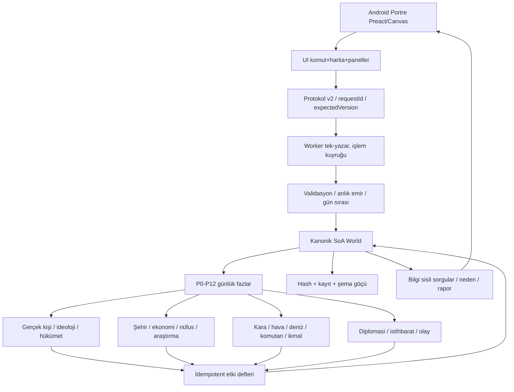

# Tarih Strateji v1.6 — Teknik mimari, etki grafiği ve entegrasyon sözleşmesi

## 1. Kod denetiminde doğrulanan mevcut yapı

Kontrol edilen commit: `3fdd26d53912c894f34a175469b4d13ac6edb407` (11 Kasım 2026).

- `packages/engine/src/state/world.ts`: SoA dünya tablosu; save serileştirme ve hash.
- `packages/engine/src/phases/index.ts`: günlük P0–P12; ekonomi, nüfus, deniz/hava haftalık ve kara muharebe.
- `packages/engine/src/orders.ts` / `emirEk.ts`: önizleme/uygula; bazı yeni istihbarat emirleri zaten var.
- `packages/engine/src/systems/kara.ts`: hesaplamalı muharebe ve kayıt.
- `packages/engine/src/systems/deniz.ts`: mevcut **ülke düzeyi soyut** filo/uçak tür sayıları; geliştirme hedefi bağımsız görev grupları.
- `packages/engine/src/systems/toplum.ts`, `siyasiKisiler.ts`: mevcut beş siyasi akım, seçim, rejim, sınırlı tarihî kişi havuzu.
- `packages/engine/src/systems/gelisim.ts`: mevcut inşaat yuvası **eyalet projesi eşzamanlılık limiti**; yeni şehir **bina kapasite slotu** ayrı tutulmalı.
- `packages/engine/src/donem.ts`: dönem katalogları ve araştırma.
- `packages/engine/src/decision/index.ts`: kurallı rakip devlet kararı.
- `packages/worker/src/sunucu.ts`: Worker protokolü, tur, kayıt, sorgular. `submit` yalnız kuyrukluyor; bir günlük gecikmeye yol açıyor.
- `packages/ui/src/istemci.ts`: akışlı `error` dalında Promise çözülmeden kalabilir.
- `apps/android/android/app/src/main/AndroidManifest.xml`: `sensorPortrait`; README metni yatay diyerek çelişiyor.
- `packages/data-compiler/src/harita.ts`: 463 bölge, hedef >=787; eski bölge kimlikleri için göç kaçınılmaz.

## 2. Hedef bileşen akışı



`P0–P12` içindeki tüm hesaplar tek yazar tarafından yapılır. Her `person`, `fleet`, `wing`, `city`, `treaty` ve `plan` SoA veya kontrollü referans tabloda tek kimliğe sahip olmalıdır.

## 3. Durum sözleşmeleri ve hesaplar

### 3.1 Şehir

```
cityLevel: 1..10
buildingCapacity(city) = 4 * cityLevel
usedCapacity = sum(slotCost(building)) [excluding rail, irrigation, infrastructure, zoning]
availableCapacity = max(0, buildingCapacity - usedCapacity)
```

**Ayrım:** Mevcut `insaYuvasi(w,eyalet)` (eşzamanlı proje throughput) aynı şey **değildir**. Yeni `buildingCapacity` bina toplamı; mevcut `insaYuvasi` paralel inşaat sayısı olarak sürer. Bir şehir seviye projesi tamamlandığında `cityLevel++` ve 4 slot açılır, **bedelsiz fabrika yoktur**. İnşaat maliyeti ödenmeden seviye artmaz.

### 3.2 Birlikler

```
effectiveAttack = equipmentAttack × readiness × training × commander × doctrine ×
                  supply × ammoFactor × terrain × weather × airSupport × navalSupport

effectiveDefense = equipmentDefense × entrenchment × readiness × commander × supply × terrain

effectiveSpeed = baseSpeed × motorization × terrain × roadCondition × supply × fuel
```

Her faktör sabit nokta oranıdır (S=1_000_000), etkiler kaynak ID'siyle tanımlanır, alt/üst sınır uygulanır. Yılda sonsuz değer artışı olmaz. Muharebeyi **yalnız motor P9** kesinleştirir. Görselleştirme onun kaydettiği `BattleEvent` dizisini tekrar oynatır; animasyon hit hesaplayıp ikinci kez asker öldürmez.

### 3.3 Ordu sınırı

`softCapacity = base + territoryWeight + Σ(cityLevel*weight) + industryWeight + adminTech + commandHQ + populationSupport`.

Kapalı üst sınır 400 kaldırılır veya konfigüre edilir. Kapasite aşıldığında devlet, maliyeti/ikmali ve komutan yönetimini yeterli kaynakla taşıyorsa ordu kurabilir ama düşük organizasyon, ikmal ve maliyetten zarar görür. Askerî nüfus ve gerçek ekipman stoğu zorunludur. İdeolojik bonus 'bedava tümen' üretmez.

### 3.4 Araştırma

`researchSpeed = labs × qualifiedScientists × budgetMultiplier × education × infrastructure × projectFocus × diminishingReturns`.

- Ön koşulu tamamlanmayan teknoloji başlatılamaz.
- Yeni model için `araştırma -> prototip -> üretim hazırlığı -> üretim -> kullanım` aşamaları ayrı. 1914'ten 1930'a bir alanda 1950 teknik eşik senaryosu Monte Carlo/seed testleriyle mümkün gösterilir; tüm dallara aynı anda bonus verilmez.
- İlk cihaz veya ekipman modelinin tarihî adı kaynak varsa kullanılır, alternatif erkenci prototip açıkça farklı model ID alır.

### 3.5 Demografi ve nüfus muhasebesi

```
Population(t+1) = Population(t) + Births - Deaths + Immigrants - Emigrants
Σ age×status = Σ ethnic×cultural×religious cohorts = province population
```

İskân, mevcut kaynak kohortun insan sayısını azaltıp hedefe aynı özelliklerle ekler. Hedefte önceden aynı kültür yoksa da çalışır. Kitlesel suçların oyun içi ağır insani ve siyasi sonuçları ayrı olay kayıtlarıyla izlenir; ödül yapısı kurulmaz.

### 3.6 Diplomasi

`Treaty` = `participants + conditions + clauses[] + expiry + ratification + recurring obligations`.

Her `cession` maddesi kaynağın hukuki sahibi olduğu bölgeyi, `reparation` maddesi para ve ödeme vadelerini, `puppet` maddesi efendilik ilişkisini kontrol eder. Geçersiz bir madde tüm antlaşmayı geçersiz kılar (atomik). Barış sonrası kontrol ve mülkiyet aynı kavram değildir.

### 3.7 İstihbarat

Her raporun `observedAt`, `knownTo`, `confidence`, `lower`, `upper`, `expiresAt` bilgisi olmalıdır. Başka devletin tam gizli stoklarını danışman veya AI doğrudan okuyamaz. İstihbarat görevi parasal ve siyasi maliyet kontrolünden sonra işlenir. Ortaya çıkma ihtimali deterministic RNG anahtarına dayanır; operasyon gizli raporunu oyunun genel haber akışına dökmez.

## 4. Mevcut kodla bağlantı ve entegrasyon sırası

| Yeni parça | Hangi mevcut sisteme bağlanır? | Göç / uyumluluk | Test |
|---|---|---|---|
| `core/contracts.ts` | `state/world.ts`, `paket.ts`, `serialize` | Şema 8, kalıcı ID | T06-T09,T32 |
| `core/effects.ts` | `systems/ortak.ts`, `gelisim.ts`, `explain` | Etkilerin hash ve zaman çizelgesi | T23,T33 |
| `core/cities.ts` | `systems/gelisim.ts`, `ekonomi.ts`, `orders.ts` | Eski kent seviyesinin 1-10'a göçü | T21,T40 |
| `core/operations.ts` | `systems/deniz.ts`, `us.ts`, `decision` | Ülke gemi/uçak toplamlarından grup dağıtımı | T10-T14,T44 |
| `core/combat.ts` | `systems/kara.ts` P9 ve `worker` görünümü | Tek savaş sonucu; çift kayıp yok | T12,T45 |
| `core/research.ts` | `systems/ekonomi.ts`, `catalog.ts`, `donem.ts` | 36×12 kademeler korunur | T16-T19 |
| `core/demography.ts` | `systems/nufus.ts`, `toplum.ts` | Eski 7 kimlik -> seyrek kohort referansları | T01-T05 |
| `core/persons.ts`/`commanders.ts` | `siyasiKisiler.ts`, `decision`, `kara.ts` | İsim/rol/kariyer kimlikleri | T06-T09 |
| `core/peace.ts` | `diplomasi.ts`, `orders.ts`, `worker` | Barış şartlarını ayrı kayıtla sakla | T23,T46 |

**Önemli:** Bu paketteki `core/` dosyaları **bağımsız çekirdek referans kodudur**, henüz var olan oyun motoruna bağlanmamıştır. Doğrudan `engine/src/index.ts`'ten export etmek ve 'tamam' demek yanlış olur. Önce şema göçü, eski fonksiyonların yeni sözleşmeye uyarlanması, çalışan testler ve UI bağlantısı gerekir.

## 5. Riskler ve çözüm öncelikleri

**Kritik / P0:** Worker sürümünün güncel olmaması, `Istenci` akışlı Promise'in askıda kalması, tek-yazar yarışları, anlık emir/otomatik kayıt uyumsuzluğu, aynı gün onaylanan teklifin sonraki güne sürüklenmesi. Kod yaması ve regresyon testleri.

**Yüksek / P1:** Harita 463->787+ dönüşümünde mülkiyet/nüfus/bina/ordu eşleştirme; save migration; mobil Canvas performansı. Eski kayıtların sessizce açılması yerine sürüm uyumluluk denetimi.

**Yüksek / P2:** Çift sayılan hava/deniz desteği, farklı görevlerde aynı filo, eski gemi toplamlarının migration sırasında kaybolması, komutan etkisinin hiyerarşide iki kez çarpılması. Kanonik birlik rezervasyon defteri.

**Yüksek / P3:** Nüfus alt kimlik sayılarında yuvarlama ve zorunlu göç sonrası negatif/karanlık rakamlar; tek kişi/çok rol tekrar sayımı. Korunum testleri.

**Orta / P4:** Teknolojinin aşırı çabuk yayılması, politikaların tek yönlü pozitif bonuslara dönüşmesi, YZ'nin çok fazla karar üretip mobil CPU tüketmesi. Uzun dönem benchmark ve karşı-olgu testleri.

**Orta / P5:** Harita üzerinde ayrı muharebe ekranı kurulurken aynı kaybın bir daha işlenmesi. Render yalnız rapor oynatır ve state mutation Worker'da kalır.

## 6. Gerçekten doğrulananlar ve doğrulanmayanlar

**Bu paketle bağımsız doğrulanan:** `core` TypeScript tür denetimi ve örnek `node:test` senaryoları; komutlar ve çıktıları `tests/v16-smoke.test.ts` içinde. 

**Kaynak depoda henüz çalıştırılmadı:** `npm ci`, `npm run tip`, `npm run lint`, `npm test`, `npm run lab`, GitHub Actions, Android APK, cihaz testi, 787+ dünya veri derlemesi, şema göçü, tam UI entegrasyonu. Kaynak GitHub bağlantısında yazma yetkisi 403 verdi. Bu nedenle yama bir talimatla uygulanacak dosya olarak teslim ediliyor; depoya işlendiği iddia edilmiyor.

## 7. v1.5'in 26 sayfalık oyun belgesiyle fark kontrolü

Kütüphanede **`Tarih-Strateji-Oyun-Dosyasi-v1.5.pdf`** bulundu ve ilgili bölümleri okundu. Belge **7 Kasım 2026 / `f7a24b0`** revizyonunu özetlemektedir. İncelenen GitHub `main` ise **11 Kasım 2026 / `3fdd26d`**. Dolayısıyla kodu değiştirmeden önce doğrudan v1.5 belgesinde yazıyor diye bir özelliği eksik kabul etmek doğru değildir.

- PDF bölüm 4: mevcut sistemde her emir P2'de ertesi gün işlenir; v1.6 aynı-gün idari emir gereksinimi bunun bilinçli revizyonudur.
- PDF bölüm 4.5: şema 5/6 -> 7 göçü tanımlıdır; yeni 7 -> 8 göçünün hem 5/6 hem 7 kayıtlarıyla sınanması gerekir.
- PDF bölüm 6.11: mevcut YZ cepheyi günlük, diplomasiyi aylık, barışı 15 günlük değerlendirir; v1.6 çok aşamalı plan hafızası bunu devralır, aynı kararlar iki kez işlenmez.
- PDF bölüm 7: yeni emir türlerinin Türkçe kalıp ayrıştırıcısı zaten vardır; v1.6 çok adımlı kalıcı komutlar için yeni parser katmanı eklemelidir.
- PDF bölüm 8: v1.5 kaynak sürümündeki 192 kabul testi ve hash verisi yalnız o sürüm için bildirilmiştir; `main` için yeniden çalıştırılmadan güncel test sonucu olarak raporlanmamalıdır.

Önceki analizde bahsedilen **55 bulgunun tek tek özgün kimlikli listesi** bu kitte bulunmadığı için, 55'inin tamamının işlendiği iddia edilemez. Ana prompt bunların kaynak dosyada saptanıp tek tek izlenmesini zorunlu kılar.
